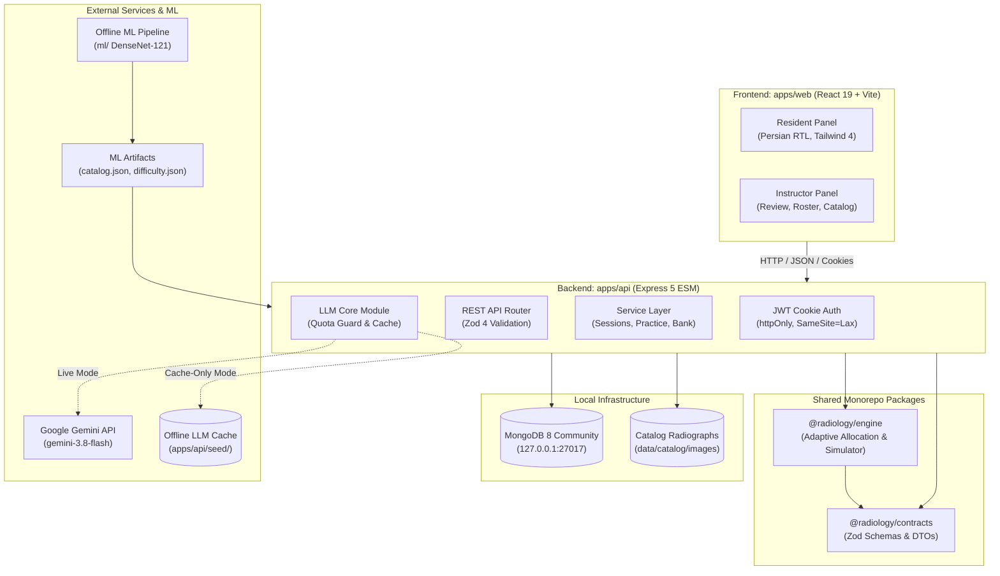

# Radiology Adaptive Training Platform

[](https://github.com/mahdimoradi-tech/radiology-adaptive-trainer/actions/workflows/ci.yml)
[](https://nodejs.org/)
[](https://react.dev/)
[](https://expressjs.com/)
[](https://www.mongodb.com/)
[](https://ai.google.dev/)

An adaptive educational web platform designed to train radiology residents on diagnosing chest radiographs across three primary clinical categories: **COVID-19**, **Viral/Bacterial Pneumonia**, and **Normal**.

The system dynamically models each trainee's individual diagnostic error patterns (false-positive and false-negative tendencies), synthesizes tailored test sessions using an adaptive question-selection algorithm, and integrates Google Gemini for multimodal radiograph analysis, instructor-moderated question bank generation, and personalized pedagogical feedback.

> [!IMPORTANT]
> **Educational Use Disclaimer:** This platform is strictly an educational tool designed for trainee practice and academic research. It does **not** provide medical advice, diagnosis, or clinical treatment recommendations. All datasets are public, de-identified research archives. Model predictions and LLM feedback must never be used in clinical decision-making.

---

## Table of Contents

- [Features](#features)
- [System Architecture](#system-architecture)
- [Prerequisites](#prerequisites)
- [Quickstart](#quickstart)
- [Default Demo Credentials](#default-demo-credentials)
- [Environment Variables](#environment-variables)
- [Available Scripts](#available-scripts)
- [LLM Modes & Quota Architecture](#llm-modes--quota-architecture)
- [Verification & Quality Gates](#verification--quality-gates)
- [Repository Structure](#repository-structure)
- [Empirical Evaluation & Metrics](#empirical-evaluation--metrics)
- [Known Issues & Limitations](#known-issues--limitations)
- [Datasets & Licenses](#datasets--licenses)
- [Team & Solo Mode](#team--solo-mode)
- [Screenshots](#screenshots)

---

## Features

### Resident Trainee Panel

- **Adaptive Diagnostic Testing:** Initial 45-question baseline assessment followed by personalized adaptive sessions that concentrate on the resident's specific diagnostic confusion pairs.
- **Accessible Radiograph Runner:** Full keyboard navigation, Persian RTL layout, opaque image presentation with zero ground-truth label leakage, and un-mirrored radiographs.
- **Session Evaluation Reports:** Post-session analytics featuring 3x3 confusion matrices, per-class accuracy, False Positive Rate (FPR), False Negative Rate (FNR), and overall diagnostic performance.
- **Personalized AI Feedback:** Grounded radiological explanations for diagnostic errors and personalized narrative summaries highlighting strengths and areas for improvement.
- **Targeted Confusion-Pair Practice:** On-demand practice sets focused specifically on confusing disease pairs (e.g., COVID-19 vs Pneumonia) with immediate rationale reveal.
- **Progress Trajectory Tracking:** Visual history tracking accuracy trends and mastery threshold achievements across sequential sessions.
- **Medical Knowledge Guide:** Dedicated educational reference (`/app/education`) detailing radiological hallmarks (ground-glass opacities, consolidations, clear lungs) grounded in vetted knowledge-base documents.

### Instructor Panel

- **Trainee Roster & Trajectory Inspector:** Monitoring resident cohorts, session history, individual learning curves, and mastery status.
- **AI Question Bank Review Queue:** Comprehensive workflow to inspect, approve, reject, or edit Gemini-generated multiple-choice questions before they enter the active practice pool.
- **Catalog & Confounder Monitoring:** Real-time visibility into the 1,177-image catalog distribution across disease classes, difficulty buckets, and dataset sources (`/instructor/catalog`), including demographic and acquisition confounder disclosures.
- **LLM Operational Status:** Real-time monitoring of daily Gemini API budget consumption, throttle status, and cache utilization.

### Pure Adaptive Engine

- **Deterministic Allocation:** Largest-remainder mathematical distribution calculating per-class and per-difficulty question quotas based on trainee error weights.
- **Virtual Resident Simulator:** In-memory simulation framework evaluating training policies (`adaptive`, `random`, `fixed`) across diverse virtual resident profiles without network or database dependencies.

---

## System Architecture



---

## Prerequisites

- **Operating System:** Windows 11 (PowerShell 5.1 or PowerShell 7)
- **Node.js:** v24 LTS (`node -v` >= 24.0.0)
- **Package Manager:** npm (`npm -v` >= 11.0.0)
- **Database:** MongoDB Community Server 8.x installed directly on Windows running locally on `127.0.0.1:27017` (No Docker required)
- **Python (Optional - Offline ML Pipeline only):** Python 3.12 + `uv` (required only if retraining the DenseNet-121 difficulty pipeline in `ml/`)

---

## Quickstart

Follow these exact steps in order in a PowerShell terminal:

### 1. Clone the Repository

```powershell
git clone https://github.com/mahdimoradi-tech/radiology-adaptive-trainer.git
cd radiology-adaptive-trainer
```

### 2. Configure Environment Variables

```powershell
Copy-Item .env.example .env
```

_(Default settings run in 100% offline `LLM_MODE=cache-only` mode and require no API keys)._

### 3. Install Monorepo Dependencies

```powershell
npm install
```

### 4. Seed the Radiograph Image Catalog

Imports the 1,177 catalog images with difficulty scores into MongoDB:

```powershell
npm run seed:catalog -w @radiology/api
```

### 5. Create the Initial Instructor Account

Provisions the administrator/instructor account:

```powershell
npm run create-instructor -w @radiology/api
```

### 6. Import the Question Bank

Populates instructor-approved multiple-choice questions for targeted practice:

```powershell
npm run bank:import -w @radiology/api
```

### 7. Import Pre-cached LLM Responses

Loads pre-generated diagnostic explanations and narrative reports for full offline operation:

```powershell
npm run llm:cache:import -w @radiology/api
```

### 8. Seed Demo Trainees & Historical Sessions

Generates pre-populated resident profiles with historical learning curves and confusion patterns:

```powershell
npm run demo:seed -w @radiology/api
```

### 9. Launch the Development Environment

Starts the Express API (`http://127.0.0.1:4000`) and Vite React frontend (`http://127.0.0.1:5173`) concurrently:

```powershell
npm run dev
```

Navigate to `http://127.0.0.1:5173` in your browser.

---

## Default Demo Credentials

| Role                 | Email                          | Password                 | Purpose                                                     |
| -------------------- | ------------------------------ | ------------------------ | ----------------------------------------------------------- |
| **Instructor**       | `instructor@hospital.test`     | `InstructorPassword123!` | Question review, resident roster, catalog monitor           |
| **Resident (Demo)**  | `resident.demo@hospital.test`  | `DemoResident123!`       | Has completed sessions, report analytics, targeted practice |
| **Resident (Fresh)** | `resident.fresh@hospital.test` | `FreshResident123!`      | Brand new trainee starting Session 1 baseline               |

---

## Environment Variables

All environment variables are validated at startup with Zod in `apps/api/src/config/env.js`:

| Variable                           | Default                               | Description                                                            |
| ---------------------------------- | ------------------------------------- | ---------------------------------------------------------------------- |
| `NODE_ENV`                         | `development`                         | Runtime environment (`development`, `test`, `production`)              |
| `PORT`                             | `4000`                                | Express API listening port                                             |
| `MONGODB_URI`                      | `mongodb://127.0.0.1:27017/radiology` | Local MongoDB database URI                                             |
| `MONGODB_URI_TEST`                 | `mongodb://127.0.0.1:27017`           | Base MongoDB URI for isolated test databases                           |
| `JWT_SECRET`                       | _(Random 32+ chars)_                  | Secret key for signing HS256 session cookies                           |
| `JWT_TTL_HOURS`                    | `12`                                  | Session cookie validity window in hours                                |
| `PUBLIC_ID_SALT`                   | _(Random 16+ chars)_                  | HMAC salt for generating opaque image identifiers                      |
| `BCRYPT_COST`                      | `12`                                  | Password hashing salt rounds (4 in automated tests)                    |
| `COOKIE_SECURE`                    | `false`                               | Sets `Secure` cookie flag (automatically enforced in production)       |
| `CORS_ORIGIN`                      | `http://127.0.0.1:5173`               | Allowed Web origin (wildcard `*` is strictly disallowed)               |
| `RATE_LIMIT_ENABLED`               | `true`                                | Enables Express rate limiters on auth and LLM routes                   |
| `ALLOW_REPEATS`                    | `false`                               | Allows radiograph re-sampling across sequential sessions               |
| `CATALOG_FILE`                     | `ml/artifacts/catalog.json`           | Path to ML image catalog metadata                                      |
| `CATALOG_IMAGE_DIR`                | `data/catalog/images`                 | Directory containing web-optimized radiograph JPEGs                    |
| `LLM_MODE`                         | `cache-only`                          | Execution mode: `cache-only` (offline), `fake` (test), `live` (Gemini) |
| `LLM_ENABLED`                      | `true`                                | Master toggle for LLM functionality                                    |
| `GEMINI_API_KEY`                   | `""`                                  | Google AI Studio API key (required only for `live` mode)               |
| `GEMINI_MODEL`                     | `gemini-3.8-flash`                    | Gemini model identifier                                                |
| `LLM_DAILY_REQUEST_BUDGET`         | `16`                                  | Maximum allowed live calls per Pacific day                             |
| `LLM_MIN_INTERVAL_MS`              | `13000`                               | Minimum throttle spacing between live Gemini calls                     |
| `LLM_TIMEOUT_MS`                   | `60000`                               | Live LLM HTTP timeout in milliseconds                                  |
| `LLM_RATE_LIMIT_PER_USER_PER_HOUR` | `30`                                  | Per-resident narrative report generation limit                         |

---

## Available Scripts

### Root Workspace Scripts

```powershell
npm run dev               # Start both API and Web concurrently
npm run lint              # Run ESLint and check Persian RTL logical utilities
npm test                  # Run entire Vitest test suite across all workspaces
npm run build             # Build contracts, engine, api, and web bundles
npm run check:rtl         # Verify strict usage of logical RTL CSS utilities
npm run format:check      # Check code formatting with Prettier
```

### Reproducible Evaluation Suite

```powershell
npm run eval:all          # Run all evaluations (E1-E4) and update docs/EVALUATION.md
npm run eval:simulation   # E1: Adaptive vs Random vs Fixed simulation (50 seeds)
npm run eval:analysis     # E2: LLM analysis vs ground truth & DenseNet baseline
npm run eval:questions    # E3: Question bank stats and rubric sampling
npm run eval:ml           # E4: DenseNet-121 out-of-fold accuracy & confounders
```

### Database & Seed Utilities (`apps/api`)

```powershell
npm run seed:catalog -w @radiology/api       # Seed catalog images from artifacts
npm run create-instructor -w @radiology/api  # Create or promote instructor user
npm run demo:seed -w @radiology/api          # Seed realistic demo residents and history
npm run bank:import -w @radiology/api        # Import approved question bank
npm run bank:export -w @radiology/api        # Export question bank to JSON
npm run llm:cache:import -w @radiology/api   # Import pre-cached LLM responses
npm run llm:cache:export -w @radiology/api   # Export current LLM cache to seed file
```

---

## LLM Modes & Quota Architecture

The platform uses Google Gemini (`gemini-3.8-flash`) while accounting for the constraints of the Google AI Studio free tier:

- **Rate Limit:** 5 requests / minute
- **Daily Budget:** 20 requests / calendar day (resetting at midnight America/Los_Angeles)
- **Token Limit:** 250,000 tokens / minute

### Three Execution Modes

1. **`cache-only` (Default & Offline Presentation):** Network requests are completely disabled. The platform serves pre-cached responses from `apps/api/seed/llm-cache.json` or falls back to deterministic, grounded pedagogical templates.
2. **`fake` (Automated Testing):** Deterministic in-memory provider used across Vitest unit and integration test suites. Zero external dependencies.
3. **`live` (Live AI Generation):** Connects to Gemini Interactions API. Protected by:
   - **Atomic Budget Reservation:** MongoDB-backed counter tracking requests against the 16-call daily cap.
   - **Process Throttling:** Enforces a minimum 13-second interval (`LLM_MIN_INTERVAL_MS`) between consecutive requests.
   - **429 Circuit Breaker:** On HTTP 429, backs off once; a second 429 sets `exhausted: true` for the remainder of the Pacific day.
   - **Anti-Hallucination Guard:** Validates all generated JSON digits against allowed session statistics and strips non-ASCII digits. Extraneous numbers trigger an immediate fallback.

---

## Verification & Quality Gates

The project maintains comprehensive quality guardrails enforced locally and in CI:

```powershell
npm run lint              # 0 ESLint errors, 0 warnings, strict RTL validation
npm test                  # 86 test files, >660 unit and integration tests passing
npm run build             # Production builds for @radiology/web and contracts
npm audit --omit=dev      # 0 production vulnerabilities
```

CI runs automatically via GitHub Actions on Ubuntu with Node.js 24 LTS, MongoDB 8, and Python 3.12. Direct pushes to `main` are blocked by branch protection and local pre-push hooks (`scripts/hooks/no-push-main.js`).

---

## Repository Structure

```
radiology-adaptive-trainer/
├── apps/
│   ├── api/                 # Express 5 REST API (ES modules, JWT cookie auth, Mongoose)
│   │   ├── src/             # Modules: auth, catalog, images, sessions, bank, llm, practice
│   │   ├── scripts/         # Administrative CLI tools (catalog seeding, instructor creation)
│   │   └── seed/            # Portable seed files (analyses, questions, pre-cached LLM responses)
│   └── web/                 # React 19 + Vite 8 frontend (Persian RTL, Tailwind 4)
│       └── src/             # Pages & features: resident training, instructor review, catalog
├── packages/
│   ├── contracts/           # Shared Zod 4 schemas and contracts (Single Source of Truth)
│   └── engine/              # Pure JavaScript adaptive question allocation engine & simulator
├── ml/                      # Offline Python pipeline (PyTorch DenseNet-121 feature extractor)
│   ├── artifacts/           # catalog.json, difficulty.json, confusion matrix
│   └── src/                 # Dataset merger, cross-validation, and difficulty calculation
├── docs/                    # Architectural Decision Records (ADRs), evaluation reports, specifications
│   ├── adr/                 # ADR 0001 through 0014
│   ├── evaluation/          # Empirical evaluation data and rubric exports
│   ├── EVALUATION.md        # Reproducible empirical evaluation report
│   ├── KNOWN-ISSUES.md      # Technical debt, edge cases, and architectural limitations
│   ├── DATA-SOURCES.md      # Dataset provenance, class distributions, and licenses
│   ├── DEMO-SCRIPT.md       # Live presentation walkthrough and defense guide
│   └── DEMO-CHECKLIST.md    # Pre-defense technical checklist
└── scripts/                 # Monorepo evaluation orchestrators and RTL verification tools
```

---

## Empirical Evaluation & Metrics

The system has undergone empirical evaluation across four key axes (E1: Adaptive Engine Simulation, E2: Multimodal Image Analysis, E3: Question Bank Quality, and E4: Machine Learning Baseline & Confounders).

All metrics, confidence intervals, Cohen's kappa agreement statistics, and confusion matrices are generated deterministically and documented in:

👉 **[Read the Full Evaluation Report (`docs/EVALUATION.md`)](docs/EVALUATION.md)**

_(Note: Raw numbers are intentionally maintained exclusively in `docs/EVALUATION.md` to ensure empirical reproducibility and prevent documentation drift)._

---

## Known Issues & Limitations

A transparent inventory of edge cases, architectural trade-offs, and dataset-level limitations is documented in:

👉 **[Read Known Issues & Technical Debt (`docs/KNOWN-ISSUES.md`)](docs/KNOWN-ISSUES.md)**

Key acknowledged topics include dataset demographic confounders (adult COVID-19 vs pediatric Kermany pneumonia), adaptive policy session convergence rates in simulated environments, and the single-expert rubric evaluation caveat.

---

## Datasets & Licenses

The platform uses de-identified chest X-ray radiographs combined from three open research repositories:

1. **COVID-19 Image Data Collection** (Joseph Paul Cohen et al.)
2. **COVID-19 Chest X-ray Dataset Initiative** (Figure 1 & GitHub contributors)
3. **Large Chest X-Ray Dataset** (Kermany et al., Cell 2018)

For licensing terms, attribution notices, and demographic distribution analyses:

👉 **[Read Data Sources & Provenance (`docs/DATA-SOURCES.md`)](docs/DATA-SOURCES.md)**

---

## Team & Solo Mode

This project is a B.Sc. capstone project developed by a two-person engineering team. In accordance with **[Solo Mode Protocol (`docs/SOLO-MODE.md`)](docs/SOLO-MODE.md)**, Operator A (Mahdi Moradi, repository owner) authored and drove the system implementation under isolated, rigorous self-review and automated CI quality gates.

- **Operator A:** Mahdi Moradi ([@mahdimoradi-tech](https://github.com/mahdimoradi-tech))
- **Operator B:** Abolfazl Rahmati

---

## Screenshots

<!-- SCREENSHOT: Resident Dashboard (Overview, active session resume, recent accuracy) -->

<!-- SCREENSHOT: Resident Test Runner (Accessible radiograph display, multi-choice diagnostic options) -->

<!-- SCREENSHOT: Resident Session Report (Confusion matrix, FPR/FNR analytics, LLM narrative tutor) -->

<!-- SCREENSHOT: Resident Targeted Practice (Focus on identified confusion pair with rationale reveal) -->

<!-- SCREENSHOT: Instructor Question Review Queue (AI-generated question approval and editing interface) -->

<!-- SCREENSHOT: Instructor Catalog & Confounder Monitor (Class x bucket distribution and dataset disclosure) -->

---

## License

This project is developed for educational and academic evaluation purposes. Source code is licensed under the [MIT License](LICENSE). Embedded medical image datasets remain subject to their respective original research licenses.
