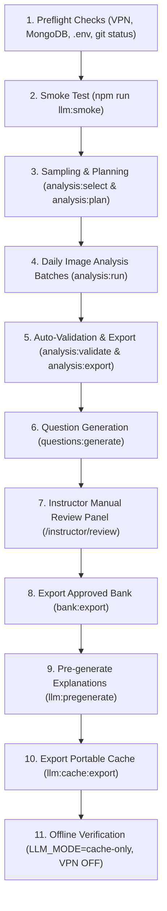

# LLM & Data Generation Operational Runbook

This document defines the verified operational procedures, rate limits, daily budget quotas, execution orders, failure modes, and resume protocols for all multimodal image analysis, question generation, and LLM feedback scripts in the Radiology Adaptive Training Platform.

---

## 1. Overview & Gemini Free-Tier Quota Constraints

### 1.1 Core API Quotas (`gemini-3.8-flash`)
The platform connects to Google AI Studio via the Gemini Interactions API (`@google/genai` >= 2.3.0). Free-tier access operates under the following hard boundaries:
- **Rate Limit:** 5 requests per minute (RPM)
- **Token Bandwidth:** 250,000 tokens per minute (TPM)
- **Daily Budget Limit:** 20 requests per calendar day (RPD)
- **Safety Margin (Internal Guard):** Hard-capped at **16 requests per Pacific day** (`LLM_DAILY_REQUEST_BUDGET=16`), reserving 4 requests as a buffer against accidental quota exhaustion or concurrency drift.
- **Inter-call Throttle Spacing:** Minimum interval of **13,000 ms** between consecutive API calls (`LLM_MIN_INTERVAL_MS=13000`), enforced across processes via MongoDB tracking in collection `llm_usage`.

### 1.2 Pacific Calendar Day Boundary & Reset Timing
The Gemini API resets its 20 RPD counter at **midnight US Pacific Time (`00:00 America/Los_Angeles`)**.

- **US Standard Time (PST, UTC-8):** In effect from early November to mid-March.  
  - Midnight PST corresponds to **11:30 AM Tehran Time (IRST, UTC+3:30)**.
- **US Daylight Saving Time (PDT, UTC-7):** In effect from mid-March to early November.  
  - Midnight PDT corresponds to **10:30 AM Tehran Time (IRST, UTC+3:30)**.

> [!IMPORTANT]
> **Do NOT rely on local clocks or wall time.** Always run `npm run analysis:status -w @radiology/api` or `npm run questions:status -w @radiology/api` and check the **`Day: YYYY-MM-DD (Pacific)`** line. If the date string matches the current Pacific calendar date and `Exhausted` is `false`, the daily quota slot is active.

---

## 2. Comprehensive Script Reference Table

The following table catalogs all 14 offline data, analysis, and LLM scripts located in `apps/api/scripts/`.

| Script Name | Purpose | Exact Execution Command | Calls Gemini? | Requests per Invocation | Reads | Writes | Source File & Line |
| :--- | :--- | :--- | :---: | :---: | :--- | :--- | :--- |
| `analysis:select` | Stratified deterministic selection of 120 images (40/class) | `npm run analysis:select -w @radiology/api -- [--seed analysis-v1] [--per-class 40]` | **No** | 0 | MongoDB `images` (`ImageModel`), `.env` | `apps/api/seed/analysis-set.json` | [analysis-select.js:22](file:///d:/university/pamphlet/bachelor-project/radiology-adaptive-trainer/apps/api/scripts/analysis-select.js#L22) |
| `analysis:plan` | Slices 120 images into 40 mixed-class batches (20 for Run A, 20 for Run B) | `npm run analysis:plan -w @radiology/api -- [--seed analysis-v1] [--batch-size 6] [--prompt-version v1]` | **No** | 0 | `apps/api/seed/analysis-set.json`, `.env` | MongoDB `analysis_batches` (`AnalysisBatchModel`) | [analysis-plan.js:21](file:///d:/university/pamphlet/bachelor-project/radiology-adaptive-trainer/apps/api/scripts/analysis-plan.js#L21) |
| `analysis:run` | Executes multimodal batch image analysis with Gemini | `npm run analysis:run -w @radiology/api -- [--max-requests N] [--max-batches N] [--runs A\|B] [--delay-ms N] [--dry-run]` | **Yes** (unless `--dry-run`) | $\le \text{maxRequests}$ (1 per batch; retries on 429 RPM consume +1) | Disk images (`data/catalog/images`), MongoDB `analysis_batches`, `images`, `llm_usage` | MongoDB `image_analyses`, `analysis_batches`, `llm_usage` | [analysis-run.js:32](file:///d:/university/pamphlet/bachelor-project/radiology-adaptive-trainer/apps/api/scripts/analysis-run.js#L32) |
| `analysis:validate` | Evaluates 9-rule cross-run consensus ($A \cap B$) and ground-truth agreement | `npm run analysis:validate -w @radiology/api -- [--prompt-version v1]` | **No** | 0 | MongoDB `image_analyses`, `images` | MongoDB `analysis_validations` (`AnalysisValidationModel`) | [analysis-validate.js:12](file:///d:/university/pamphlet/bachelor-project/radiology-adaptive-trainer/apps/api/scripts/analysis-validate.js#L12) |
| `analysis:status` | Reports batch completion, coverage, agreement, auto-pass counts, and budget | `npm run analysis:status -w @radiology/api -- [--prompt-version v1]` | **No** | 0 | MongoDB `analysis_batches`, `image_analyses`, `analysis_validations`, `llm_usage` | None (terminal output) | [analysis-status.js:12](file:///d:/university/pamphlet/bachelor-project/radiology-adaptive-trainer/apps/api/scripts/analysis-status.js#L12) |
| `analysis:export` | Exports completed analyses and validations to portable JSON | `npm run analysis:export -w @radiology/api -- [--output <path>] [--prompt-version v1]` | **No** | 0 | MongoDB `image_analyses`, `analysis_validations` | `apps/api/seed/image-analyses.json` | [analysis-export.js:15](file:///d:/university/pamphlet/bachelor-project/radiology-adaptive-trainer/apps/api/scripts/analysis-export.js#L15) |
| `analysis:import` | Imports portable analyses and validations into MongoDB | `npm run analysis:import -w @radiology/api -- [--input <path>]` | **No** | 0 | `apps/api/seed/image-analyses.json` | MongoDB `image_analyses`, `analysis_validations` | [analysis-import.js:15](file:///d:/university/pamphlet/bachelor-project/radiology-adaptive-trainer/apps/api/scripts/analysis-import.js#L15) |
| `questions:generate` | Generates candidate MCQs from consensus findings and KB snippets | `npm run questions:generate -w @radiology/api -- [--max-requests 12] [--batch-size 8] [--dry-run] [--limit N]` | **Yes** (unless `--dry-run`) | $\le \text{maxRequests}$ (1 per 8-image batch; skips existing stable IDs at 0 cost) | MongoDB `analysis_validations`, `images`, `question_bank`, KB markdown files, `llm_usage` | MongoDB `question_bank`, `question_gen_attempts`, `llm_usage` | [questions-generate.js:8](file:///d:/university/pamphlet/bachelor-project/radiology-adaptive-trainer/apps/api/scripts/questions-generate.js#L8) |
| `questions:status` | Displays question bank inventory, review states, type breakdown, and rejection reasons | `npm run questions:status -w @radiology/api` | **No** | 0 | MongoDB `question_bank`, `question_gen_attempts`, `llm_usage` | None (terminal output) | [questions-status.js:6](file:///d:/university/pamphlet/bachelor-project/radiology-adaptive-trainer/apps/api/scripts/questions-status.js#L6) |
| `bank:export` | Exports instructor-approved questions to portable seed JSON | `npm run bank:export -w @radiology/api` | **No** | 0 | MongoDB `question_bank` (`status: 'approved'`) | `apps/api/seed/question-bank.approved.json` | [bank-export.js:5](file:///d:/university/pamphlet/bachelor-project/radiology-adaptive-trainer/apps/api/scripts/bank-export.js#L5) |
| `bank:import` | Imports portable approved questions with upsert by stable ID | `npm run bank:import -w @radiology/api` | **No** | 0 | `apps/api/seed/question-bank.approved.json` | MongoDB `question_bank` | [bank-import.js:5](file:///d:/university/pamphlet/bachelor-project/radiology-adaptive-trainer/apps/api/scripts/bank-import.js#L5) |
| `llm:smoke` | Validates live Gemini Interactions API connectivity and budget reservation | `npm run llm:smoke -w @radiology/api` | **Yes** | Exactly 1 | `.env`, MongoDB `llm_usage` | MongoDB `llm_usage` (+1 reservation) | [llm-smoke.js:15](file:///d:/university/pamphlet/bachelor-project/radiology-adaptive-trainer/apps/api/scripts/llm-smoke.js#L15) |
| `llm:pregenerate` | Pre-generates 6 canonical confusion-pair explanations for portable cache | `npm run llm:pregenerate -w @radiology/api -- [--lang fa\|en] [--dry-run]` | **Yes** (unless `--dry-run` or cached) | 1 per language missing from cache (0 if already cached) | MongoDB `llm_cache`, `llm_usage`, KB files | MongoDB `llm_cache` (`portable: true`), `llm_usage` | [pregenerate-explanations.js:14](file:///d:/university/pamphlet/bachelor-project/radiology-adaptive-trainer/apps/api/scripts/pregenerate-explanations.js#L14) |
| `llm:cache:export` | Exports portable explanation cache entries to seed JSON | `npm run llm:cache:export -w @radiology/api` | **No** | 0 | MongoDB `llm_cache` (`portable: true`) | `apps/api/seed/llm-cache.portable.json` | [export-llm-cache.js:11](file:///d:/university/pamphlet/bachelor-project/radiology-adaptive-trainer/apps/api/scripts/export-llm-cache.js#L11) |
| `llm:cache:import` | Imports portable explanation entries into MongoDB cache | `npm run llm:cache:import -w @radiology/api` | **No** | 0 | `apps/api/seed/llm-cache.portable.json` | MongoDB `llm_cache` | [import-llm-cache.js:11](file:///d:/university/pamphlet/bachelor-project/radiology-adaptive-trainer/apps/api/scripts/import-llm-cache.js#L11) |

---

## 3. Recommended Operational Execution Order

Follow this sequence to construct all required datasets, validations, question banks, and portable caches with zero quota waste:



### Stage 1: Preflight Verification
1. Ensure MongoDB service is running locally (`mongosh --eval "db.adminCommand('ping')"`).
2. Connect to VPN with verified Google AI Studio connectivity.
3. Confirm repository working tree is clean on `main` branch.
4. Verify `.env` contains `LLM_MODE=live` and a valid `GEMINI_API_KEY`.
5. Run smoke test:
   ```powershell
   npm run llm:smoke -w @radiology/api
   ```
   *Expected outcome:* Latency reported, 1 request consumed out of 16 daily budget.

### Stage 2: Analysis Setup & Multi-Day Execution
1. Sample 120 images and construct batches (0 API cost):
   ```powershell
   npm run analysis:select -w @radiology/api
   npm run analysis:plan -w @radiology/api
   ```
2. Run daily analysis batches across 3 consecutive Pacific days:
   - **Day 1:** Execute 14 batches of Run A:
     ```powershell
     npm run analysis:run -w @radiology/api -- --max-requests 14 --runs A
     ```
   - **Day 2:** Complete remaining 6 batches of Run A and start Run B (8 batches):
     ```powershell
     npm run analysis:run -w @radiology/api -- --max-requests 14
     ```
   - **Day 3:** Complete final 12 batches of Run B:
     ```powershell
     npm run analysis:run -w @radiology/api -- --max-requests 12 --runs B
     ```
3. Validate consensus and export analyses:
   ```powershell
   npm run analysis:validate -w @radiology/api
   npm run analysis:status -w @radiology/api
   npm run analysis:export -w @radiology/api
   ```

### Stage 3: Question Generation & Instructor Review
1. Generate MCQ candidates in batches of 8 from `auto_passed` validations:
   ```powershell
   npm run questions:generate -w @radiology/api -- --max-requests 12
   npm run questions:status -w @radiology/api
   ```
   *(Repeat on Day 5 if additional candidate volume is desired).*
2. Open the instructor review panel in the browser: `http://127.0.0.1:5173/instructor/review`.
3. Review questions individually using rapid keyboard shortcuts:
   - `A`: Approve
   - `R`: Reject
   - `J` / `K`: Next / Previous
4. Export the approved question bank:
   ```powershell
   npm run bank:export -w @radiology/api
   ```

### Stage 4: Cache Pre-generation & Portable Commit
1. Pre-generate Persian and English diagnostic explanations (1 request per language, uncached):
   ```powershell
   npm run llm:pregenerate -w @radiology/api -- --lang fa
   npm run llm:pregenerate -w @radiology/api -- --lang en
   ```
2. Export portable cache:
   ```powershell
   npm run llm:cache:export -w @radiology/api
   ```
3. Commit the generated seed data files on branch `chore/T08c-data-seeds`:
   - `apps/api/seed/image-analyses.json`
   - `apps/api/seed/question-bank.approved.json`
   - `apps/api/seed/llm-cache.portable.json`

---

## 4. Cost Formulas & Theoretical Budgets

### 4.1 Image Analysis Set Cost Formula
- **Target Analysis Set:** $N = 120$ images (40 covid19, 40 pneumonia, 40 normal).
- **Batch Size:** $B_{\text{analysis}} = 6$ images per multimodal request.
- **Batches per Run:** $N / B_{\text{analysis}} = 120 / 6 = 20$ batches.
- **Independent Runs:** 2 runs (Prompt A and Prompt B with rotated image order).
- **Total Nominal API Requests:**
  $$\text{Requests}_{\text{analysis}} = 20 \times 2 = 40 \text{ requests}$$
- **Daily Budget Pacing:** At a safe budget of 14 requests/day:
  $$\text{Days required} = \lceil 40 / 14 \rceil = 3 \text{ calendar days}$$

### 4.2 Question Generation Cost Formula
- **Batch Size:** $B_{\text{gen}} = 8$ images per text prompt.
- **Yield per Image:** 1 `finding` question always + 1 `distribution` question (if disease with valid distribution) OR 1 `differential` question (capped at 4 per pair). Average candidate yield $\approx 1.5$ questions per image.
- **Requests as a Function of Validated Images ($V$):**
  $$\text{Requests}_{\text{questions}} = \lceil V / 8 \rceil$$
  - If $V = 60$ auto-passed images ($\approx 50\%$ validation pass rate): $\lceil 60 / 8 \rceil = 8$ requests (**1 calendar day**).
  - If $V = 80$ auto-passed images: $\lceil 80 / 8 \rceil = 10$ requests (**1 calendar day**).
- **Marginal Cost per Candidate MCQ:**
  $$\text{Cost per Candidate} \approx \frac{1 \text{ request}}{8 \times 1.5 \text{ questions}} \approx 0.083 \text{ requests / question}$$

### 4.3 Explanation & Narrative Cost Formula
- **Explanations (`llm:pregenerate`):**
  - Canonical confusion pairs: exactly 6 pairs (`covid19:pneumonia`, `covid19:normal`, `pneumonia:covid19`, `pneumonia:normal`, `normal:covid19`, `normal:pneumonia`).
  - Batching: All missing pairs for a requested language are packed into **a single request** with shared KB snippets.
  - Persian (`--lang fa`): **1 request** (caches all 6 pairs).
  - English (`--lang en`): **1 request** (caches all 6 pairs).
  - Repeat executions when cache is populated: **0 requests**.
- **Session Narratives (`/api/sessions/:id/report-narrative`):**
  - Generated live on-demand when a resident views their test report.
  - Consumes **1 request** per finished session, permanently cached in `llm_cache` by session metrics hash.
  - *Note:* Session narratives cannot be pre-generated via batch CLI because they require actual trainee engine statistics (confusion matrix, FPR/FNR, learning trends). For demonstrations, running a single test session under `LLM_MODE=live` and exporting the cache satisfies all offline presentation needs.

---

## 5. Day-by-Day Operational Plan

| Day | Primary Tasks | Commands to Run | Gemini Requests | Output / Verification Check |
| :---: | :--- | :--- | :---: | :--- |
| **Day 0** | Preflight, smoke check, sampling & planning | `npm run llm:smoke`<br>`npm run analysis:select`<br>`npm run analysis:plan` | 1 | `analysis:status` shows 40 batches planned (0 done). |
| **Day 1** | Analysis Run A (part 1) | `npm run analysis:run -- --max-requests 14 --runs A` | 14 | `analysis:status` shows Run A: 14/20 done. Budget: 14/16 used. |
| **Day 2** | Analysis Run A (finish) & Run B (start) | `npm run analysis:run -- --max-requests 14` | 14 | `analysis:status` shows Run A: 20/20 done, Run B: 8/20 done. |
| **Day 3** | Analysis Run B (finish) & Auto-Validation | `npm run analysis:run -- --max-requests 12 --runs B`<br>`npm run analysis:validate`<br>`npm run analysis:export` | 12 | Total 40 batches done. `analysis:export` writes `seed/image-analyses.json`. |
| **Day 4** | Question Generation & Review Panel | `npm run questions:generate -- --max-requests 12`<br>`npm run questions:status`<br>Review at `http://127.0.0.1:5173/instructor/review` | 10–12 | Target: $\ge 24$ approved questions ($\ge 8$/type) across $\ge 3$ confusion pairs. |
| **Day 5** | Bank Export, Explanations & Seed Commit | `npm run bank:export`<br>`npm run llm:pregenerate -- --lang fa`<br>`npm run llm:pregenerate -- --lang en`<br>`npm run llm:cache:export` | 2 | `seed/*.json` files populated; ready for PR on `chore/T08c-data-seeds`. |

---

## 6. Failure Modes, Auto-Recovery & Operator Actions

### 6.1 HTTP 429: Per-Minute Rate Limit Exceeded
- **Trigger:** More than 5 requests sent within 60 seconds (or transient provider backpressure).
- **System Behavior:**
  - `runner.js` parses the error message for `"per minute"` or `"retry in Xs"`.
  - Backs off dynamically for $X + 20$ seconds (or default 45–65s) and retries the batch **once**.
  - If the retry fails with a second per-minute error, the runner logs `RATE_LIMIT_PAUSE` and cleanly terminates with exit code 0 to prevent lockouts.
- **Operator Action:**
  - Wait 2–3 minutes.
  - Verify that no other process or background tool is using the API key.
  - Re-run the command; the runner automatically resumes from the unfinished batch.

### 6.2 HTTP 429: Daily Quota Exhausted (`RESOURCE_EXHAUSTED`)
- **Trigger:** Total daily requests reached 20 on Google AI Studio.
- **System Behavior:**
  - The system detects `"per day"` in the error message.
  - Immediately invokes `markExhausted()`, atomically updating MongoDB collection `llm_usage` with `exhausted: true` for the current Pacific day.
  - The script terminates cleanly with exit code 0 (`exitReason: 'QUOTA_429'`).
- **Operator Action:**
  - **Do NOT attempt further live runs today.**
  - Check `analysis:status` or `questions:status` to observe the current Pacific date and count.
  - Resume the following day after midnight Pacific (~11:30 AM Tehran time).

### 6.3 HTTP 503 / 500: Model Overloaded or Service Unavailable
- **Trigger:** Transient Google Cloud or Gemini infrastructure outages.
- **System Behavior:**
  - The runner catches the error, increments `attempts` on the current batch document, logs the stack trace in `lastError`, and marks status as `failed` if attempts reach `MAX_ATTEMPTS = 2`.
  - The runner proceeds to eligible batches or pauses if repeated.
- **Operator Action:**
  - Check Google AI Studio status.
  - Re-run the script once service recovers; pending and failed batches with attempts $< 2$ will be processed automatically.

### 6.4 Schema Validation Failure in LLM Output
- **Trigger:** Model returns malformed JSON, omissions of required keys, or invalid enum values.
- **System Behavior:**
  - **Analysis:** `validateBatchResponse` enforces array length of exactly 6 and unique indices $1..6$. Bad responses increment batch attempts.
  - **Questions:** `validateQuestionCandidate` executes 10 pure validation checks (zero numbers, zero %, Persian ratio $\ge 60\%$, tied keys). Rejections are safely written to `question_gen_attempts` for evaluation analysis (T10) while valid questions are stored in `question_bank`.
- **Operator Action:**
  - No manual database editing is required. Rejections are natural and expected. If candidate yield is lower than desired, simply execute another batch on the next quota day.

### 6.5 Network / VPN Disconnection
- **Trigger:** Interrupted local internet connection or VPN proxy disconnect during active API call.
- **System Behavior:**
  - Node fetch throws `FetchError` / `ETIMEDOUT` / `ECONNRESET`.
  - Caught cleanly by provider timeout/retry handler; batch status remains recoverable.
- **Operator Action:**
  - Reconnect the VPN and confirm internet access.
  - Run `npm run llm:smoke -w @radiology/api` to verify connectivity, then resume the interrupted script.

---

## 7. Security & Key Hygiene

1. **Strictly Never Commit Secrets:**  
   Never commit `.env` or paste `GEMINI_API_KEY` into terminal prompts, git commit messages, or PR descriptions. Verify with `git status` before every commit.
2. **Commitment of Portable Seed Files:**  
   The resulting JSON files in `apps/api/seed/` (`image-analyses.json`, `question-bank.approved.json`, `llm-cache.portable.json`) contain only public dataset IDs, model annotations, and approved Persian questions. These files **must** be committed to version control to allow teammates and CI to run 100% offline.
3. **Dedicated Key Allocation:**  
   Do not share the API key used for data generation with other applications, personal scripts, or AI IDE chat plugins. Extraneous calls will drain the daily 16-request budget unexpectedly.

---

## 8. Verification & List of Unknowns

All statements in this document have been verified against the underlying source code in `apps/api/scripts/`, `apps/api/src/modules/`, ADR 0012, and ADR 0013. The following parameters cannot be determined purely from static code analysis and represent empirical unknowns:

1. **`UNKNOWN: Candidate Validation Acceptance Rate`**  
   The empirical pass rate of generated MCQs through the 10-rule validator (`modules/bank/validate.js`). While the prompt explicitly forbids numbers and percentages, LLMs occasionally generate numerals or non-medical phrasing. The actual yield ratio must be recorded from `questions:status` during the real data run.
2. **`UNKNOWN: VLM Auto-Validation Pass Rate on Hard Images`**  
   Per ADR 0013, high-difficulty images ($d \ge 0.68$) were misclassified by the out-of-fold DenseNet-121 model. Because auto-validation strictly requires agreement with the true dataset label, the consensus pass rate on hard images may be low. This outcome is an evaluated scientific property (T10), not a software defect.
3. **`UNKNOWN: Real-World Latency under VPN Proxy`**  
   Multimodal requests carrying 6 raw base64 JPEG images (~1.5 MB payload) have an execution timeout of 180,000 ms. The exact network latency per batch depends on the operator's VPN tunnel performance and is measured empirically during execution.

---

## 9. Evaluation Suite Integration (T10)

Once image analyses and question bank items are generated and exported to `apps/api/seed/`:
- **`npm run eval:analysis`**: Evaluates LLM multimodal image analysis accuracy, Run A vs Run B Cohen's kappa agreement, auto-validation pass rate, and compares against the DenseNet-121 baseline on the identical images.
- **`npm run eval:questions export-rubric`**: Samples up to 24 approved questions (8 per type) for human grading in `docs/evaluation/question-rubric.csv`.
- **`npm run eval:questions score`**: Aggregates the completed human rubric with Wilson 95% confidence intervals and reports pipeline statistics.
- **`npm run eval:all`**: Orchestrates E1 through E4 and compiles the master empirical evaluation report into `docs/EVALUATION.md`.
