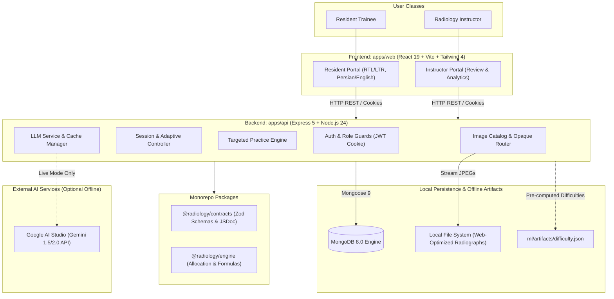

# Software Requirements Specification (SRS) — As-Built Baseline

> [!IMPORTANT]
> **Document Status: As-Built (Retrospective)**  
> **System Baseline Commit:** `9357ace` (Date: 2026-11-13)  
> **Standard Alignment:** ISO/IEC/IEEE 29148:2018 (Systems and software engineering — Life cycle processes — Requirements engineering, tailored lite).
> 
> This document is a retrospective, evidence-backed Software Requirements Specification. The Radiology Adaptive Training Platform was implemented iteratively across 21 engineering tasks (T00 through T15). The requirements codified herein represent the actual operational capabilities, constraints, and contracts of the completed system as derived from source code, unit/integration test suites, and Architectural Decision Records (ADRs). This document does not claim to have been authored prior to implementation.

---

## 1. Introduction

### 1.1 Purpose
The purpose of this document is to specify the functional and non-functional requirements of the **Radiology Adaptive Training Platform** based on its implemented state at baseline commit `9357ace`. It serves as the definitive technical requirements reference for academic evaluation, software auditing, and future capstone defense.

### 1.2 Scope and System Boundary
- **Intended Purpose:** The platform is a web-based educational simulation system designed to train radiology residents in interpreting frontal chest radiographs across three primary classifications: COVID-19 (`covid19`), non-COVID pneumonia (`pneumonia`), and normal lungs (`normal`).
- **Core Adaptive Mechanism:** The platform dynamically analyzes resident diagnostic error patterns—specifically individual False Positive Rates ($FPR$) and False Negative Rates ($FNR$) per pathology class—to iteratively calibrate the diagnostic composition and difficulty distribution of subsequent training sessions (`packages/engine/src/formulas.js:1-125`).
- **Multimodal AI Integration:** A multimodal Vision-Language Model (Gemini) is integrated for offline closed-vocabulary chest radiograph finding extraction, automated pedagogical multiple-choice question generation, instructor review triage, and deterministic error explanations (`apps/api/src/modules/llm`).
- **Strict Non-Clinical Boundary:** The platform is exclusively an educational tool. It is **not** a diagnostic device, Clinical Decision Support System (CDSS), or Software as a Medical Device (SaMD). It must never be used for real patient triage or clinical diagnostic decisions (`README.md:14-22`, `docs/DOMAIN.md:43-44`). No protected health information (PHI) or real patient identifiers exist in the system.

### 1.3 Definitions, Acronyms, and Abbreviations
A comprehensive glossary of terms is maintained in [GLOSSARY.md](GLOSSARY.md). Key terms essential to this specification include:
- **Baseline Test:** The mandatory entry examination consisting of 45 chest X-rays with balanced class representation (15 each of `covid19`, `pneumonia`, `normal`) and standard difficulty weighting (40% Easy, 30% Medium, 30% Hard) (`ADR 0010`, `apps/api/src/modules/sessions/service.js:46-56`).
- **Adaptive Session:** Subsequent 45-question diagnostic tests generated by dynamically weighting class proportions based on historical error rates, subject to mathematical floor bounds (minimum 9 per class, minimum 2 per difficulty bucket) (`packages/engine/src/allocation.js:1-85`).
- **Confusion Pair:** An ordered misdiagnosis relationship $(c_{\text{true}}, c_{\text{pred}})$ where $c_{\text{true}} \neq c_{\text{pred}}$ (e.g., misinterpreting `covid19` as `pneumonia`) (`packages/engine/src/formulas.js:68-80`).
- **Targeted Practice:** A focused micro-learning module providing 5 multiple-choice questions with immediate pedagogical feedback aimed at remediating a specific diagnostic confusion pair (`apps/api/src/modules/practice/service.js:1-110`).
- **Label Leakage:** The unauthorized transmission of ground truth pathology (`trueClass`), model confidence, difficulty score, or source dataset tags to the client browser prior to test completion (`apps/api/src/__tests__/global-leak.test.js:1-150`).
- **Opaque Public ID:** A cryptographically secure HMAC-SHA256 token used in client-facing API routes to reference radiograph image files without disclosing dataset origin or sequential IDs (`apps/api/src/modules/catalog/service.js:1-45`).
- **`cache-only` Mode:** Operational state wherein LLM features operate entirely without external network requests, serving pre-computed, deterministic responses from local MongoDB collections (`apps/api/src/modules/llm/provider.js:1-90`).

### 1.4 References
1. **Academic Paper:** Kianmehr, M., & Hashemzadeh, M. (2025). *Personalization of the Radiology Residency Training Process Using Deep Learning and Interactive Extraction of Diagnostic Error Patterns*. Journal of Information and Communication Technology (Iran), vol. 17, issues 66-67, pp. 102-127 (`docs/reference/paper.pdf`).
2. **Requirements Standard:** ISO/IEC/IEEE 29148:2018 *Systems and software engineering — Life cycle processes — Requirements engineering*.
3. **Architectural Decision Records (ADRs):** `docs/adr/0001-record-architecture-decisions.md` through `docs/adr/0014-targeted-practice.md`.
4. **Engineering Task Specifications:** `docs/tasks/T00-bootstrap.md` through `docs/tasks/T15-ui-polish.md`.
5. **Quality Assurance Baselines:**
   - Security Audit: `docs/qa/SECURITY-REPORT.md` (26 verified criteria).
   - Route Inventory: `docs/qa/ROUTE-INVENTORY.md` (31 Express 5 endpoints).
   - Manual QA Run: `docs/qa/manual-run-2026-11-12.md` (M01–M38 test cases).
   - UI Accessibility Audit: `docs/qa/ui-audit-final.md` and `docs/qa/LIGHTHOUSE-REPORT.md`.
6. **Machine Learning Pipeline:** `ml/artifacts/difficulty.json`, `ml/src/dataset.py`, `ml/src/evaluate.py`.

### 1.5 Document Overview
This document is organized into eight subsequent sections:
- **Section 2:** Overall description (system perspective, user classes, operating environment, design constraints, and dependencies).
- **Section 3:** Functional requirements organized by functional area (FR-AUTH, FR-TEST, FR-ADAPT, FR-REP, FR-PRAC, FR-PROG, FR-EDU, FR-INS, FR-LLM, FR-DATA).
- **Section 4:** Non-functional requirements (security, privacy, usability, portability, reliability, maintainability, performance).
- **Section 5:** External interface specifications (UI, API, database, and hardware).
- **Section 6:** Data requirements and entity-relationship models.
- **Section 7:** System use cases (UC-01 through UC-09).
- **Section 8:** Known limitations, technical debt, and risk disclosures.
- **Section 9:** Traceability gap analysis.

---

## 2. Overall Description

### 2.1 Product Perspective
The Radiology Adaptive Training Platform is a standalone, full-stack web application designed for on-premises deployment on developer and institutional workstations. It operates without external cloud dependencies during standard trainee instruction.

### 2.2 User Classes and Characteristics
The system defines two mutually exclusive role tiers enforced by cryptographic JSON Web Tokens (`apps/api/src/modules/auth/service.js:1-60`):

1. **Resident Trainee (`resident`):**
   - **Characteristics:** Medical graduates and radiology residents seeking specialized competence in thoracic radiograph interpretation.
   - **Capabilities:** Self-registration; taking the mandatory baseline diagnostic exam; completing adaptive training sessions; reviewing completed session reports and error breakdowns; engaging in targeted practice sessions; reviewing educational reference material; monitoring individual progress charts.
   - **Restrictions:** Strict prohibition from viewing radiograph ground truth or difficulty metrics prior to answer submission; absolute access denial to administrative and instructor routes (`HTTP 403`).

2. **Radiology Instructor (`instructor`):**
   - **Characteristics:** Senior faculty radiologist or departmental administrator supervising resident education.
   - **Capabilities:** Inspecting the global resident roster and tracking cohort performance; auditing detailed individual resident session records and error trajectories; managing the AI-generated pedagogical question bank (approving, rejecting, and editing generated questions); auditing image catalog statistics and dataset demographic confounders; inspecting LLM service health, token budget counters, and cache status.
   - **Restrictions:** Instructors are administrative supervisors and cannot submit trainee test answers or generate resident training sessions (`HTTP 403`).

### 2.3 Operating Environment
The platform is designed and verified to run in the following environment (`README.md:24-42`, `docs/progress/developer-log.md:5-7`):
- **Host Operating System:** Microsoft Windows 11 (64-bit) running Windows PowerShell 5.1 or PowerShell 7.
- **Runtime Environment:** Node.js version 24.11.0 LTS with npm 11.21.1 workspaces.
- **Database Engine:** MongoDB Community Server 8.0+ running natively as a Windows service on `127.0.0.1:27017` (strictly without Docker).
- **Web Browser Clients:** Modern evergreen browsers with ECMAScript 2023 and CSS container query support (Google Chrome 120+, Microsoft Edge 120+, Mozilla Firefox 120+).
- **Offline ML Environment:** Python 3.11 / 3.12 with PyTorch 2.5 (CPU) for offline dataset preparation and difficulty feature scoring.

### 2.4 Design and Implementation Constraints
1. **Programming Language Restriction:** Strict requirement for standard JavaScript (ES Modules, `node:test`, modern JSX). TypeScript was deliberately prohibited across all application tiers by architectural directive (`ADR 0002`). Static contracts and type boundaries are established via Zod 4 schemas and comprehensive JSDoc `@typedef` annotations in `packages/contracts` (`packages/contracts/package.json:1-25`).
2. **Containerization Restriction:** Docker and containerized runtimes were explicitly prohibited to match developer workstation limitations (`AGENTS.md:1-25`). MongoDB must be installed and managed as a native Windows service.
3. **Zero Label Leakage Architecture:** Ground-truth diagnostic classes (`covid19`, `pneumonia`, `normal`), difficulty scores, confusion predictions, and dataset provenance are strictly sanitized from client-facing payloads during active examinations (`ADR 0008`, `apps/api/src/__tests__/global-leak.test.js:1-120`).
4. **Bilingual and RTL Layout Support:** The user interface is designed natively for right-to-left (RTL) Persian display with secondary left-to-right (LTR) English localization, using Vazirmatn typography and Tailwind CSS 4 logical layout utilities (`apps/web/src/index.css:1-70`, `docs/qa/UI-CHECKLIST.md:1-20`).
5. **Committed Secrets Prohibition:** API keys, secrets, `.env` files, model binary checkpoints, and uncompressed raw datasets must never be committed to source control (`AGENTS.md:Golden Rules`).

### 2.5 Assumptions and Dependencies
1. **Dataset Demographic Confounder:** All normal (1,582) and pneumonia (4,245) radiographs derive from the pediatric Kermany cohort (ages 1–5), while all COVID-19 radiographs (177) derive from adult cohorts (`ADR 0005`, `docs/KNOWN-ISSUES.md:ISS-01`). DenseNet-121 classifiers partially exploit institutional and anatomical acquisition artifacts.
2. **Gemini Free-Tier Quota Constraints:** The Google AI Studio free tier limits live API consumption to 20 requests/day and 5 requests/minute (`ADR 0012`). Live online sessions cannot sustain high-volume classroom usage. The platform implements a client-side daily budget guard (16 requests/day cap) and pre-computes offline cache seeds (`llm-cache.portable.json`) to guarantee 100% functionality in `cache-only` mode (`apps/api/src/modules/llm/guard.js:1-60`).
3. **Catalog Class Scarcity:** The curated 1,177-image catalog contains only 2 Medium and 3 Hard COVID-19 images. The adaptive engine implements nearest-bucket fallback logic to maintain total test question quotas without throwing runtime exceptions (`ADR 0004`, `packages/engine/src/allocation.js:50-80`).
