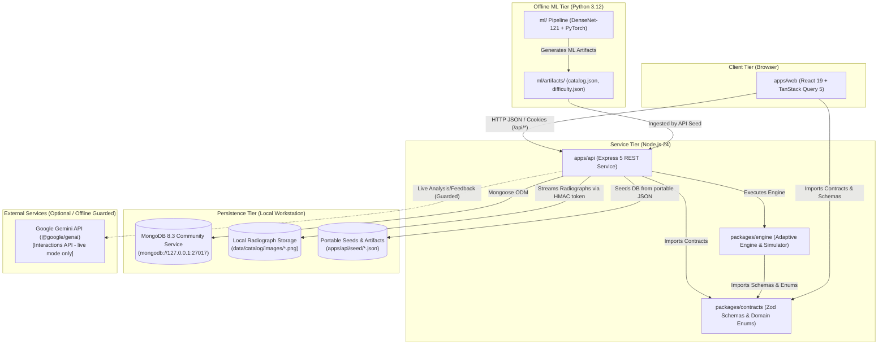
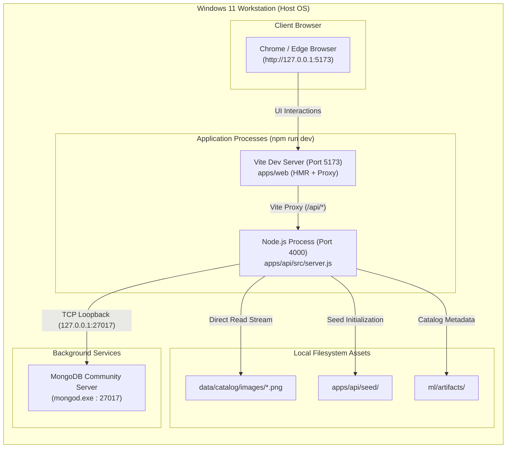

# Software Design Description (SDD) — As-Built Architecture

> [!IMPORTANT]
> **Document Status: As-Built (Retrospective)**  
> **System Baseline Commit:** `9357ace` (Date: 2026-11-13)  
> **Standard Alignment:** IEEE 1016-2009 (*Standard for Information Technology — Systems Design — Software Design Descriptions*, tailored lite).  
> 
> This document is an evidence-backed Software Design Description for the **Radiology Adaptive Training Platform**. It specifies the actual software architecture, monorepo decomposition, database models, REST APIs, adaptive mathematical algorithms, security controls, LLM integration, offline ML pipeline, and frontend design as implemented across tasks T00 through T15. All structural diagrams, algorithms, configuration keys, and schemas reflect existing, verified source code.

---

## 1. Introduction and Design Goals

### 1.1 Purpose and System Scope
The Radiology Adaptive Training Platform is a web-based educational simulation system engineered to train radiology residents in diagnosing frontal chest radiographs across three disease classifications: COVID-19 (`covid19`), non-COVID pneumonia (`pneumonia`), and normal lungs (`normal`).

The system dynamically models resident diagnostic error patterns—specifically individual False Positive Rates ($FPR$) and False Negative Rates ($FNR$) per pathology class—to iteratively calibrate the diagnostic composition and difficulty distribution of subsequent training sessions (`packages/engine/src/rates.js:1-125`).

This design document covers the complete software architecture, linking directly to the requirements defined in the [Software Requirements Specification (SRS)](01-SRS.md):
- **Functional Requirements:** `FR-AUTH-01..05`, `FR-TEST-01..07`, `FR-ADAPT-01..08`, `FR-REP-01..08`, `FR-PRAC-01..07`, `FR-PROG-01..06`, `FR-EDU-01..04`, `FR-INS-01..08`, `FR-LLM-01..08`, `FR-DATA-01..04`.
- **Non-Functional Requirements:** `NFR-SEC-01..05`, `NFR-PRIV-01..04`, `NFR-USAB-01..05`, `NFR-PORT-01..03`, `NFR-REL-01..03`, `NFR-MAINT-01..03`, `NFR-PERF-01..03`.

### 1.2 Five Core Architectural Quality Attributes

| # | Quality Attribute | Target Metric / Standard | Architectural Realization and Code Location |
|---|---|---|---|
| **QA-1** | **Label-Leak Safety** | Zero transmission of ground truth, difficulty, or source datasets to trainee browser prior to session completion (`NFR-PRIV-01..04`). | Enforced by strict Zod schema projection at the API boundary (`SessionPublicSchema`, `PracticeQuestionResident`), opaque HMAC-SHA256 image public IDs (`catalog/service.js:1-45`), deep response sanitization, and automated recursive security scanners (`apps/api/src/__tests__/global-leak.test.js`, `apps/web/src/pages/resident/__tests__/QuizLeak.test.jsx`). |
| **QA-2** | **Offline Demo & Independence** | 100% functionality without internet connection or external cloud API access during demonstration (`NFR-REL-01`, `NFR-PORT-02`). | Architected with `LLM_MODE=cache-only`, local MongoDB Community Server 8 instance, portable JSON seeds (`apps/api/seed/llm-cache.portable.json`, `question-bank.approved.json`, `image-analyses.json`), and static image serving (`data/catalog/images`). Fresh clone setup reproducible in <25 seconds without network calls (`apps/api/scripts/demo-seed.js`). |
| **QA-3** | **RTL Persian Educational UI** | Native Right-to-Left layout, Vazirmatn typography, Jalali dates, WCAG AA accessibility, zero image inversion (`NFR-USAB-01..05`). | Implemented using Tailwind CSS 4 logical layout utilities (`ms-*`, `pe-*`, `text-start`), dynamic `<html lang dir>` injection, isolated `dir="ltr"` container on `XrayImage.jsx` prohibiting anatomical image mirroring, Jalali date formatting via `Intl.DateTimeFormat('fa-IR-u-ca-persian')`, and automated contrast linters (`scripts/check-rtl-classes.js`, `scripts/check-low-contrast.js`). |
| **QA-4** | **Testable Pure Engine** | Zero I/O, 100% deterministic mathematical execution, zero floating-point allocation drift (`NFR-MAINT-01..03`). | The `@radiology/engine` package contains strictly no network, database, filesystem, or DOM dependencies. All allocations utilize largest-remainder integer math. Randomized components accept seeded PRNG generators (`seedrandom`). Validated by 100% branch test coverage and property-based invariant testing (`fast-check`). |
| **QA-5** | **Reproducible ML Pipeline** | Deterministic feature extraction, out-of-fold scoring, and stratified image catalog curation (`NFR-REL-02`, `FR-DATA-01..04`). | Python 3.12 + `uv` offline pipeline (`ml/`) running on CPU with fixed seeds (`seed=42`). Pre-trained DenseNet-121 feature cache, 5-fold cross-validation, difficulty score computation $d = 1 - p(\text{true})$, and export to versioned artifacts (`ml/artifacts/difficulty.json`, `catalog.json`). |

---

## 2. Architecture Overview

### 2.1 Monorepo Structure
The repository is structured as an npm workspaces monorepo managed under Node.js 24 LTS, complemented by an isolated Python virtual environment for offline ML processing.

```
radiology-adaptive-trainer/
├── apps/
│   ├── api/                   # Express 5 REST API + Mongoose 9 persistence
│   └── web/                   # React 19 SPA + Vite 8 + Tailwind CSS 4 RTL
├── packages/
│   ├── contracts/             # Shared Zod 4 schemas and domain constants
│   └── engine/                # Pure mathematical adaptive engine and simulator
├── ml/                        # Offline Python 3.12 + PyTorch ML pipeline
├── data/                      # Web-optimized radiograph image assets
├── docs/                      # Architectural specifications, ADRs, QA logs, as-built docs
└── scripts/                   # Evaluation scripts, verification linters, git hooks
```

### 2.2 Monorepo Package Matrix

| Workspace / Directory | Architectural Purpose | Primary Runtime Dependencies | Monorepo Dependencies |
|---|---|---|---|
| `packages/contracts` | Canonical contract leaf package. Exposes runtime Zod schemas, domain enums, error codes, and JSDoc typedefs. | `zod (^4.6.7)` | *None (Leaf package)* |
| `packages/engine` | Pure mathematical adaptive algorithm, question selector, resident simulator, and statistical helpers. Zero I/O. | *None* (dev: `fast-check ^4.10.2`) | `@radiology/contracts` |
| `apps/api` | Backend HTTP REST server, JWT cookie auth, session lifecycle, catalog streaming, Mongoose models, and LLM orchestration. | `express (^5.3.0)`, `mongoose (^9.11.4)`, `jsonwebtoken (^9.0.3)`, `bcryptjs (^3.0.3)`, `helmet (^8.3.0)`, `cookie-parser (^1.4.7)`, `express-rate-limit (^8.7.2)`, `@google/genai (^2.32.0)`, `pino (^10.4.0)` | `@radiology/contracts`, `@radiology/engine` |
| `apps/web` | Frontend Single Page Application. Dual resident and instructor portals, responsive Persian RTL UI, interactive quiz, and charts. | `react (19.3.1)`, `react-dom (19.3.1)`, `react-router (^7.18.5)`, `@tanstack/react-query (^5.105.1)`, `tailwindcss (^4.3.3)`, `i18next (^26.6.0)`, `@fontsource-variable/vazirmatn (^5.3.0)` | `@radiology/contracts` *(HTTP client to `apps/api`)* |
| `ml/` | Standalone offline Python pipeline for feature extraction, 5-fold cross-validation, and difficulty scoring. | `torch (2.14.1+cpu)`, `torchvision (0.29.1+cpu)`, `numpy (2.5.4)`, `pandas (3.1.0)`, `scikit-learn (1.9.1)`, `pillow (13.0.0)` | *None (Outputs file artifacts ingested by `apps/api`)* |

### 2.3 Component and Tier Diagram



### 2.4 Monorepo Dependency Rule Verification
The architecture strictly enforces unidirectional coupling:
- `packages/contracts` is the root contract leaf and depends on no internal workspace.
- `packages/engine` depends strictly on `packages/contracts` and has no network, filesystem, or database imports.
- `apps/api` depends on `packages/contracts` and `packages/engine`.
- `apps/web` depends on `packages/contracts` and interacts with `apps/api` strictly through HTTP REST.

Execution of the dependency check command confirms zero unauthorized cross-package imports:
```powershell
git grep -n "from '@radiology" packages
```
**Empirical Output:**
```
packages/engine/src/__tests__/targeted-and-mastery.test.js:2:import { MASTERY_THRESHOLD } from '@radiology/contracts';
packages/engine/src/allocation.js:1:import { CLASS_IDS, BUCKETS } from '@radiology/contracts';
packages/engine/src/index.js:1:import { CONTRACTS_VERSION } from '@radiology/contracts';
packages/engine/src/rates.js:1:import { CLASS_IDS, BUCKETS } from '@radiology/contracts';
packages/engine/src/selection.js:1:import { CLASS_IDS, BUCKETS, EngineConfigSchema } from '@radiology/contracts';
packages/engine/src/simulator/runner.js:1:import { CLASS_IDS, BUCKETS } from '@radiology/contracts';
packages/engine/src/targeted.js:1:import { CLASS_IDS, MASTERY_THRESHOLD } from '@radiology/contracts';
```
No package imports from `apps/api` or `apps/web`.

---

## 3. Technology Stack

Every component and library version in the table below is verified against the repository's `package.json` files and `ml/uv.lock` lockfile.

### 3.1 Core Runtimes and Frameworks

| Layer / Role | Technology | Version | Location / Source | Purpose |
|---|---|---|---|---|
| **Runtime Environment** | Node.js | `>=24.0.0` (LTS v24.11.0) | `package.json:engines` | Cross-platform JavaScript runtime running on Windows 11. |
| **Package Manager** | npm | `11.21.1` | Local environment | npm workspaces managing monorepo packages. |
| **Language Standards** | ECMAScript 2024 | ES Modules (`"type": "module"`) | All `package.json` | Modern JavaScript with native ES module imports across all packages. |
| **Backend Framework** | Express | `^5.3.0` | `apps/api/package.json` | REST API framework with native async route handling and promise rejection catchers. |
| **Database & ODM** | MongoDB / Mongoose | MongoDB `8.3.0` / Mongoose `^9.11.4` | `apps/api/package.json` | Document database running as Windows service; Mongoose schemas, types, and indexes. |
| **Schema Validation** | Zod | `^4.6.7` | `packages/contracts/package.json` | Universal runtime validation schema defining API contracts and domain shapes. |
| **Frontend Framework** | React / React DOM | `19.3.1` | `apps/web/package.json` | Component-based UI library utilizing modern React 19 architecture. |
| **Frontend Build Tool** | Vite | `^8.3.5` | `apps/web/package.json` | Next-generation frontend bundler with Hot Module Replacement (HMR). |
| **Client Routing** | React Router | `^7.18.5` | `apps/web/package.json` | Declarative client-side routing with role-based navigation guards. |
| **Server State & Cache** | TanStack React Query | `^5.105.1` | `apps/web/package.json` | Asynchronous data fetching, optimistic UI caching, and request deduplication. |
| **Styling & Design** | Tailwind CSS | `^4.3.3` | `apps/web/package.json` | Utility-first CSS engine with `@tailwindcss/vite` plugin and logical RTL utilities. |
| **Typography** | Vazirmatn | `^5.3.0` | `apps/web/package.json` | Variable Persian font package (`@fontsource-variable/vazirmatn`). |
| **Internationalization** | i18next / react-i18next | `^26.6.0` / `^17.1.10` | `apps/web/package.json` | Client-side localization with 100% key parity across Persian (`fa`) and English (`en`). |
| **AI / Multimodal SDK** | `@google/genai` | `^2.32.0` | `apps/api/package.json` | Official Google GenAI SDK for Gemini Interactions API. |
| **Offline ML Pipeline** | Python / uv | Python `>=3.12,<3.13` (3.12.0) | `ml/pyproject.toml` | Python virtual environment managed via `uv` packaging tool. |
| **Deep Learning Framework** | PyTorch / torchvision | `2.14.1+cpu` / `0.29.1+cpu` | `ml/uv.lock` | CPU-optimized PyTorch and Torchvision pre-trained DenseNet-121 model. |
| **ML Data Science Stack** | scikit-learn / NumPy / pandas | `1.9.1` / `2.5.4` / `3.1.0` | `ml/uv.lock` | Out-of-fold cross-validation, feature manipulation, and metrics. |
| **Image Processing (Python)**| Pillow | `13.0.0` | `ml/uv.lock` | Resizing, normalization, and aspect-ratio preservation of chest X-rays. |

### 3.2 Testing, Security, and Code Quality Tooling

| Category | Tool | Version | Configuration / Scope |
|---|---|---|---|
| **Unit & Integration Test** | Vitest | `^4.1.12` | Monorepo test runner (`vitest.config.js`). Covers contracts, engine, API, and web. |
| **Property-Based Testing** | fast-check | `^4.10.2` | Invariant testing for engine rate math and allocation boundaries. |
| **HTTP API Testing** | supertest | `^7.3.1` | Integration test harness for Express routes and middleware. |
| **DOM Testing** | JSDOM / Testing Library | `^26.1.0` / `^16.3.3` | Browser environment simulation for React component assertions. |
| **Authentication & Tokens**| jsonwebtoken / bcryptjs | `^9.0.3` / `^3.0.3` | HS256 JWT cookie signing and salted password hashing (work factor 12). |
| **HTTP Security Headers** | helmet / cookie-parser | `^8.3.0` / `^1.4.7` | Content Security Policy, strict headers, and cookie parsing. |
| **API Rate Limiting** | express-rate-limit | `^8.7.2` | Global, authentication, and LLM endpoint brute-force and quota protection. |
| **Structured Logging** | pino / pino-http | `^10.4.0` / `^11.0.0` | High-performance JSON logging with diagnostic privacy sanitization. |
| **Linters & Formatters** | ESLint / Prettier | `^10.13.0` / `^3.9.10` | Static analysis, code formatting, and automated RTL class checks. |
| **Git Hooks & Commits** | Husky / Commitlint | `^9.1.7` / `^21.2.4` | Pre-commit linting (`lint-staged 17.6.0`) and Conventional Commit enforcement. |
| **Python Testing & Lint** | pytest / ruff | `>=8.3.0` / `>=0.6.0` | Test runner and fast linter for `ml/` codebase. |

---

## 12. Deployment and Runtime View

### 12.1 Local Workstation Operating Model
In accordance with `ADR 0002`, the entire application runs natively on a single Windows 11 development workstation without containerization (no Docker, no WSL). This design eliminates virtualization overhead and guarantees that academic reviewers can audit and run the software using standard developer tools.



### 12.2 Runtime Process Topology
1. **Database Service (`mongod.exe`):** Runs as a local Windows service listening on `127.0.0.1:27017`. Database name: `radiology` (production/dev) or dynamic temporary database for Vitest runs.
2. **Backend API Process:** Launched via `node --watch --env-file-if-exists=../../.env src/server.js` from `apps/api`. Binds to `127.0.0.1:4000`. Serves REST endpoints, validates schemas, verifies JWT cookies, and streams image binaries.
3. **Frontend Development Process:** Launched via `vite` from `apps/web`. Binds to `127.0.0.1:5173`. Proxies `/api` requests to `http://127.0.0.1:4000`, enabling seamless same-origin cookie exchange (`SameSite=Lax`) without cross-origin configuration.
4. **Unified Process Orchestrator:** The root command `npm run dev` executes `concurrently` (`^10.0.6`) with color-coded prefix tags to manage both the backend API and frontend Vite servers concurrently.

### 12.3 Filesystem Storage Layout
- `data/catalog/images/`: Holds 1,177 web-optimized PNG chest X-ray images (max dimension 800px width/height, 8-bit grayscale converted to PNG).
- `ml/artifacts/catalog.json`: 1,177 image catalog manifest including true class, difficulty score, difficulty bucket, predicted class, and source dataset.
- `ml/artifacts/difficulty.json`: Comprehensive out-of-fold prediction array across all 6,004 merged training images.
- `apps/api/seed/`:
  - `image-analyses.json`: 69 approved multimodal consensus analyses.
  - `question-bank.approved.json`: 83 instructor-approved pedagogical multiple-choice questions.
  - `llm-cache.portable.json`: 12 pre-generated bilingual feedback entries covering all confusion pairs.
- `apps/api/src/modules/llm/kb/`: 6 markdown files containing clinically grounded domain knowledge (`covid19.md`, `pneumonia.md`, `normal.md`, etc.).

### 12.4 Environment Variables Reference
All environment configuration is strictly validated at application startup using Zod (`apps/api/src/config/env.js:4-86`). In compliance with repository security rules, secret values are never committed; only variable names, data types, defaults, and operational meanings are specified below.

| Variable Name | Type / Allowed Values | Default Value | Validation Constraint / Requirement | Architectural Purpose |
|---|---|---|---|---|
| `NODE_ENV` | `development` \| `production` \| `test` | `development` | Zod enum | Controls error stack traces, logging verbosity, and test optimizations. |
| `PORT` | Integer `1`..`65535` | `4000` | Port number | TCP port on which the Express REST API listens. |
| `MONGODB_URI` | String (URI) | `mongodb://127.0.0.1:27017/radiology` | Valid MongoDB connection string | Primary connection string for Mongoose database connection. |
| `MONGODB_URI_TEST` | String (URI) | `mongodb://127.0.0.1:27017` | Valid MongoDB connection string | Base URI used by Vitest integration tests for ephemeral database creation. |
| `JWT_SECRET` | String | *None (Required)* | Length $\ge 32$ chars; cannot be `'change-me'` in `production` | Secret key used to sign and verify HS256 JSON Web Tokens. |
| `JWT_TTL_HOURS` | Positive Number | `12` | Positive number | Time-to-live for authentication session tokens in hours. |
| `PUBLIC_ID_SALT` | String | *None (Required)* | Length $\ge 16$ chars | Salt used to compute deterministic HMAC-SHA256 image public tokens. |
| `BCRYPT_COST` | Integer `4`..`16` | `12` (4 in test mode) | Integer bounds | Computational work factor for bcrypt password hashing. |
| `COOKIE_SECURE` | Boolean | `false` (enforced `true` in production) | Boolean flag | Requires `Secure` flag on `auth_token` HTTP cookie. |
| `CORS_ORIGIN` | String | `""` | Cannot be wildcard `'*'` | Allowed client origin for CORS headers when credentials are exchanged. |
| `RATE_LIMIT_ENABLED` | Boolean | `true` | Boolean flag | Toggles API rate limiting middleware globally. |
| `ALLOW_REPEATS` | Boolean | `false` | Boolean flag | Controls whether the adaptive engine can reuse images already answered by the resident. |
| `CATALOG_FILE` | String (Path) | `ml/artifacts/catalog.json` | Valid relative/absolute path | Path to the image catalog metadata JSON file. |
| `CATALOG_IMAGE_DIR`| String (Path) | `data/catalog/images` | Valid relative/absolute path | Directory containing physical PNG chest radiograph image files. |
| `LLM_MODE` | `live` \| `cache-only` \| `fake` | `cache-only` | Zod enum | Governs LLM provider behavior: cache-only (offline), fake (testing), or live (Gemini API). |
| `LLM_ENABLED` | Boolean | `true` | Boolean flag | Master switch for LLM feedback and report generation features. |
| `GEMINI_API_KEY` | String | `""` | Mandatory if `LLM_MODE='live'` and `LLM_ENABLED=true` | API key for authenticating with Google Gemini Interactions API. |
| `GEMINI_MODEL` | String | `gemini-3.8-flash` | Valid Gemini model identifier | Model identifier targeted by `@google/genai` interactions client. |
| `LLM_DAILY_REQUEST_BUDGET` | Integer $\ge 1$ | `16` | Positive integer | Maximum external Gemini API calls permitted per Pacific calendar day. |
| `LLM_MIN_INTERVAL_MS` | Integer $\ge 0$ | `13000` (13 sec) | Non-negative integer | Enforces spacing between external LLM calls to comply with the 5 RPM rate limit. |
| `LLM_TIMEOUT_MS` | Integer $\ge 1000$ | `60000` (60 sec) | Milliseconds | Abort timeout for outgoing Gemini API requests. |
| `LLM_RATE_LIMIT_PER_USER_PER_HOUR` | Integer $\ge 1$ | `30` | Positive integer | Endpoint rate limit protecting LLM feedback requests from resident flooding. |
