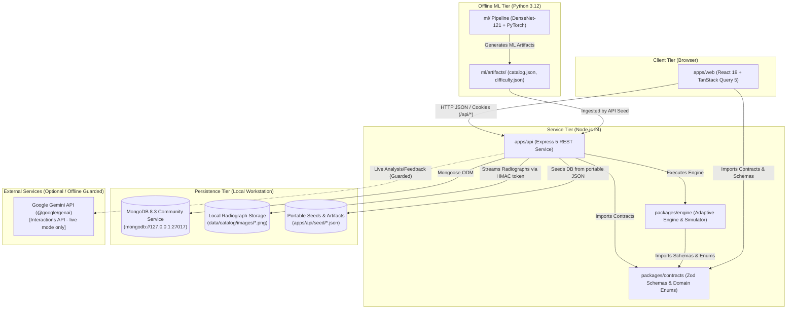
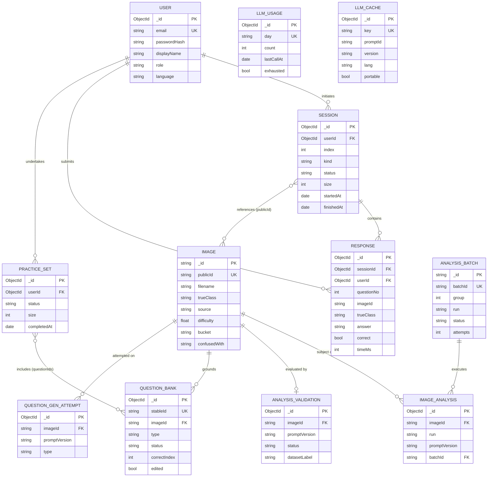
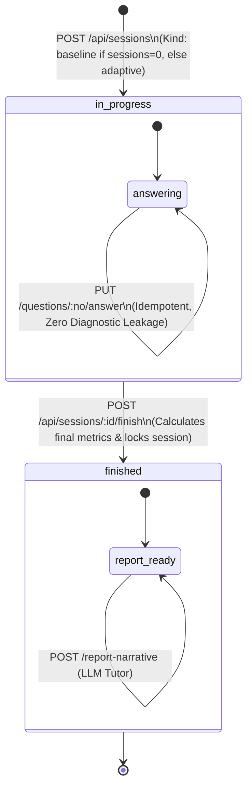
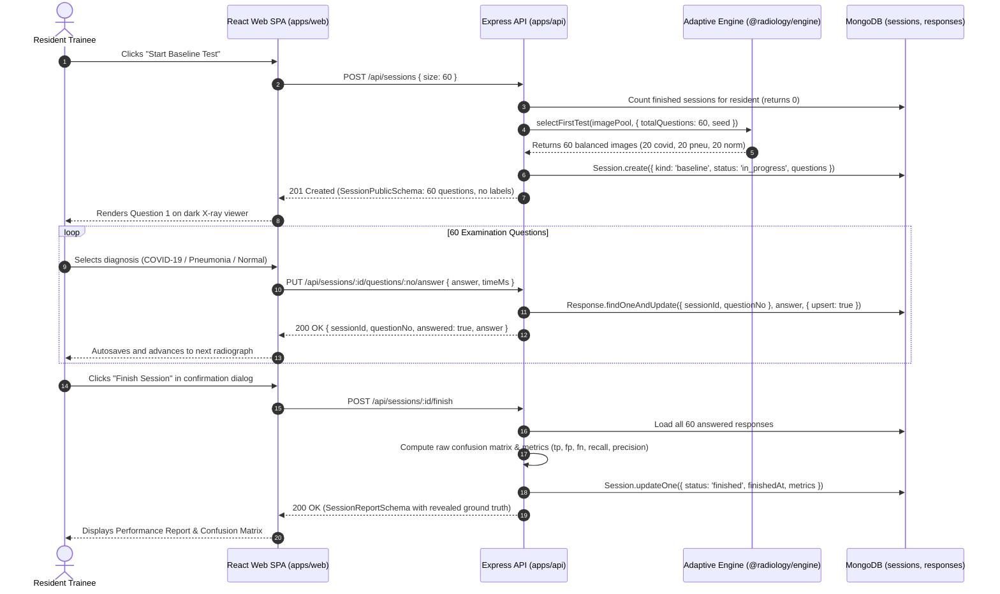
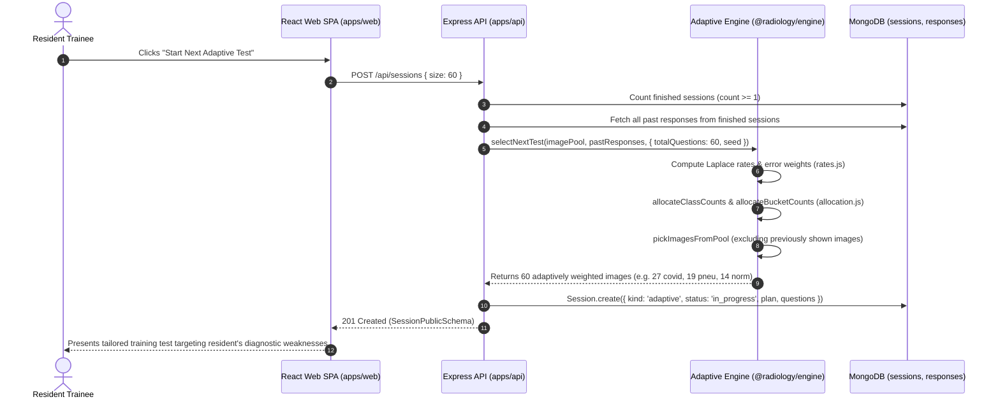
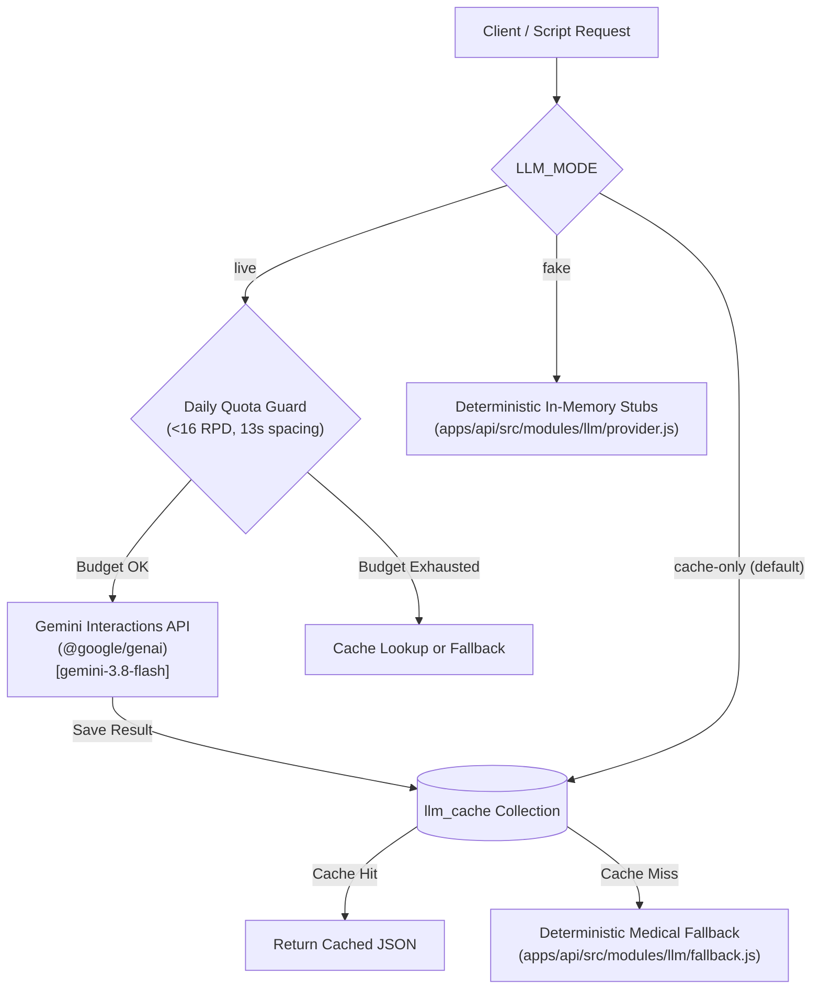
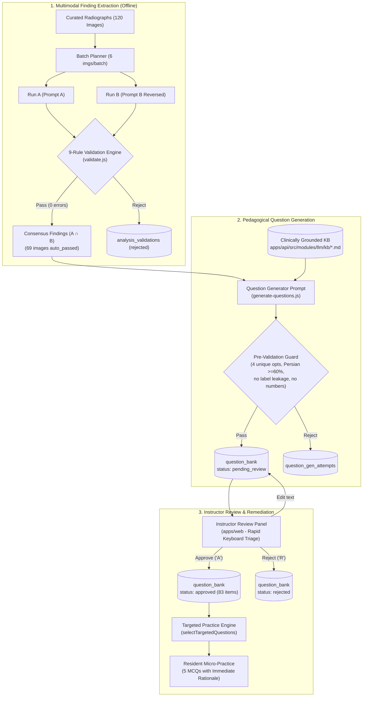
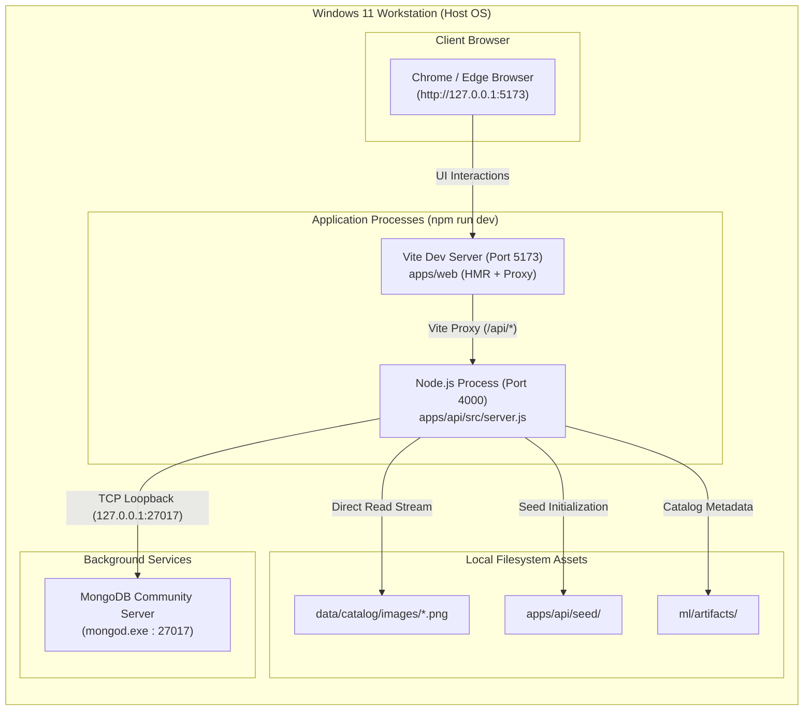

# Software Design Description (SDD) — As-Built Architecture

> [!IMPORTANT]
> **Document Status: As-Built (Retrospective)**  
> **System Baseline Commit:** `9357ace` (Date: 2026-11-13)  
> **Standard Alignment:** IEEE 1016-2009 (*Standard for Information Technology — Systems Design — Software Design Descriptions*, tailored lite).  
> 
> This document is an evidence-backed Software Design Description for the **Radiology Adaptive Training Platform**. It specifies the actual software architecture, monorepo decomposition, database models, REST APIs, adaptive mathematical algorithms, security controls, LLM integration, offline ML pipeline, and frontend design as implemented across tasks T00 through T15. All structural diagrams, algorithms, configuration keys, and schemas reflect existing, verified source code.

---

## 1. Introduction and Design Goals

### 1.1 Purpose and System Scope
The Radiology Adaptive Training Platform is a web-based educational simulation system engineered to train radiology residents in diagnosing frontal chest radiographs across three disease classifications: COVID-19 (`covid19`), non-COVID pneumonia (`pneumonia`), and normal lungs (`normal`).

The system dynamically models resident diagnostic error patterns—specifically individual False Positive Rates ($FPR$) and False Negative Rates ($FNR$) per pathology class—to iteratively calibrate the diagnostic composition and difficulty distribution of subsequent training sessions (`packages/engine/src/rates.js:1-125`).

This design document covers the complete software architecture, linking directly to the requirements defined in the [Software Requirements Specification (SRS)](01-SRS.md):
- **Functional Requirements:** `FR-AUTH-01..05`, `FR-TEST-01..07`, `FR-ADAPT-01..08`, `FR-REP-01..08`, `FR-PRAC-01..07`, `FR-PROG-01..06`, `FR-EDU-01..04`, `FR-INS-01..08`, `FR-LLM-01..08`, `FR-DATA-01..04`.
- **Non-Functional Requirements:** `NFR-SEC-01..05`, `NFR-PRIV-01..04`, `NFR-USAB-01..05`, `NFR-PORT-01..03`, `NFR-REL-01..03`, `NFR-MAINT-01..03`, `NFR-PERF-01..03`.

### 1.2 Five Core Architectural Quality Attributes

| # | Quality Attribute | Target Metric / Standard | Architectural Realization and Code Location |
|---|---|---|---|
| **QA-1** | **Label-Leak Safety** | Zero transmission of ground truth, difficulty, or source datasets to trainee browser prior to session completion (`NFR-PRIV-01..04`). | Enforced by strict Zod schema projection at the API boundary (`SessionPublicSchema`, `PracticeQuestionResident`), opaque HMAC-SHA256 image public IDs (`catalog/service.js:1-45`), deep response sanitization, and automated recursive security scanners (`apps/api/src/__tests__/global-leak.test.js`, `apps/web/src/pages/resident/__tests__/QuizLeak.test.jsx`). |
| **QA-2** | **Offline Demo & Independence** | 100% functionality without internet connection or external cloud API access during demonstration (`NFR-REL-01`, `NFR-PORT-02`). | Architected with `LLM_MODE=cache-only`, local MongoDB Community Server 8 instance, portable JSON seeds (`apps/api/seed/llm-cache.portable.json`, `question-bank.approved.json`, `image-analyses.json`), and static image serving (`data/catalog/images`). Fresh clone setup reproducible in <25 seconds without network calls (`apps/api/scripts/demo-seed.js`). |
| **QA-3** | **RTL Persian Educational UI** | Native Right-to-Left layout, Vazirmatn typography, Jalali dates, WCAG AA accessibility, zero image inversion (`NFR-USAB-01..05`). | Implemented using Tailwind CSS 4 logical layout utilities (`ms-*`, `pe-*`, `text-start`), dynamic `<html lang dir>` injection, isolated `dir="ltr"` container on `XrayImage.jsx` prohibiting anatomical image mirroring, Jalali date formatting via `Intl.DateTimeFormat('fa-IR-u-ca-persian')`, and automated contrast linters (`scripts/check-rtl-classes.js`, `scripts/check-low-contrast.js`). |
| **QA-4** | **Testable Pure Engine** | Zero I/O, 100% deterministic mathematical execution, zero floating-point allocation drift (`NFR-MAINT-01..03`). | The `@radiology/engine` package contains strictly no network, database, filesystem, or DOM dependencies. All allocations utilize largest-remainder integer math. Randomized components accept seeded PRNG generators (`seedrandom`). Validated by 100% branch test coverage and property-based invariant testing (`fast-check`). |
| **QA-5** | **Reproducible ML Pipeline** | Deterministic feature extraction, out-of-fold scoring, and stratified image catalog curation (`NFR-REL-02`, `FR-DATA-01..04`). | Python 3.12 + `uv` offline pipeline (`ml/`) running on CPU with fixed seeds (`seed=42`). Pre-trained DenseNet-121 feature cache, 5-fold cross-validation, difficulty score computation $d = 1 - p(\text{true})$, and export to versioned artifacts (`ml/artifacts/difficulty.json`, `catalog.json`). |

---

## 2. Architecture Overview

### 2.1 Monorepo Structure
The repository is structured as an npm workspaces monorepo managed under Node.js 24 LTS, complemented by an isolated Python virtual environment for offline ML processing.

```
radiology-adaptive-trainer/
├── apps/
│   ├── api/                   # Express 5 REST API + Mongoose 9 persistence
│   └── web/                   # React 19 SPA + Vite 8 + Tailwind CSS 4 RTL
├── packages/
│   ├── contracts/             # Shared Zod 4 schemas and domain constants
│   └── engine/                # Pure mathematical adaptive engine and simulator
├── ml/                        # Offline Python 3.12 + PyTorch ML pipeline
├── data/                      # Web-optimized radiograph image assets
├── docs/                      # Architectural specifications, ADRs, QA logs, as-built docs
└── scripts/                   # Evaluation scripts, verification linters, git hooks
```

### 2.2 Monorepo Package Matrix

| Workspace / Directory | Architectural Purpose | Primary Runtime Dependencies | Monorepo Dependencies |
|---|---|---|---|
| `packages/contracts` | Canonical contract leaf package. Exposes runtime Zod schemas, domain enums, error codes, and JSDoc typedefs. | `zod (^4.6.7)` | *None (Leaf package)* |
| `packages/engine` | Pure mathematical adaptive algorithm, question selector, resident simulator, and statistical helpers. Zero I/O. | *None* (dev: `fast-check ^4.10.2`) | `@radiology/contracts` |
| `apps/api` | Backend HTTP REST server, JWT cookie auth, session lifecycle, catalog streaming, Mongoose models, and LLM orchestration. | `express (^5.3.0)`, `mongoose (^9.11.4)`, `jsonwebtoken (^9.0.3)`, `bcryptjs (^3.0.3)`, `helmet (^8.3.0)`, `cookie-parser (^1.4.7)`, `express-rate-limit (^8.7.2)`, `@google/genai (^2.32.0)`, `pino (^10.4.0)` | `@radiology/contracts`, `@radiology/engine` |
| `apps/web` | Frontend Single Page Application. Dual resident and instructor portals, responsive Persian RTL UI, interactive quiz, and charts. | `react (19.3.1)`, `react-dom (19.3.1)`, `react-router (^7.18.5)`, `@tanstack/react-query (^5.105.1)`, `tailwindcss (^4.3.3)`, `i18next (^26.6.0)`, `@fontsource-variable/vazirmatn (^5.3.0)` | `@radiology/contracts` *(HTTP client to `apps/api`)* |
| `ml/` | Standalone offline Python pipeline for feature extraction, 5-fold cross-validation, and difficulty scoring. | `torch (2.14.1+cpu)`, `torchvision (0.29.1+cpu)`, `numpy (2.5.4)`, `pandas (3.1.0)`, `scikit-learn (1.9.1)`, `pillow (13.0.0)` | *None (Outputs file artifacts ingested by `apps/api`)* |

### 2.3 Component and Tier Diagram



### 2.4 Monorepo Dependency Rule Verification
The architecture strictly enforces unidirectional coupling:
- `packages/contracts` is the root contract leaf and depends on no internal workspace.
- `packages/engine` depends strictly on `packages/contracts` and has no network, filesystem, or database imports.
- `apps/api` depends on `packages/contracts` and `packages/engine`.
- `apps/web` depends on `packages/contracts` and interacts with `apps/api` strictly through HTTP REST.

Execution of the dependency check command confirms zero unauthorized cross-package imports:
```powershell
git grep -n "from '@radiology" packages
```
**Empirical Output:**
```
packages/engine/src/__tests__/targeted-and-mastery.test.js:2:import { MASTERY_THRESHOLD } from '@radiology/contracts';
packages/engine/src/allocation.js:1:import { CLASS_IDS, BUCKETS } from '@radiology/contracts';
packages/engine/src/index.js:1:import { CONTRACTS_VERSION } from '@radiology/contracts';
packages/engine/src/rates.js:1:import { CLASS_IDS, BUCKETS } from '@radiology/contracts';
packages/engine/src/selection.js:1:import { CLASS_IDS, BUCKETS, EngineConfigSchema } from '@radiology/contracts';
packages/engine/src/simulator/runner.js:1:import { CLASS_IDS, BUCKETS } from '@radiology/contracts';
packages/engine/src/targeted.js:1:import { CLASS_IDS, MASTERY_THRESHOLD } from '@radiology/contracts';
```
No package imports from `apps/api` or `apps/web`.

---

## 3. Technology Stack

Every component and library version in the table below is verified against the repository's `package.json` files and `ml/uv.lock` lockfile.

### 3.1 Core Runtimes and Frameworks

| Layer / Role | Technology | Version | Location / Source | Purpose |
|---|---|---|---|---|
| **Runtime Environment** | Node.js | `>=24.0.0` (LTS v24.11.0) | `package.json:engines` | Cross-platform JavaScript runtime running on Windows 11. |
| **Package Manager** | npm | `11.21.1` | Local environment | npm workspaces managing monorepo packages. |
| **Language Standards** | ECMAScript 2024 | ES Modules (`"type": "module"`) | All `package.json` | Modern JavaScript with native ES module imports across all packages. |
| **Backend Framework** | Express | `^5.3.0` | `apps/api/package.json` | REST API framework with native async route handling and promise rejection catchers. |
| **Database & ODM** | MongoDB / Mongoose | MongoDB `8.3.0` / Mongoose `^9.11.4` | `apps/api/package.json` | Document database running as Windows service; Mongoose schemas, types, and indexes. |
| **Schema Validation** | Zod | `^4.6.7` | `packages/contracts/package.json` | Universal runtime validation schema defining API contracts and domain shapes. |
| **Frontend Framework** | React / React DOM | `19.3.1` | `apps/web/package.json` | Component-based UI library utilizing modern React 19 architecture. |
| **Frontend Build Tool** | Vite | `^8.3.5` | `apps/web/package.json` | Next-generation frontend bundler with Hot Module Replacement (HMR). |
| **Client Routing** | React Router | `^7.18.5` | `apps/web/package.json` | Declarative client-side routing with role-based navigation guards. |
| **Server State & Cache** | TanStack React Query | `^5.105.1` | `apps/web/package.json` | Asynchronous data fetching, optimistic UI caching, and request deduplication. |
| **Styling & Design** | Tailwind CSS | `^4.3.3` | `apps/web/package.json` | Utility-first CSS engine with `@tailwindcss/vite` plugin and logical RTL utilities. |
| **Typography** | Vazirmatn | `^5.3.0` | `apps/web/package.json` | Variable Persian font package (`@fontsource-variable/vazirmatn`). |
| **Internationalization** | i18next / react-i18next | `^26.6.0` / `^17.1.10` | `apps/web/package.json` | Client-side localization with 100% key parity across Persian (`fa`) and English (`en`). |
| **AI / Multimodal SDK** | `@google/genai` | `^2.32.0` | `apps/api/package.json` | Official Google GenAI SDK for Gemini Interactions API. |
| **Offline ML Pipeline** | Python / uv | Python `>=3.12,<3.13` (3.12.0) | `ml/pyproject.toml` | Python virtual environment managed via `uv` packaging tool. |
| **Deep Learning Framework** | PyTorch / torchvision | `2.14.1+cpu` / `0.29.1+cpu` | `ml/uv.lock` | CPU-optimized PyTorch and Torchvision pre-trained DenseNet-121 model. |
| **ML Data Science Stack** | scikit-learn / NumPy / pandas | `1.9.1` / `2.5.4` / `3.1.0` | `ml/uv.lock` | Out-of-fold cross-validation, feature manipulation, and metrics. |
| **Image Processing (Python)**| Pillow | `13.0.0` | `ml/uv.lock` | Resizing, normalization, and aspect-ratio preservation of chest X-rays. |

### 3.2 Testing, Security, and Code Quality Tooling

| Category | Tool | Version | Configuration / Scope |
|---|---|---|---|
| **Unit & Integration Test** | Vitest | `^4.1.12` | Monorepo test runner (`vitest.config.js`). Covers contracts, engine, API, and web. |
| **Property-Based Testing** | fast-check | `^4.10.2` | Invariant testing for engine rate math and allocation boundaries. |
| **HTTP API Testing** | supertest | `^7.3.1` | Integration test harness for Express routes and middleware. |
| **DOM Testing** | JSDOM / Testing Library | `^26.1.0` / `^16.3.3` | Browser environment simulation for React component assertions. |
| **Authentication & Tokens**| jsonwebtoken / bcryptjs | `^9.0.3` / `^3.0.3` | HS256 JWT cookie signing and salted password hashing (work factor 12). |
| **HTTP Security Headers** | helmet / cookie-parser | `^8.3.0` / `^1.4.7` | Content Security Policy, strict headers, and cookie parsing. |
| **API Rate Limiting** | express-rate-limit | `^8.7.2` | Global, authentication, and LLM endpoint brute-force and quota protection. |
| **Structured Logging** | pino / pino-http | `^10.4.0` / `^11.0.0` | High-performance JSON logging with diagnostic privacy sanitization. |
| **Linters & Formatters** | ESLint / Prettier | `^10.13.0` / `^3.9.10` | Static analysis, code formatting, and automated RTL class checks. |
| **Git Hooks & Commits** | Husky / Commitlint | `^9.1.7` / `^21.2.4` | Pre-commit linting (`lint-staged 17.6.0`) and Conventional Commit enforcement. |
| **Python Testing & Lint** | pytest / ruff | `>=8.3.0` / `>=0.6.0` | Test runner and fast linter for `ml/` codebase. |

---

## 4. Data Design

### 4.1 Entity-Relationship Overview
The data persistence tier is implemented using MongoDB Community Server 8.3 and Mongoose 9.11. The schema encompasses twelve specialized collections governing authentication, image catalog assets, adaptive session lifecycle, error response histories, targeted practice, LLM quota management, offline multimodal VLM analyses, and instructor question review.



### 4.2 Collection Specifications

#### 4.2.1 `users` Collection (`UserModel`, `apps/api/src/modules/auth/model.js:3-42`)
- **Purpose:** Stores accounts and credentials for resident trainees and instructors.
- **Key Fields:**
  - `_id`: MongoDB ObjectId primary key.
  - `email`: String, required, unique, lowercase, trimmed, maximum 254 characters.
  - `passwordHash`: String, required. Salted bcrypt hash with work factor 12.
  - `displayName`: String, required, 2 to 60 characters.
  - `role`: String enum (`'resident' | 'instructor'`), default `'resident'`.
  - `language`: String enum (`'fa' | 'en'`), default `'fa'`.
  - `createdAt`, `updatedAt`: Timestamps automatically managed by Mongoose.
- **Indexes:**
  - `{ email: 1 }` (unique).
- **Relationships:** Referenced as foreign key by `sessions.userId`, `responses.userId`, and `practice_sets.userId`.

#### 4.2.2 `images` Collection (`ImageModel`, `apps/api/src/modules/catalog/model.js:3-52`)
- **Purpose:** Primary metadata catalog for the 1,177 web-optimized frontal chest radiographs.
- **Key Fields:**
  - `_id`: String primary key representing the deterministic catalog identifier (e.g. `kermany_f9ddce356c7b`).
  - `publicId`: String, required, unique. Opaque HMAC-SHA256 token used in client-facing APIs.
  - `filename`: String, required. Web-optimized PNG filename under `data/catalog/images/`.
  - `trueClass`: String enum (`'covid19' | 'pneumonia' | 'normal'`), ground truth diagnosis.
  - `source`: String, dataset provenance (`'cohen' | 'figure1' | 'kermany'`).
  - `difficulty`: Number in $[0.0, 1.0]$, computed as $d = 1 - p(\text{trueClass})$.
  - `bucket`: String enum (`'easy' | 'medium' | 'hard'`).
  - `confusedWith`: String enum (`'covid19' | 'pneumonia' | 'normal'`), primary out-of-fold confusion candidate.
- **Indexes:**
  - `{ publicId: 1 }` (unique, index for HMAC radiograph file streaming).
  - `{ trueClass: 1, bucket: 1 }` (compound index for fast stratified sampling).
- **Relationships:** Referenced by `sessions.questions.imageId`, `responses.imageId`, `image_analyses.imageId`, `analysis_validations.imageId`, and `question_bank.imageId`.

#### 4.2.3 `sessions` Collection (`SessionModel`, `apps/api/src/modules/sessions/model.js:42-108`)
- **Purpose:** Manages the full lifecycle, question ordering, and evaluation metrics for diagnostic tests.
- **Key Fields:**
  - `_id`: MongoDB ObjectId primary key.
  - `userId`: ObjectId referencing `users._id`.
  - `index`: Integer $\ge 1$, sequential session counter for the resident.
  - `kind`: String enum (`'baseline' | 'adaptive'`).
  - `status`: String enum (`'in_progress' | 'finished'`), default `'in_progress'`.
  - `size`: Integer $\ge 45$, total questions (default 60).
  - `configSnapshot`: Mixed document storing algorithm parameters used during generation.
  - `plan`: Mixed document recording planned class and bucket quotas.
  - `questions`: Array of embedded question subdocuments (`no`, `imageId`, `publicId`, `trueClass`, `bucket`, `difficulty`, `confusedWith`).
  - `startedAt`: Date, default `Date.now`.
  - `finishedAt`: Date, default `null`. Set upon finalization.
  - `metrics`: Mixed document containing finalized session evaluation metrics ($FPR$, $FNR$, precision, recall, confusion matrix).
- **Indexes:**
  - `{ userId: 1, index: 1 }` (unique, enforces strict session sequencing).
  - `{ userId: 1, status: 1 }` (unique partial index where `status: 'in_progress'`, enforces single-active-session rule).
  - `{ userId: 1, 'questions.publicId': 1 }` (verifies resident authorization for image bytes).
- **Relationships:** Belongs to `users`; parents multiple `responses`.

#### 4.2.4 `responses` Collection (`ResponseModel`, `apps/api/src/modules/sessions/model.js:109-172`)
- **Purpose:** Logs atomic question submission events during an active training session.
- **Key Fields:**
  - `_id`: MongoDB ObjectId primary key.
  - `sessionId`: ObjectId referencing `sessions._id`.
  - `userId`: ObjectId referencing `users._id`.
  - `questionNo`: Integer $\ge 1$, question ordinal in the session.
  - `imageId`: String catalog identifier.
  - `trueClass`: String enum (`'covid19' | 'pneumonia' | 'normal'`).
  - `answer`: String enum (`'covid19' | 'pneumonia' | 'normal'`), trainee's diagnosis.
  - `bucket`: String enum (`'easy' | 'medium' | 'hard'`).
  - `correct`: Boolean indicating whether `answer === trueClass`.
  - `answeredAt`: Date, timestamp of submission.
  - `timeMs`: Number, resident response latency in milliseconds.
- **Indexes:**
  - `{ sessionId: 1, questionNo: 1 }` (unique, guarantees idempotent single response per question).
  - `{ userId: 1 }` (aggregates trainee performance trajectories).
  - `{ sessionId: 1 }` (fetches session answer histories).
- **Relationships:** Belongs to `sessions` and `users`.

#### 4.2.5 `practice_sets` Collection (`PracticeSetModel`, `apps/api/src/modules/practice/model.js:44-101`)
- **Purpose:** Represents targeted remediation micro-sessions focused on specific diagnostic confusion pairs.
- **Key Fields:**
  - `_id`: MongoDB ObjectId primary key.
  - `userId`: ObjectId referencing `users._id`.
  - `status`: String enum (`'in_progress' | 'completed'`), default `'in_progress'`.
  - `size`: Integer between 1 and 20 (standard 5 questions).
  - `questionIds`: Array of ObjectIds referencing approved `question_bank` entries.
  - `publicIds`: Array of opaque HMAC tokens for associated radiographs.
  - `optionOrder`: 2D Array of integers recording deterministic option permutations.
  - `plan`: Mixed object recording targeted pair and pedagogical focus.
  - `answers`: Array of embedded subdocuments (`questionId`, `selectedIndex`, `shuffledIndex`, `correct`, `timeMs`, `answeredAt`).
  - `completedAt`: Date, default `null`. Set when all questions are answered.
- **Indexes:**
  - `{ userId: 1, createdAt: -1 }` (paginated resident practice history).
  - `{ userId: 1 }`, `{ status: 1 }`, `{ publicIds: 1 }` (image streaming authorization).
- **Relationships:** Belongs to `users`; references multiple `question_bank` items.

#### 4.2.6 `llm_usage` Collection (`LlmUsage`, `apps/api/src/modules/llm/budget.js:17-46`)
- **Purpose:** Enforces the 16 requests per calendar day external Gemini budget guard via atomic increments.
- **Key Fields:**
  - `_id`: MongoDB ObjectId primary key.
  - `day`: String, unique format `YYYY-MM-DD` in `America/Los_Angeles` timezone.
  - `count`: Integer $\ge 0$, daily request counter.
  - `lastCallAt`: Date, timestamp of the most recent live API request.
  - `exhausted`: Boolean, set to `true` when budget limit is reached or repeated 429s trip the breaker.
- **Indexes:**
  - `{ day: 1 }` (unique).
- **Relationships:** Independent operational collection.

#### 4.2.7 `llm_cache` Collection (`LlmCache`, `apps/api/src/modules/llm/cache.js:35-77`)
- **Purpose:** Stores deterministic prompt inputs and structured outputs for error explanations and report narratives.
- **Key Fields:**
  - `_id`: MongoDB ObjectId primary key.
  - `key`: String, unique SHA-256 hash computed over `${promptId}:${version}:${canonicalJson(input)}`.
  - `promptId`: String, prompt identifier (e.g. `explanation-pair`, `report-narrative`).
  - `version`: String, prompt template version (e.g. `v1`).
  - `lang`: String enum (`'fa' | 'en'`), default `'fa'`.
  - `portable`: Boolean flag indicating seedable entries checked into Git (`llm-cache.portable.json`).
  - `input`: Mixed document, exact normalized prompt input parameters.
  - `response`: Mixed document, cached structured JSON response.
- **Indexes:**
  - `{ key: 1 }` (unique, primary cache lookup key).
  - `{ promptId: 1 }`, `{ portable: 1 }`.
- **Relationships:** Queried by the LLM caching middleware before invoking external providers.

#### 4.2.8 `analysis_batches` Collection (`AnalysisBatchModel`, `apps/api/src/modules/analysis/model.js:7-44`)
- **Purpose:** Tracks planned multimodal Gemini API batch operations (6 images per call, Run A or Run B).
- **Key Fields:**
  - `_id` / `batchId`: String primary key (format `v1-g07-A`).
  - `group`: Integer $\ge 0$, image grouping index.
  - `run`: String enum (`'A' | 'B'`).
  - `imageIds`: Array of 6 string catalog identifiers.
  - `status`: String enum (`'pending' | 'done' | 'failed'`), default `'pending'`.
  - `attempts`: Integer $\ge 0$, execution retry counter.
  - `lastError`: String, error trace of most recent failure.
  - `requestedAt`, `finishedAt`: Execution timestamps.
  - `model`, `promptVersion`: Model identifier and prompt version.
- **Indexes:**
  - `{ batchId: 1 }` (unique).
  - `{ status: 1 }`, `{ group: 1, run: 1 }`.
- **Relationships:** Groups multiple `image_analyses`.

#### 4.2.9 `image_analyses` Collection (`ImageAnalysisModel`, `apps/api/src/modules/analysis/model.js:50-68`)
- **Purpose:** Stores parsed, Zod-validated multimodal finding extractions for an image under a specific run.
- **Key Fields:**
  - `_id`: MongoDB ObjectId primary key.
  - `imageId`: String catalog identifier.
  - `run`: String enum (`'A' | 'B'`).
  - `promptVersion`: String, prompt template version (default `'v1'`).
  - `model`: String, Gemini model name used for inference.
  - `batchId`: String referencing `analysis_batches.batchId`.
  - `output`: Mixed document containing structured findings: `laterality`, `zones`, `patterns`, `distribution`, `predictedClass`, `certainty`, `imageQuality`.
- **Indexes:**
  - `{ imageId: 1, run: 1, promptVersion: 1 }` (unique compound index preventing duplicate analysis runs).
  - `{ batchId: 1 }`.
- **Relationships:** References `images` and `analysis_batches`.

#### 4.2.10 `analysis_validations` Collection (`AnalysisValidationModel`, `apps/api/src/modules/analysis/model.js:74-106`)
- **Purpose:** Records cross-run consistency evaluations and consensus finding intersections ($A \cap B$).
- **Key Fields:**
  - `_id`: MongoDB ObjectId primary key.
  - `imageId`: String catalog identifier.
  - `promptVersion`: String (default `'v1'`).
  - `status`: String enum (`'auto_passed' | 'auto_rejected'`).
  - `reasons`: Array of rejection codes if auto-validation failed (from 9-rule validation engine).
  - `consensus`: Object storing consensus findings: `patterns` (intersection array), `distribution`, `laterality`, `zones`.
  - `datasetLabel`: String enum (`'covid19' | 'pneumonia' | 'normal'`).
  - `validatedAt`: Date, timestamp of evaluation.
- **Indexes:**
  - `{ imageId: 1, promptVersion: 1 }` (unique, exactly one validation per image).
  - `{ status: 1 }`.
- **Relationships:** References `images`.

#### 4.2.11 `question_bank` Collection (`QuestionBankModel`, `apps/api/src/modules/bank/model.js:37-216`)
- **Purpose:** Manages multiple-choice pedagogical questions for instructor triage and resident practice.
- **Key Fields:**
  - `_id`: MongoDB ObjectId primary key.
  - `stableId`: String, unique SHA-1 hash guaranteeing generation idempotency.
  - `imageId`: String catalog identifier.
  - `type`: String enum (`'finding' | 'distribution' | 'differential'`).
  - `pair`: Object defining `{ trueClass, confusedWith }`.
  - `bucket`: String enum (`'easy' | 'medium' | 'hard'`).
  - `stem`: String, Persian question prompt.
  - `options`: Array of exactly 4 subdocuments: `{ text: string, key: string | null }`.
  - `correctIndex`: Integer $0..3$, zero-based index of the correct answer.
  - `rationale`: String, Persian explanation ($\le 300$ characters).
  - `kbRef`: String, reference tag to grounded medical knowledge base file.
  - `tags`: Array of domain strings.
  - `status`: String enum (`'pending_review' | 'approved' | 'rejected'`), default `'pending_review'`.
  - `edited`: Boolean, flag indicating instructor text modification.
  - `source`: Object recording generation provenance (`model`, `promptVersion`, `analysisIds`).
  - `reviewedBy`: String, instructor identifier.
  - `reviewedAt`: Date of approval or rejection.
  - `note`: String, instructor feedback or review note.
  - `history`: Array of audit events (`action`, `by`, `at`, `fromStatus`, `toStatus`, `changes`, `note`).
  - `analysisSummary`: Snapshot of consensus findings and VLM certainty.
- **Indexes:**
  - `{ stableId: 1 }` (unique).
  - `{ imageId: 1 }`.
  - `{ status: 1, type: 1 }` (fast instructor triage filtering).
  - `{ 'pair.trueClass': 1, 'pair.confusedWith': 1 }` (targeted practice selection).
  - `{ createdAt: -1 }`.
- **Relationships:** References `images`; referenced by `practice_sets.questionIds`.

#### 4.2.12 `question_gen_attempts` Collection (`QuestionGenAttemptModel`, `apps/api/src/modules/bank/model.js:220-236`)
- **Purpose:** Logs candidate questions rejected by automated pre-validation rules for evaluation tracking.
- **Key Fields:**
  - `_id`: MongoDB ObjectId primary key.
  - `imageId`: String catalog identifier.
  - `promptVersion`: String.
  - `type`: String question type.
  - `candidate`: Mixed document recording rejected question content.
  - `reasons`: Array of validation failure codes.
  - `createdAt`: Date, timestamp of attempt.
- **Indexes:**
  - `{ imageId: 1, promptVersion: 1 }`.
- **Relationships:** References `images`.

---

## 5. API Design

### 5.1 Endpoint Inventory (31 Routes)
All thirty-one registered routes in `apps/api` are detailed below in full alignment with `docs/qa/ROUTE-INVENTORY.md` and `packages/contracts`.

| # | HTTP Method | Route Path | Access / Role | Request Schema (Body / Query) | Response Schema | Mapped SRS Requirements |
|---|---|---|---|---|---|---|
| **1** | `GET` | `/api/health` | Public | None | `{ status: 'ok', time, uptime, db, contractsVersion }` | `FR-AUTH-05`, `NFR-REL-01` |
| **2** | `POST` | `/api/auth/register` | Public (`authLimiter`) | `RegisterBodySchema` | `AuthResponseSchema` (Sets `rt_session` cookie) | `FR-AUTH-01`, `NFR-SEC-01` |
| **3** | `POST` | `/api/auth/login` | Public (`authLimiter`) | `LoginBodySchema` | `AuthResponseSchema` (Sets `rt_session` cookie) | `FR-AUTH-02`, `NFR-SEC-01` |
| **4** | `POST` | `/api/auth/logout` | Public | None | `{ message: string }` (Clears `rt_session` cookie) | `FR-AUTH-03` |
| **5** | `GET` | `/api/me` | Authenticated (`resident`, `instructor`) | None | `AuthResponseSchema` | `FR-AUTH-04` |
| **6** | `GET` | `/api/images/:publicId/file` | Authenticated + `canViewImage` | Param: `publicId` (HMAC string) | Binary stream (`image/png`) | `FR-TEST-02`, `FR-DATA-02`, `NFR-PRIV-01` |
| **7** | `POST` | `/api/sessions` | `resident` | `CreateSessionBodySchema` (`size?`) | `SessionPublicSchema` | `FR-TEST-01`, `FR-ADAPT-01` |
| **8** | `GET` | `/api/sessions` | `resident` | Query: `PaginationQuerySchema` | `PaginatedSessionsSchema` | `FR-TEST-04` |
| **9** | `GET` | `/api/sessions/:id` | `resident` | Param: `id` (ObjectId) | `SessionPublicSchema` | `FR-TEST-01`, `FR-TEST-02`, `NFR-PRIV-02` |
| **10** | `PUT` | `/api/sessions/:id/questions/:no/answer` | `resident` | `AnswerBodySchema` (`answer`, `timeMs?`) | `AnswerPublicSchema` | `FR-TEST-02` |
| **11** | `POST` | `/api/sessions/:id/finish` | `resident` | Param: `id` (ObjectId) | `SessionReportSchema` | `FR-TEST-03`, `FR-REP-01` |
| **12** | `GET` | `/api/sessions/:id/report` | `resident` | Param: `id` (ObjectId) | `SessionReportSchema` | `FR-REP-01..08` |
| **13** | `GET` | `/api/progress` | `resident` | None | `ProgressSchema` | `FR-PROG-01..06` |
| **14** | `POST` | `/api/sessions/:id/explanations` | `resident` | `ExplanationsBodySchema` (`pairs?`, `lang?`) | `ExplanationsResponseSchema` | `FR-LLM-05` |
| **15** | `POST` | `/api/sessions/:id/report-narrative` | `resident` (`narrativeLimiter`) | `NarrativeBodySchema` (`lang?`, `detail?`) | `NarrativeResponseSchema` | `FR-LLM-06`, `NFR-PERF-03` |
| **16** | `POST` | `/api/practice` | `resident` | `PracticeCreateRequestSchema` (`pair`, `size?`) | `PracticeSetResidentSchema` | `FR-PRAC-01`, `FR-PRAC-02` |
| **17** | `GET` | `/api/practice` | `resident` | Query: `PaginationQuerySchema` | `{ items: PracticeSummarySchema[], total, page, pageSize }` | `FR-PRAC-06` |
| **18** | `GET` | `/api/practice/:id` | `resident` | Param: `id` (ObjectId) | `PracticeSetResidentSchema` | `FR-PRAC-03`, `NFR-PRIV-02` |
| **19** | `PUT` | `/api/practice/:id/questions/:no/answer` | `resident` | `PracticeAnswerRequestSchema` (`selectedIndex`, `timeMs?`) | `PracticeAnswerResponseSchema` | `FR-PRAC-04`, `FR-PRAC-05` |
| **20** | `GET` | `/api/catalog/stats` | `instructor` | None | `CatalogStatsSchema` | `FR-INS-04`, `FR-DATA-03` |
| **21** | `GET` | `/api/catalog/images` | `instructor` | Query: `CatalogImagesQuerySchema` | `CatalogImagesResponseSchema` | `FR-INS-04`, `FR-DATA-04` |
| **22** | `GET` | `/api/admin/users` | `instructor` | Query: `PaginationQuerySchema` | `{ items: AdminResidentSummarySchema[], total, page, pageSize }` | `FR-INS-01` |
| **23** | `GET` | `/api/admin/users/:userId/progress` | `instructor` | Param: `userId` (ObjectId) | `ProgressSchema` | `FR-INS-02` |
| **24** | `GET` | `/api/admin/sessions/:id/report` | `instructor` | Param: `id` (ObjectId) | `SessionReportSchema` | `FR-INS-03` |
| **25** | `GET` | `/api/admin/questions` | `instructor` | Query: `QuestionBankQuerySchema` | `QuestionBankListResponseSchema` | `FR-INS-05` |
| **26** | `GET` | `/api/admin/questions/stats` | `instructor` | None | `QuestionBankStatsSchema` | `FR-INS-05` |
| **27** | `GET` | `/api/admin/questions/:id` | `instructor` | Param: `id` (ObjectId) | `QuestionBankItemSchema` | `FR-INS-06` |
| **28** | `POST` | `/api/admin/questions/:id/approve` | `instructor` | `ApproveQuestionBodySchema` (`note?`) | `QuestionBankItemSchema` | `FR-INS-07` |
| **29** | `POST` | `/api/admin/questions/:id/reject` | `instructor` | `RejectQuestionBodySchema` (`note?`) | `QuestionBankItemSchema` | `FR-INS-07` |
| **30** | `PUT` | `/api/admin/questions/:id` | `instructor` | `EditQuestionBodySchema` (`stem`, `options`, `correctIndex`, `rationale`, `note?`) | `QuestionBankItemSchema` | `FR-INS-08` |
| **31** | `GET` | `/api/admin/llm/status` | `instructor` | None | `AdminLlmStatusSchema` | `FR-LLM-08` |

### 5.2 Error Response Format and Status Codes
The Express 5 centralized error middleware (`apps/api/src/middleware/errorHandler.js:7-50`) ensures all failed HTTP requests emit a standardized, predictable JSON payload compliant with `ApiErrorSchema` (`packages/contracts/src/common.js:32-38`):

```json
{
  "error": {
    "code": "VALIDATION_ERROR",
    "message": "Validation error",
    "details": [
      {
        "code": "invalid_type",
        "expected": "string",
        "received": "undefined",
        "path": ["email"],
        "message": "Required"
      }
    ]
  }
}
```

#### HTTP Status Codes Utilized by the API
- **`200 OK`:** Successful data retrieval or idempotent update.
- **`201 Created`:** Successful entity creation (`POST /api/auth/register`, `POST /api/sessions`, `POST /api/practice`).
- **`204 No Content`:** Preflight CORS `OPTIONS` completion.
- **`400 Bad Request`:**
  - `VALIDATION_ERROR`: Zod schema validation failed on request body, query parameters, or URL route params.
  - `VALIDATION_ERROR`: Malformed JSON in request payload.
- **`401 Unauthorized`:**
  - `UNAUTHENTICATED`: Missing, invalid, expired, or tampered `rt_session` JWT cookie.
  - `INVALID_CREDENTIALS`: Incorrect email or password during login.
- **`403 Forbidden`:**
  - `FORBIDDEN`: Role mismatch (resident attempting instructor routes, or instructor attempting resident training routes).
  - `FORBIDDEN`: Resident attempting to access a radiograph image not present in their active session or practice set.
- **`404 Not Found`:**
  - `NOT_FOUND`: Resource with given ID does not exist, or unhandled endpoint path.
  - `NOT_FOUND`: Malformed Mongoose ObjectId returning 404 CastError (`BUG-001` fix).
  - `QUESTION_NOT_FOUND`: Referenced question number does not exist within the session.
- **`409 Conflict`:**
  - `SESSION_IN_PROGRESS`: Resident already has an active session (`status: 'in_progress'`).
  - `SESSION_NOT_IN_PROGRESS`: Resident submitting answer to an inactive or finished session.
  - `SESSION_NOT_FINISHED`: Requesting report for a session that has not been completed.
  - `SESSION_ALREADY_FINISHED`: Attempting to finalize an already completed session.
  - `EMAIL_TAKEN`: Attempting to register an email address that is already registered.
  - `POOL_EXHAUSTED`: Insufficient eligible radiographs in the catalog to build a non-repeating test.
  - `NO_HISTORY`: Resident has zero completed sessions and cannot generate targeted practice.
  - `PRACTICE_POOL_EXHAUSTED`: All approved question bank items for the confusion pair have already been practiced.
- **`413 Payload Too Large`:** Request body exceeds the 100kb threshold configured on `express.json()`.
- **`415 Unsupported Media Type`:**
  - `UNSUPPORTED_MEDIA_TYPE`: State-changing request (`POST`, `PUT`, `PATCH`) with payload lacks `Content-Type: application/json`.
- **`429 Too Many Requests`:**
  - `RATE_LIMITED`: Endpoint brute-force limit exceeded on authentication, LLM narrative generation, or daily Gemini budget.
- **`500 Internal Server Error`:**
  - `INTERNAL_ERROR`: Unhandled exception. Detailed error stack traces are logged via Pino and suppressed from client responses in production.

### 5.3 Postman API Collection
The complete REST interface is documented, parameterized, and executable via Postman. The collection file is maintained in the repository at [docs/postman/radiology-api.postman_collection.json](../postman/radiology-api.postman_collection.json). It provides pre-configured requests, environment variables (`baseUrl`, `residentEmail`, `instructorEmail`), authentication scripts, and response assertions covering the entire testing lifecycle.

---

## 6. Core Algorithms

The core adaptive and statistical algorithms are implemented as pure, deterministic JavaScript functions within `@radiology/engine` (`packages/engine/src/`). They have strictly zero external I/O or network dependencies and are verified against formal property tests and hand-calculated mathematical proofs.

### 6.1 Diagnostic Error Pattern Extraction

#### 6.1.1 3x3 Confusion Matrix
- **Function Name:** `confusionMatrix(responses, classIds = CLASS_IDS)`
- **Source Location:** `packages/engine/src/rates.js:10-27`
- **Mathematical Formula:**
  For a set of resident test responses $R$ and pathology classifications $\mathcal{C} = \{\text{covid19}, \text{pneumonia}, \text{normal}\}$:
  $$M[c_{\text{true}}][c_{\text{pred}}] = \sum_{r \in R} \mathbb{I}(r.\text{trueClass} = c_{\text{true}} \land r.\text{answer} = c_{\text{pred}})$$
- **Worked Test Example (`packages/engine/src/__tests__/math-and-rates.test.js:56-97`):**
  Given 4 responses:
  1. `trueClass: 'covid19'`, `answer: 'covid19'` (TP for covid19)
  2. `trueClass: 'covid19'`, `answer: 'pneumonia'` (FN for covid19, FP for pneumonia, TN for normal)
  3. `trueClass: 'pneumonia'`, `answer: 'pneumonia'` (TP for pneumonia, TN for covid19, TN for normal)
  4. `trueClass: 'normal'`, `answer: 'pneumonia'` (FN for normal, FP for pneumonia, TN for covid19)
  
  Produces matrix:
  ```json
  {
    "covid19":   { "covid19": 1, "pneumonia": 1, "normal": 0 },
    "pneumonia": { "covid19": 0, "pneumonia": 1, "normal": 0 },
    "normal":    { "covid19": 0, "pneumonia": 1, "normal": 0 }
  }
  ```

#### 6.1.2 Laplace-Smoothed Rates (FPR, FNR, Error)
- **Function Name:** `rates(responses, alpha = 1, classIds = CLASS_IDS)`
- **Source Location:** `packages/engine/src/rates.js:37-71`
- **Mathematical Formulas:**
  One-vs-rest tallies for class $c$:
  $$TP_c = \sum_{r \in R} \mathbb{I}(r.\text{trueClass} = c \land r.\text{answer} = c)$$
  $$FN_c = \sum_{r \in R} \mathbb{I}(r.\text{trueClass} = c \land r.\text{answer} \neq c)$$
  $$FP_c = \sum_{r \in R} \mathbb{I}(r.\text{trueClass} \neq c \land r.\text{answer} = c)$$
  $$TN_c = \sum_{r \in R} \mathbb{I}(r.\text{trueClass} \neq c \land r.\text{answer} \neq c)$$

  To eliminate division by zero on unexposed classes ($0/0$), additive Laplace smoothing ($\alpha = 1$) is applied:
  $$\text{FNR}_c = \frac{FN_c + \alpha}{(TP_c + FN_c) + 2\alpha}$$
  $$\text{FPR}_c = \frac{FP_c + \alpha}{(FP_c + TN_c) + 2\alpha}$$
  $$\text{error}_c = \text{FNR}_c + \text{FPR}_c$$

- **Worked Test Example (`packages/engine/src/__tests__/math-and-rates.test.js:70-87`):**
  Using the 4-response dataset above with $\alpha = 1$:
  - **covid19:** $TP=1, FN=1, FP=0, TN=2$
    $$\text{FNR} = \frac{1 + 1}{2 + 2} = \frac{2}{4} = 0.5000$$
    $$\text{FPR} = \frac{0 + 1}{2 + 2} = \frac{1}{4} = 0.2500$$
    $$\text{error} = 0.5000 + 0.2500 = 0.7500$$
  - **pneumonia:** $TP=1, FN=0, FP=2, TN=1$
    $$\text{FNR} = \frac{0 + 1}{1 + 2} = \frac{1}{3} \approx 0.3333$$
    $$\text{FPR} = \frac{2 + 1}{3 + 2} = \frac{3}{5} = 0.6000$$
    $$\text{error} = \frac{1}{3} + \frac{3}{5} = \frac{14}{15} \approx 0.9333$$
  - **normal:** $TP=0, FN=1, FP=0, TN=3$
    $$\text{FNR} = \frac{1 + 1}{1 + 2} = \frac{2}{3} \approx 0.6667$$
    $$\text{FPR} = \frac{0 + 1}{3 + 2} = \frac{1}{5} = 0.2000$$
    $$\text{error} = \frac{2}{3} + \frac{1}{5} = \frac{13}{15} \approx 0.8667$$
  - **Total Error Sum:**
    $$\sum_{c} \text{error}_c = \frac{3}{4} + \frac{14}{15} + \frac{13}{15} = \frac{3}{4} + \frac{27}{15} = \frac{3}{4} + \frac{9}{5} = \frac{51}{20} = 2.5500$$

#### 6.1.3 Normalized Class Error Weights and Formula Reconciliation
- **Function Name:** `classWeights(ratesResult, classIds = CLASS_IDS)`
- **Source Location:** `packages/engine/src/rates.js:81-100`
- **Mathematical Formula:**
  $$w_c = \begin{cases} \frac{\text{error}_c}{\sum_{k \in \mathcal{C}} \text{error}_k} & \text{if } \sum_{k} \text{error}_k > 0 \\ \frac{1}{|\mathcal{C}|} & \text{if } \sum_{k} \text{error}_k = 0 \end{cases}$$
- **Reconciliation of Documentation vs. Code:**
  - *Paper / Early Draft Text:* Some preliminary project notes referenced non-normalized heuristic scaling factors ($W_i = \text{base} + \lambda \cdot \text{error}_i$).
  - *Actual Implementation:* In `@radiology/engine`, `classWeights` implements the exact normalized error ratio $w_c = \text{error}_c / \sum \text{error}_k$. This mathematical design guarantees that $\sum_{c \in \mathcal{C}} w_c = 1.0$ unconditionally, preventing weight drift, overflow, or negative allocations across arbitrary numbers of iterations (`ADR 0004`).
- **Worked Test Example (`packages/engine/src/__tests__/math-and-rates.test.js:92-97`):**
  Given total error sum $51/20 = 2.55$:
  $$w_{\text{covid19}} = \frac{3/4}{51/20} = \frac{15}{51} = \frac{5}{17} \approx 0.294118$$
  $$w_{\text{pneumonia}} = \frac{14/15}{51/20} = \frac{56}{153} \approx 0.366013$$
  $$w_{\text{normal}} = \frac{13/15}{51/20} = \frac{52}{153} \approx 0.339869$$
  $$\sum w_c = \frac{45 + 56 + 52}{153} = \frac{153}{153} = 1.000000$$

---

### 6.2 Integer Allocation Algorithms

#### 6.2.1 Largest Remainder (Hamilton-Hare) Method
- **Function Name:** `largestRemainder(total, weights)`
- **Source Location:** `packages/engine/src/math.js:9-44`
- **Algorithm:**
  1. Normalize weights: $w'_i = w_i / \sum_k w_k$.
  2. Compute exact unrounded quotas: $q_i = total \times w'_i$.
  3. Assign initial floored integer counts: $f_i = \lfloor q_i \rfloor$.
  4. Compute remaining unallocated items: $R = total - \sum_i f_i$.
  5. Compute fractional remainders: $d_i = q_i - f_i$.
  6. Sort bins descending by $d_i$. Ties ($|d_a - d_b| \le 10^{-9}$) are broken deterministically by lowest bin index $i$.
  7. Increment the first $R$ bins by 1. Return $\mathbf{f}$.
- **Worked Test Example (`packages/engine/src/__tests__/math-and-rates.test.js:18-24`):**
  - Allocate $total = 10$ with weights $[0.333, 0.333, 0.334]$.
  - Exact quotas: $[3.33, 3.33, 3.34]$.
  - Floored integers: $[3, 3, 3]$, allocated $= 9$, remainder $R = 1$.
  - Fractional parts: $d_0 = 0.33, d_1 = 0.33, d_2 = 0.34$.
  - Index 2 has the largest fractional part ($0.34 > 0.33$) and receives $+1$.
  - Final integer allocation: $[3, 3, 4]$. Sum $= 10$.

#### 6.2.2 Disease Class Allocation
- **Function Name:** `allocateClassCounts(totalQuestions, weights, minClassShare = 0.20, classIds = CLASS_IDS)`
- **Source Location:** `packages/engine/src/allocation.js:15-37`
- **Algorithm:**
  1. Calculate reserved minimum floor per class: $\text{minClass} = \lceil \text{minClassShare} \times totalQuestions \rceil$.
  2. For $N = 60$ and $\text{minClassShare} = 0.20$, $\text{minClass} = \lceil 0.20 \times 60 \rceil = 12$.
  3. Compute unreserved adaptive pool: $R = totalQuestions - |\mathcal{C}| \times \text{minClass} = 60 - 36 = 24$.
  4. Distribute $R$ using `largestRemainder(R, weights)`.
  5. Final class count: $N_c = \text{minClass} + \text{remainderAlloc}_c$.
- **Worked Test Example (`packages/engine/src/__tests__/allocation.test.js:6-31`):**
  - $N = 60$, weights: $\{ \text{covid19}: 0.60, \text{pneumonia}: 0.30, \text{normal}: 0.10 \}$.
  - Floor: 12 per class (36 total). Remainder $R = 24$.
  - Exact fractional distribution of 24:
    - covid19: $24 \times 0.60 = 14.4$ ($\text{floor}=14, \text{frac}=0.4$)
    - pneumonia: $24 \times 0.30 = 7.2$ ($\text{floor}=7, \text{frac}=0.2$)
    - normal: $24 \times 0.10 = 2.4$ ($\text{floor}=2, \text{frac}=0.4$)
  - Initial sum $= 14 + 7 + 2 = 23$. Leftover $= 1$.
  - Tie-break: covid19 (index 0) and normal (index 2) share fraction 0.4. Index 0 receives the extra item.
  - Final class allocations:
    $$\text{covid19}: 12 + 15 = 27$$
    $$\text{pneumonia}: 12 + 7 = 19$$
    $$\text{normal}: 12 + 2 = 14$$
    $$\text{Sum} = 27 + 19 + 14 = 60$$

#### 6.2.3 Difficulty Bucket Allocation
- **Function Name:** `allocateBucketCounts(classCounts, totalQuestions, responses = [], options = {})`
- **Source Location:** `packages/engine/src/allocation.js:54-121`
- **Algorithm:**
  - **Baseline Session (`isFirstTest = true`):**
    For each class $c$, distributes $N_c$ via `largestRemainder(Nc, firstTestBucketShares)` where default shares are $\{ \text{easy}: 0.40, \text{medium}: 0.30, \text{hard}: 0.30 \}$.
    *Worked Test Example (`allocation.test.js:58-69`):* For $N_c = 20$, yields $\{ \text{easy}: 8, \text{medium}: 6, \text{hard}: 6 \}$.
  - **Adaptive Session:**
    1. Reserved bucket floor: $\text{minBucket} = \max(1, \text{round}(\text{minBucketShare} \times totalQuestions))$. For $N = 60$, $\text{minBucket} = \max(1, \text{round}(0.04 \times 60)) = 2$.
    2. Computes historical incorrect rate per class-bucket bin:
       $$IR_{c,b} = \frac{\text{incorrect}_{c,b} + \alpha}{\text{total}_{c,b} + 2\alpha}$$
    3. Normalizes weights: $w_{c,b} = IR_{c,b} / \sum_{b'} IR_{c,b'}$.
    4. Distributes remainder $R_c = N_c - 3 \times \text{minBucket}$ via `largestRemainder(Rc, wc)`.
    5. Final bucket count: $N_{c,b} = \text{minBucket} + \text{remainderAlloc}_b$.

---

### 6.3 Test Assembly and Targeted Selection

#### 6.3.1 Session Question Selection and Shortage Substitution
- **Function Names:**
  - Baseline Test: `selectFirstTest(imagePool, userConfig = {})` (`packages/engine/src/selection.js:174-194`)
  - Adaptive Test: `selectNextTest(imagePool, responseHistory = [], userConfig = {})` (`packages/engine/src/selection.js:204-234`)
  - Image Picker: `pickImagesFromPool(...)` (`packages/engine/src/selection.js:34-165`)
- **Execution Logic:**
  1. PRNG Initialization: Initialized with deterministic seed (`createRng(config.seed)`).
  2. Binning: Available catalog images partitioned into bins by $[c][b]$, excluding previously shown images when `allowRepeats = false`.
  3. Quota Draw: Exact counts $N_{c,b}$ drawn from candidate bins.
  4. Multi-Tier Shortage Substitution (if a bin is depleted):
     - Tier 1: Fallback to nearest difficulty bucket within the same class (for `easy`: `medium` then `hard`; for `hard`: `medium` then `easy`; for `medium`: `easy` then `hard`).
     - Tier 2: Draw from other classes ordered descending by class error weight $w_c$ (`medium` $\to$ `easy` $\to$ `hard`).
     - Audit: Every substitution is recorded in `plan.shortfalls`. Total missing images recorded in `plan.deficit`.

#### 6.3.2 Targeted Practice Question Selection
- **Function Name:** `selectTargetedQuestions(bank, history = [], config = {}, n = 10, answeredQuestionIds = [], classIds = CLASS_IDS)`
- **Source Location:** `packages/engine/src/targeted.js:56-191`
- **Algorithm:**
  1. Extracts the 6 off-diagonal confusion pairs $(c_{\text{true}} \neq c_{\text{pred}})$.
  2. Computes pair error weight with Laplace smoothing: $W_{tc \to pred} = M[tc][pred] + \alpha$.
  3. Allocates target count $n$ across pairs using `largestRemainder`.
  4. Draws approved, unpracticed questions matching each specific confusion pair.
  5. Shortage fallback: Fills missing items from questions matching the same `trueClass`, then from any remaining approved questions.

#### 6.3.3 Resident Mastery Rule
- **Function Name:** `isMastered(latestSessionResponses, threshold = MASTERY_THRESHOLD, classIds = CLASS_IDS)`
- **Source Location:** `packages/engine/src/targeted.js:16-40`
- **Mastery Threshold Constant:** `MASTERY_THRESHOLD = 0.8` (`packages/contracts/src/engine.js:10`).
- **Mathematical Rule:**
  A resident achieves overall diagnostic mastery if and only if:
  $$\forall c \in \mathcal{C}: \quad \text{Count}_c > 0 \quad \land \quad \frac{\text{Correct}_c}{\text{Count}_c} \ge \text{MASTERY\_THRESHOLD}$$
- **Worked Test Example (`packages/engine/src/__tests__/targeted-and-mastery.test.js:7-35`):**
  A finished session with accuracy per class:
  - covid19: $4/5 = 80\%$ ($\ge 0.8$)
  - pneumonia: $5/5 = 100\%$ ($\ge 0.8$)
  - normal: $8/10 = 80\%$ ($\ge 0.8$)
  $\implies$ `isMastered` evaluates to `true`.
  If covid19 drops to $3/5 = 60\%$, `isMastered` evaluates to `false`.

---

### 6.4 Statistical Helpers

#### 6.4.1 Wilson Score Confidence Interval
- **Function Name:** `wilsonInterval(k, n, z = 1.96)`
- **Source Location:** `packages/engine/src/stats/wilson.js:9-24`
- **Mathematical Formula:**
  For $k$ successes in $n$ binomial trials with standard normal quantile $z$ (1.96 for 95% confidence):
  $$p = \frac{k}{n}, \quad \text{center} = \frac{p + \frac{z^2}{2n}}{1 + \frac{z^2}{n}}$$
  $$\text{half} = \frac{z}{1 + \frac{z^2}{n}} \sqrt{\frac{p(1-p)}{n} + \frac{z^2}{4n^2}}$$
  $$\text{low} = \max\left(0, \text{center} - \text{half}\right), \quad \text{high} = \min\left(1, \text{center} + \text{half}\right)$$
- **Worked Test Example (`packages/engine/src/__tests__/stats.test.js:6-11`):**
  For $k = 8, n = 10, z = 1.96$:
  $$p = 0.8000, \quad \text{low} \approx 0.4900, \quad \text{high} \approx 0.9433$$
  Returns `{ p: 0.8, low: 0.490..., high: 0.943... }`. Handles $n=0$ by returning `null` values.

#### 6.4.2 Cohen's Kappa Inter-Rater Agreement
- **Function Name:** `cohenKappa(table)`
- **Source Location:** `packages/engine/src/stats/kappa.js:8-74`
- **Mathematical Formula:**
  For an $m \times m$ agreement contingency matrix between two raters (or Run A vs. Run B):
  $$p_o = \frac{\sum_{i=1}^m x_{ii}}{N}, \quad p_e = \sum_{i=1}^m \frac{R_i \cdot C_i}{N^2}, \quad \kappa = \frac{p_o - p_e}{1 - p_e}$$
- **Worked Test Example (`packages/engine/src/__tests__/stats.test.js:50-58`):**
  Given $2 \times 2$ agreement table $\begin{pmatrix} 20 & 5 \\ 10 & 15 \end{pmatrix}$:
  $$N = 50, \quad \sum x_{ii} = 20 + 15 = 35 \implies p_o = \frac{35}{50} = 0.7000$$
  $$R_1 = 25, C_1 = 30 \implies \frac{25 \times 30}{2500} = 0.3000$$
  $$R_2 = 25, C_2 = 20 \implies \frac{25 \times 20}{2500} = 0.2000 \implies p_e = 0.5000$$
  $$\kappa = \frac{0.7000 - 0.5000}{1 - 0.5000} = \frac{0.2000}{0.5000} = 0.4000$$

---

### 6.5 Architectural Deviations from Reference Paper (ADR 0004 Summary)

| # | Topic | Reference Paper Approach | System Implementation (`@radiology/engine`) | Architectural Rationale (`ADR 0004`) |
|---|---|---|---|---|
| **1** | **Division by Zero** | Raw ratios $FNR = \frac{FN}{TP+FN}$, $FPR = \frac{FP}{FP+TN}$. | Additive Laplace smoothing ($\alpha = 1$): $\frac{FN + 1}{TP + FN + 2}$. | Prevents `0/0` (`NaN`) or `Infinity` when a class has zero exposures or zero errors. |
| **2** | **Integer Rounding** | Naive floating-point rounding. | Largest Remainder (Hamilton-Hare) integer apportionment. | Guarantees $\sum N_c = N$ and $\sum N_{c,b} = N_c$ exactly with zero integer drift. |
| **3** | **Class Error Weights** | Unnormalized or arbitrary linear scaling. | Strictly normalized error proportion: $w_c = \text{error}_c / \sum \text{error}_k$. | Enforces $\sum w_c = 1.0$ unconditionally; eliminates negative or unbounded weight values. |
| **4** | **Minimum Test Size** | Unconstrained test sizes ($N$ arbitrary). | Enforced design floor: $N \ge 45$ questions. | Reserved class minimums ($3 \times 20\%$) take $\approx 60\%$ of $N$. At $N < 45$, fewer than 18 questions remain for adaptive error reallocation, compromising educational efficacy. |
| **5** | **Image Repetition** | Allows unconstrained image repetition across sessions. | Default `allowRepeats = false` with deterministic shortage substitution. | Prevents residents from answering via rote visual recall rather than diagnostic reasoning. |

---

## 7. Session Lifecycle and State Machine

### 7.1 Session State Machine (`ADR 0010`)
The training session lifecycle is governed by an explicit finite state machine with strict database-level concurrency and access guards.



#### State Transition Rules and Integrity Guards
1. **Single Active Session Guard:** At most one session with `status: 'in_progress'` is permitted per resident. Enforced at the database level by MongoDB unique partial index `{ userId: 1, status: 1 }` with filter `{ status: 'in_progress' }`. Attempting to start another session returns `409 SESSION_IN_PROGRESS`.
2. **Answer Ingestion Guard:** Submissions via `PUT /api/sessions/:id/questions/:no/answer` are accepted strictly when `status === 'in_progress'`. Submitting to a completed session returns `409 SESSION_NOT_IN_PROGRESS`.
3. **Atomic Finalization:** Calling `POST /api/sessions/:id/finish` evaluates final metrics, records `finishedAt = new Date()`, updates status to `'finished'`, and locks the session. Re-invoking finish returns `409 SESSION_ALREADY_FINISHED`.
4. **Report Privacy Guard:** Calling `GET /api/sessions/:id/report` while a session is active returns `409 SESSION_NOT_FINISHED`. Diagnostic ground truth is never accessible to residents while answering questions.

---

### 7.2 Session Lifecycle Sequence Diagrams

#### 7.2.1 Sequence A: Baseline Examination Flow
A new resident completes their initial 60-question diagnostic baseline exam.



#### 7.2.2 Sequence B: Adaptive Examination Flow
A resident with historical errors starts an adaptively calibrated training test.



---

## 8. Security Design

The security architecture implements defense-in-depth across authentication, granular role-based authorization, cryptographic tokenization, privacy sanitization, and input validation. All security controls are verified by automated security regression test suites (`apps/api/src/__tests__/security/`) and documented against the 26 criteria in [docs/qa/SECURITY-REPORT.md](../qa/SECURITY-REPORT.md).

### 8.1 Authentication and Token Management
- **Stateless JWT via HTTP-Only Cookies:**
  Authentication tokens are issued as JSON Web Tokens (JWT) signed using the HMAC-SHA256 (`HS256`) algorithm (`JWT_SECRET` minimum 32 characters, `S02`). The token is delivered exclusively in a secure cookie named `rt_session` (`apps/api/src/modules/auth/service.js:15-35`):
  - `HttpOnly: true` prevents access via client-side JavaScript (`document.cookie`), mitigating Cross-Site Scripting (XSS) token theft (`S01`).
  - `SameSite: 'Lax'` prevents cross-site request forgery in top-level navigations (`S01`).
  - `Path: '/'` bounds cookie scope across all API routes.
  - `Secure: true` is strictly enforced when `NODE_ENV === 'production'` or `COOKIE_SECURE=true`, disallowing plaintext transmission over HTTP (`S01`).
  - `JWT_TTL_HOURS: 12` sets a 12-hour session lifetime.
- **Dynamic Role Verification:**
  While the JWT contains `{ sub: userId, role }` for initial inspection, `requireAuth` queries MongoDB on every incoming request (`UserModel.findById(payload.sub)`). This architectural decision ensures that administrative role revocation or promotion takes effect immediately on the resident's next HTTP request without waiting for token expiration (`S03`).
- **Password Storage and Timing-Attack Resistance:**
  Passwords are validated against `PasswordSchema` (enforcing 8 to 72 bytes via `TextEncoder`) and hashed using `bcryptjs` with a computational cost factor of 12 (`BCRYPT_COST=12`, reduced to 4 in testing environments for test performance, `S04`). To prevent user enumeration via response latency differences, `loginUser` executes a dummy bcrypt comparison (`DUMMY_HASH`) whenever an email is not found, ensuring identical execution timing for existing and non-existing accounts (`S05`).

### 8.2 Role-Based Access Control and Authorization
The system defines two primary user roles (`resident` and `instructor`), verified by the `requireRole(role)` middleware (`apps/api/src/middleware/requireRole.js:1-25`):
- **Role Isolation:** Residents attempting to call instructor endpoints (`/api/admin/*`, `/api/catalog/*`) receive HTTP 403 `FORBIDDEN`. Instructors attempting to initiate resident sessions receive HTTP 403 `FORBIDDEN`.
- **Insecure Direct Object Reference (IDOR) Mitigation:**
  Residents can only access their own sessions, response histories, reports, and targeted practice sets (`S10`). All database queries filter strictly by `req.user._id`. If a resident attempts to access a resource owned by another user, the API responds with HTTP 404 `NOT_FOUND` rather than 403, preventing resource enumeration and ID probing.
- **Image Serving Authorization (`canViewImage`):**
  Access to physical radiograph image streams (`GET /api/images/:publicId/file`) is governed by `canViewImage` (`apps/api/src/modules/catalog/service.js:1-65`). While instructors possess global catalog access, residents are strictly restricted to images that are active components of their own assigned training sessions or practice sets:
  ```javascript
  const authorized =
    (await SessionModel.exists({ userId, 'questions.publicId': publicId })) ||
    (await PracticeSetModel.exists({ userId, publicIds: publicId }));
  ```
  Requests for unassigned or unauthorized images are rejected with HTTP 403 `FORBIDDEN` (`S11`).

### 8.3 Opaque Public IDs and Label-Leak Prevention (`ADR 0008`)
- **HMAC-SHA256 Tokenization:**
  Internal database identifiers (e.g. `kermany_f9ddce356c7b`) encode clinical dataset provenance (`kermany`, `cohen`, `figure1`), which would leak ground truth pathology to radiology trainees. To eliminate this vulnerability, client-facing endpoints reference radiographs exclusively through opaque 64-character hexadecimal tokens generated via HMAC-SHA256:
  $$\text{publicId} = \text{HMAC-SHA256}(\text{catalogId}, \text{PUBLIC\_ID\_SALT})$$
  The `PUBLIC_ID_SALT` is an environment secret requiring at least 16 characters (`apps/api/src/config/env.js:12`).
- **Strict Boundary Projection:**
  Resident-facing Zod schemas (`SessionPublicSchema`, `PracticeQuestionResident`) apply strict projections. During active testing, the question object exposes only:
  ```json
  { "no": 1, "publicId": "7f9a...", "imageUrl": "/api/images/7f9a.../file", "answered": false, "answer": null }
  ```
  Ground truth pathology (`trueClass`), model difficulty ($d$), difficulty bucket (`bucket`), primary confusion candidate (`confusedWith`), internal filenames, and dataset sources are strictly stripped.
- **Automated Recursive Security Scanning:**
  The automated security test `apps/api/src/__tests__/global-leak.test.js` performs deep recursive object traversals on all responses and HTTP headers throughout the session lifecycle, verifying zero occurrences of forbidden keys or dataset substrings (`cohen`, `kermany`, `figure1`) prior to test completion (`S13`).

### 8.4 Rate Limiting and Denial-of-Service Defense
- **Authentication Limiter (`authLimiter`):** Restricts `/api/auth/register` and `/api/auth/login` to 20 requests per 15-minute window per IP address, mitigating brute-force password cracking (`S06`).
- **LLM Narrative Limiter (`narrativeLimiter`):** Restricts `/api/sessions/:id/report-narrative` to 30 requests per hour per authenticated resident, preventing denial-of-wallet and quota exhaustion (`S06`).
- **Payload Size Limits:** `express.json({ limit: '100kb' })` rejects payloads exceeding 100kb with HTTP 413 `VALIDATION_ERROR`, protecting against memory exhaustion attacks.
- **CSRF Defense via `jsonOnly`:** All state-changing routes (`POST`, `PUT`, `PATCH`, `DELETE`) with non-empty bodies require `Content-Type: application/json`. Non-JSON requests (such as browser HTML form submissions via `application/x-www-form-urlencoded` or `multipart/form-data`) are rejected with HTTP 415 `UNSUPPORTED_MEDIA_TYPE` (`S07`).

### 8.5 HTTP Security Headers and Input Sanitization
- **Helmet Middleware:** Enforces standard secure HTTP headers globally: disables `X-Powered-By`, sets `X-Content-Type-Options: nosniff`, `X-Frame-Options: SAMEORIGIN`, `Referrer-Policy: no-referrer`, and configures strict Content Security Policy directives (`S18`).
- **Universal Zod Validation:** All incoming query parameters, URL path variables, and JSON bodies are validated at the route boundary before controller execution. Malformed ObjectIds return HTTP 404 (`CastError` handling, `BUG-001` fix), preventing unhandled server crashes (`S16`).
- **NoSQL Injection Defense:** All queries use strongly-typed Mongoose query methods with explicit parameter binding. Passing raw JSON query objects (e.g. `{"$ne": null}`) fails Zod schema string validation with HTTP 400 (`S15`).
- **Cross-Site Scripting (XSS) Prevention:** The React frontend uses standard JSX text nodes that auto-escape user content. Zero occurrences of `dangerouslySetInnerHTML`, `eval()`, or raw HTML rendering exist in the client codebase (`S23`).

---

## 9. LLM Architecture and Question Generation

The multimodal AI subsystem integrates large language and vision-language capabilities to analyze radiographs, generate pedagogical multiple-choice questions, and provide grounded clinical error explanations while operating within strict external API budget constraints.

### 9.1 Three-Mode Provider Architecture (`ADR 0012`)
The LLM module (`apps/api/src/modules/llm/provider.js`) defines a unified provider abstraction supporting three interchangeable operational modes governed by the `LLM_MODE` configuration:



1. **`live` Mode:** Communicates with Google Gemini Interactions API (`@google/genai ^2.32.0`) using the configured model (`GEMINI_MODEL=gemini-3.8-flash`). Used exclusively during scheduled offline data runs to analyze images and generate questions.
2. **`cache-only` Mode (Default):** Guarantees 100% offline functionality with zero external network traffic (`NFR-REL-01`). Looks up pre-generated, portable responses from MongoDB `llm_cache` (seeded via `apps/api/seed/llm-cache.portable.json`). If a key is missing, serves clinically verified, deterministic template fallbacks (`fallback.js`).
3. **`fake` Mode:** In-memory mock provider used in Vitest unit and integration suites to test error handling, retry backoff, and JSON response parsing without database or network dependencies.

### 9.2 Gemini API Quota Guard and Throttle (`ADR 0012`, `docs/LLM-RUNBOOK.md`)
The free-tier Gemini API enforces hard limits of 5 Requests Per Minute (RPM) and 20 Requests Per Day (RPD). To eliminate the risk of quota suspension, `apps/api/src/modules/llm/budget.js` implements a multi-tier protective guard:
- **Daily Budget Floor:** Sets a strict maximum of 16 requests per calendar day (`LLM_DAILY_REQUEST_BUDGET=16`), reserving a safety margin of 4 calls below the 20 RPD cap.
- **Pacific Day Boundary:** Tracks dates strictly within the `America/Los_Angeles` timezone (`day = YYYY-MM-DD`), aligning exactly with Google's quota reset window at 00:00 Pacific Time (~11:30 AM Tehran Time).
- **Atomic MongoDB Counter:** Every live request executes an atomic `findOneAndUpdate` on `llm_usage` incrementing `count`. If `count > budget`, the request is rejected immediately without network egress.
- **Inter-Call Throttle:** Enforces a mandatory minimum delay of 13,000 ms (`LLM_MIN_INTERVAL_MS=13000`) between consecutive calls, ensuring a maximum throughput of $\approx 4.6$ RPM, strictly below the 5 RPM ceiling.
- **Circuit Breaker:** If Google responds with HTTP 429 (`RESOURCE_EXHAUSTED`), the system automatically flags `exhausted = true` in MongoDB for the current Pacific day, aborting subsequent calls until the daily reset.

### 9.3 Multimodal Finding Extraction and Closed Vocabulary
To prevent model hallucination during radiograph analysis, all extracted findings are restricted to a formal closed vocabulary (`packages/contracts/src/vocabulary.js:1-112`):
- **Laterality:** `['bilateral', 'left', 'right', 'none']`
- **Zones:** `['upper', 'middle', 'lower']`
- **Patterns:** `['clear_lungs', 'opacity', 'consolidation', 'ground_glass', 'air_bronchograms', 'interstitial', 'pleural_thickening', 'pleural_effusion', 'hyperinflation']`
- **Distribution:** `['peripheral', 'central_perihilar', 'diffuse', 'focal_lobar', 'none']`
- **Certainty:** `['low', 'medium', 'high']`
- **Image Quality:** `['ok', 'poor', 'not_cxr']`

#### Dual-Run Strategy and 9-Rule Consistency Validation Engine
Every image is analyzed twice in independent, mixed-class batches of 6 images:
- **Run A:** Executed using Prompt A (`apps/api/src/modules/analysis/prompts/v1/analyze-a.js`).
- **Run B:** Executed using Prompt B (`analyze-b.js`) with the 6 images presented in reversed-and-rotated order to eliminate prompt position bias.

Once both runs are recorded in `image_analyses`, the pure validation engine (`apps/api/src/modules/analysis/validate.js:6-16`) evaluates the candidate across nine deterministic rules:
1. `RUN_MISSING`: Either Run A or Run B output is missing.
2. `SCHEMA_INVALID`: Output fails Zod validation against `ImageAnalysisResultSchema`.
3. `QUALITY_NOT_OK`: Either run marks `imageQuality !== 'ok'`.
4. `RUNS_DISAGREE`: `predictedClass` differs between Run A and Run B.
5. `LABEL_MISMATCH`: The consensus predicted class differs from the dataset ground truth label (`datasetLabel`).
6. `RULE_CLEAR_EXCLUSIVE`: The pattern `'clear_lungs'` is combined with any other pathology pattern in the same run.
7. `RULE_NORMAL_PATTERNS`: For `normal` lungs, patterns are not strictly equal to `['clear_lungs']`.
8. `RULE_DISEASE_NEEDS_PATTERN`: An image labeled `covid19` or `pneumonia` contains no non-clear pattern.
9. `NO_CONSENSUS_PATTERN`: For pathology cases, the mathematical intersection of patterns ($A \cap B$) is empty.

An image achieves `status: 'auto_passed'` if and only if all 9 rules pass (`reasons.length === 0`). The resulting consensus patterns ($A \cap B$) are stored in `analysis_validations`.

---

### 9.4 Question Bank Generation and Instructor Review
Candidate multiple-choice questions are generated offline using consensus findings and grounded medical knowledge base files (`apps/api/src/modules/bank/generate.js:1-120`).



#### Pre-Validation Quality Rules for Candidates
Before any generated question is stored in `question_bank`, it must satisfy ten strict automated pre-validation checks (`apps/api/src/modules/bank/validate.js:1-140`):
- Exactly 4 unique options; options must not be identical after text normalization.
- Non-empty question stem; valid zero-based `correctIndex` in $[0..3]$.
- Zero disease class leakage: the question stem must not mention `'covid19'`, `'pneumonia'`, `'normal'`, or their Persian translations.
- Absolute prohibition of digits (0–9, ۰–۹) and percentages (% / ٪) in stems and options.
- Persian script ratio $\ge 60\%$ across the question stem.
- Tied-keys vocabulary consistency: option keys must match approved vocabulary terms.
- Pedagogical rationale capped at 300 characters.

#### Instructor Review State Machine
Questions passing pre-validation are stored in `question_bank` with `status: 'pending_review'`. Instructors review items via the instructor panel (`/instructor/review`), which offers split-view radiograph inspection, consensus finding badges, and single-key keyboard actions (`A` to approve, `R` to reject, `J`/`K` to navigate). Editing any question resets its status to `'pending_review'` and logs an audit record in `history`. Bulk approvals are strictly prohibited (`FR-INS-07`).

---

## 12. Deployment and Runtime View

### 12.1 Local Workstation Operating Model
In accordance with `ADR 0002`, the entire application runs natively on a single Windows 11 development workstation without containerization (no Docker, no WSL). This design eliminates virtualization overhead and guarantees that academic reviewers can audit and run the software using standard developer tools.



### 12.2 Runtime Process Topology
1. **Database Service (`mongod.exe`):** Runs as a local Windows service listening on `127.0.0.1:27017`. Database name: `radiology` (production/dev) or dynamic temporary database for Vitest runs.
2. **Backend API Process:** Launched via `node --watch --env-file-if-exists=../../.env src/server.js` from `apps/api`. Binds to `127.0.0.1:4000`. Serves REST endpoints, validates schemas, verifies JWT cookies, and streams image binaries.
3. **Frontend Development Process:** Launched via `vite` from `apps/web`. Binds to `127.0.0.1:5173`. Proxies `/api` requests to `http://127.0.0.1:4000`, enabling seamless same-origin cookie exchange (`SameSite=Lax`) without cross-origin configuration.
4. **Unified Process Orchestrator:** The root command `npm run dev` executes `concurrently` (`^10.0.6`) with color-coded prefix tags to manage both the backend API and frontend Vite servers concurrently.

### 12.3 Filesystem Storage Layout
- `data/catalog/images/`: Holds 1,177 web-optimized PNG chest X-ray images (max dimension 800px width/height, 8-bit grayscale converted to PNG).
- `ml/artifacts/catalog.json`: 1,177 image catalog manifest including true class, difficulty score, difficulty bucket, predicted class, and source dataset.
- `ml/artifacts/difficulty.json`: Comprehensive out-of-fold prediction array across all 6,004 merged training images.
- `apps/api/seed/`:
  - `image-analyses.json`: 69 approved multimodal consensus analyses.
  - `question-bank.approved.json`: 83 instructor-approved pedagogical multiple-choice questions.
  - `llm-cache.portable.json`: 12 pre-generated bilingual feedback entries covering all confusion pairs.
- `apps/api/src/modules/llm/kb/`: 6 markdown files containing clinically grounded domain knowledge (`covid19.md`, `pneumonia.md`, `normal.md`, etc.).

### 12.4 Environment Variables Reference
All environment configuration is strictly validated at application startup using Zod (`apps/api/src/config/env.js:4-86`). In compliance with repository security rules, secret values are never committed; only variable names, data types, defaults, and operational meanings are specified below.

| Variable Name | Type / Allowed Values | Default Value | Validation Constraint / Requirement | Architectural Purpose |
|---|---|---|---|---|
| `NODE_ENV` | `development` \| `production` \| `test` | `development` | Zod enum | Controls error stack traces, logging verbosity, and test optimizations. |
| `PORT` | Integer `1`..`65535` | `4000` | Port number | TCP port on which the Express REST API listens. |
| `MONGODB_URI` | String (URI) | `mongodb://127.0.0.1:27017/radiology` | Valid MongoDB connection string | Primary connection string for Mongoose database connection. |
| `MONGODB_URI_TEST` | String (URI) | `mongodb://127.0.0.1:27017` | Valid MongoDB connection string | Base URI used by Vitest integration tests for ephemeral database creation. |
| `JWT_SECRET` | String | *None (Required)* | Length $\ge 32$ chars; cannot be `'change-me'` in `production` | Secret key used to sign and verify HS256 JSON Web Tokens. |
| `JWT_TTL_HOURS` | Positive Number | `12` | Positive number | Time-to-live for authentication session tokens in hours. |
| `PUBLIC_ID_SALT` | String | *None (Required)* | Length $\ge 16$ chars | Salt used to compute deterministic HMAC-SHA256 image public tokens. |
| `BCRYPT_COST` | Integer `4`..`16` | `12` (4 in test mode) | Integer bounds | Computational work factor for bcrypt password hashing. |
| `COOKIE_SECURE` | Boolean | `false` (enforced `true` in production) | Boolean flag | Requires `Secure` flag on `auth_token` HTTP cookie. |
| `CORS_ORIGIN` | String | `""` | Cannot be wildcard `'*'` | Allowed client origin for CORS headers when credentials are exchanged. |
| `RATE_LIMIT_ENABLED` | Boolean | `true` | Boolean flag | Toggles API rate limiting middleware globally. |
| `ALLOW_REPEATS` | Boolean | `false` | Boolean flag | Controls whether the adaptive engine can reuse images already answered by the resident. |
| `CATALOG_FILE` | String (Path) | `ml/artifacts/catalog.json` | Valid relative/absolute path | Path to the image catalog metadata JSON file. |
| `CATALOG_IMAGE_DIR`| String (Path) | `data/catalog/images` | Valid relative/absolute path | Directory containing physical PNG chest radiograph image files. |
| `LLM_MODE` | `live` \| `cache-only` \| `fake` | `cache-only` | Zod enum | Governs LLM provider behavior: cache-only (offline), fake (testing), or live (Gemini API). |
| `LLM_ENABLED` | Boolean | `true` | Boolean flag | Master switch for LLM feedback and report generation features. |
| `GEMINI_API_KEY` | String | `""` | Mandatory if `LLM_MODE='live'` and `LLM_ENABLED=true` | API key for authenticating with Google Gemini Interactions API. |
| `GEMINI_MODEL` | String | `gemini-3.8-flash` | Valid Gemini model identifier | Model identifier targeted by `@google/genai` interactions client. |
| `LLM_DAILY_REQUEST_BUDGET` | Integer $\ge 1$ | `16` | Positive integer | Maximum external Gemini API calls permitted per Pacific calendar day. |
| `LLM_MIN_INTERVAL_MS` | Integer $\ge 0$ | `13000` (13 sec) | Non-negative integer | Enforces spacing between external LLM calls to comply with the 5 RPM rate limit. |
| `LLM_TIMEOUT_MS` | Integer $\ge 1000$ | `60000` (60 sec) | Milliseconds | Abort timeout for outgoing Gemini API requests. |
| `LLM_RATE_LIMIT_PER_USER_PER_HOUR` | Integer $\ge 1$ | `30` | Positive integer | Endpoint rate limit protecting LLM feedback requests from resident flooding. |
