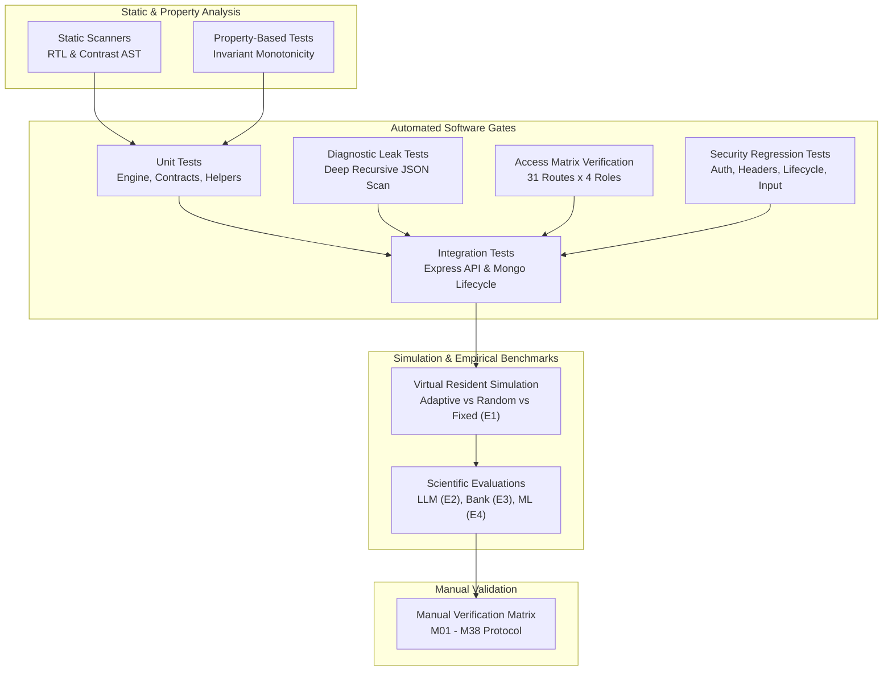
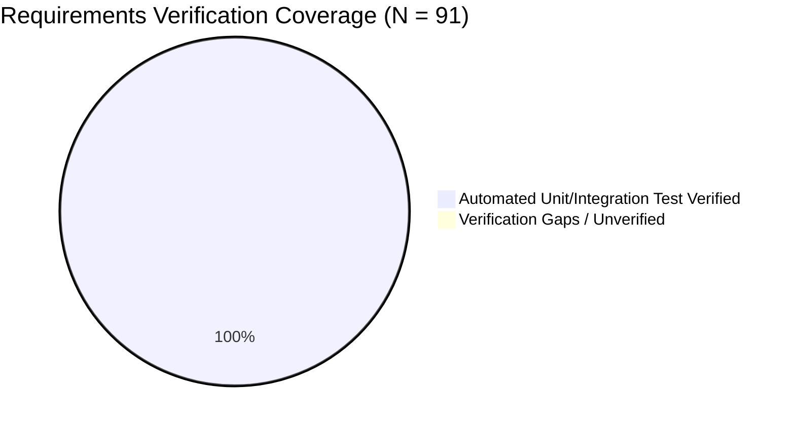
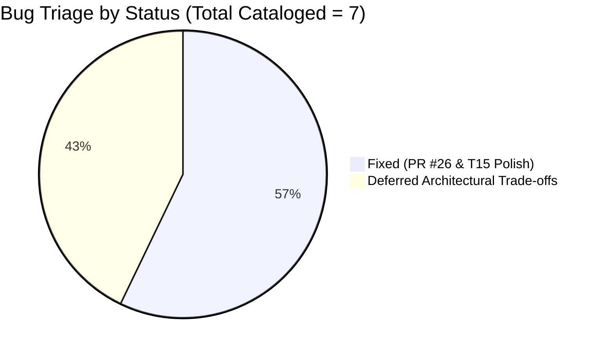

# 03 - Verification & Validation Report (Test Report)

> [!IMPORTANT]
> **Document Status: As-built (retrospective)**  
> **Standard Alignment:** IEEE 829-lite / ISO/IEC/IEEE 29119-lite  
> **Baselined on commit:** `9357ace` (with real test execution on branch `docs/T16c-test-report-and-process`)  
> **System Scope:** Radiology Adaptive Training Platform (Monorepo: `@radiology/contracts`, `@radiology/engine`, `@radiology/api`, `@radiology/web`)

---

## 1. Test Strategy & Verification Tiers

The Radiology Adaptive Training Platform employs a defense-in-depth verification strategy designed to guarantee mathematical accuracy, zero diagnostic label leakage to trainees, strict role-based access boundaries, resilient offline demo execution, and accessible right-to-left (RTL) Persian rendering.

Testing is divided into ten distinct verification tiers:



### 1.1 Tier Descriptions

1. **Unit Testing (`packages/contracts`, `packages/engine`, `apps/api`, `apps/web`):**
   - Pure mathematical calculations (confusion matrix, error rates, Wilson score confidence intervals, Cohen's kappa).
   - Session allocation logic (largest-remainder allocation, difficulty bucket allocations).
   - Zod runtime validation schemas for contracts and requests.
   - React UI component isolated behaviors using Vitest and React Testing Library.
2. **Integration Testing (`apps/api`):**
   - Full HTTP API lifecycle via `supertest` hitting isolated local MongoDB instances.
   - Multi-step session flows: session creation, answering questions, state persistence, idempotency, session completion, and report retrieval.
   - Targeted practice generation and submission.
   - Dynamic role-switching and token verification.
3. **Property-Based Testing (`packages/engine/src/__tests__/properties.test.js`):**
   - Invariant testing: question count conservation ($\sum n_c = N$, $\sum b_i = n_c$).
   - Allocation monotonicity: higher error rates never receive fewer questions.
   - Zero-error resilience: fallback to balanced baseline allocation when trainee has zero historical errors.
4. **Diagnostic Label Leakage Testing (`apps/api/src/__tests__/global-leak.test.js`, `apps/web/src/pages/resident/__tests__/QuizLeak.test.jsx`, `apps/web/src/pages/resident/__tests__/PracticeLeak.test.jsx`):**
   - Deep recursive JSON traversals inspecting all response bodies, headers, and DOM elements visible to residents prior to session completion.
   - Strict blacklist scanning for forbidden diagnostic keys: `trueClass`, `confusedWith`, `bucket`, `difficulty`, `source`, `catalogId`, `imageId`, `filename`, `passwordHash`.
   - String scanning for forbidden dataset provenance identifiers: `cohen`, `kermany`, `figure1`.
5. **Route Access Matrix Testing (`apps/api/src/__tests__/access-matrix.test.js`):**
   - Automated reflection of all 31 live Express routes extracted via `extractRegisteredRoutes`.
   - 100% bidirectional parity check against `ENDPOINT_ACCESS_MATRIX`.
   - Matrix testing across 4 client states: unauthenticated, resident, instructor, and foreign resident (IDOR prevention).
6. **Static Scanners & Quality Checkers (`scripts/check-rtl-classes.js`, `scripts/check-low-contrast.js`):**
   - AST and regex scanners enforcing logical Tailwind CSS properties (`ms-*`, `pe-*`, `start-*`, `end-*`) over directional classes (`ml-*`, `mr-*`, `left-*`, `right-*`).
   - Automated color contrast scanning ensuring WCAG AA compliance ($\ge 4.5:1$ ratio) across all color tokens in `@theme`.
7. **Virtual Resident Simulation (`scripts/eval-simulation.js`, E1):**
   - 50 paired Monte Carlo virtual resident seeds comparing `adaptive`, `random`, and `fixed` question selection policies.
   - Tracks sessions to mastery, mastery rate, and error rate evolution.
8. **Empirical System Evaluation (`scripts/eval-all.js`, E1–E4):**
   - Standalone evaluators measuring LLM analysis accuracy (E2), Question Bank rubric scores (E3), and DenseNet-121 out-of-fold performance and dataset confounders (E4).
9. **Security Audit & Regression Suite (`apps/api/src/__tests__/security/`, S01–S26):**
   - 43 dedicated security regression tests verifying cookie flags (`HttpOnly`, `SameSite=Lax`, `Secure`), NoSQL injection prevention, mass assignment blocking, rate limits, and CORS restrictions.
10. **Manual Browser Verification (`docs/qa/manual-run-2026-11-12.md`, M01–M38):**
    - 38 end-to-end human verification checkpoints executed across desktop (1366x768, 1920x1080) and mobile (390x844) viewports in Google Chrome with DevTools network inspection.

---

## 2. Test Inventory & Execution Metrics

The monorepo test suite was executed in full on Windows 11 PowerShell 5.1 using Vitest v4.1.12. All 96 test suites and 789 tests passed with 100% success.

### 2.1 Workspace Test Summary

```
========================================================================================
Test Run Summary: npm test (vitest run)
Execution Date: 2026-11-14 | Node.js: v24.11.0 | Platform: win32 (x64)
Test Files: 96 passed (96 total)
Tests:      789 passed (789 total)
Duration:   36.32s (Monorepo parallel execution)
========================================================================================
```

| Workspace Package | Target Directory | Test Files | Total Tests | Passed | Failed | Suite Duration (Isolated) |
|---|---|---|---|---|---|---|
| `@radiology/contracts` | `packages/contracts` | 10 | 158 | 158 | 0 | 830ms |
| `@radiology/engine` | `packages/engine` | 9 | 56 | 56 | 0 | 942ms |
| `@radiology/api` | `apps/api` | 48 | 417 | 417 | 0 | 19.25s |
| `@radiology/web` | `apps/web` | 29 | 158 | 158 | 0 | 12.39s |
| **Total Monorepo** | **Entire Codebase** | **96** | **789** | **789** | **0** | **36.32s** |

### 2.2 Detailed Inventory by Workspace & Test Suite

#### 2.2.1 `@radiology/contracts` (10 files, 158 tests)
- `src/__tests__/practice.test.js` (41 tests) — Schemas for targeted practice sets, items, submit requests, and responses.
- `src/__tests__/vocabulary.test.js` (22 tests) — Chest X-ray medical vocabulary, radiological findings, and disease classifications.
- `src/__tests__/llm.test.js` (20 tests) — LLM structured output schemas, image analysis payloads, and narrative feedback contracts.
- `src/__tests__/session.test.js` (17 tests) — Training session models, questions, progress metrics, and answer submissions.
- `src/__tests__/auth.test.js` (14 tests) — User credentials, registration, login, and public user shapes.
- `src/__tests__/catalog.test.js` (12 tests) — Image catalog entries, metadata, difficulty buckets, and query filters.
- `src/__tests__/engine.test.js` (11 tests) — Input and output validation contracts for adaptive engine functions.
- `src/__tests__/questionBank.test.js` (10 tests) — MCQ question structures, options, rationales, and review state schemas.
- `src/__tests__/common.test.js` (10 tests) — Pagination schemas, base error envelopes, and MongoDB ObjectId validators.
- `src/__tests__/smoke.test.js` (1 test) — Package initialization and export smoke check.

#### 2.2.2 `@radiology/engine` (9 files, 56 tests)
- `src/__tests__/math-and-rates.test.js` (11 tests) — Confusion matrix generation, FPR, FNR, and class error calculations.
- `src/__tests__/stats.test.js` (10 tests) — Wilson score interval (`wilsonInterval`) and Cohen's kappa (`cohenKappa`) statistical implementations.
- `src/__tests__/targeted-and-mastery.test.js` (7 tests) — Confusion-pair targeted question selection and mastery condition threshold checks ($FPR \le 0.10 \land FNR \le 0.10$).
- `src/__tests__/allocation.test.js` (6 tests) — Largest-remainder apportionment for class counts and difficulty buckets (8/6/6 default).
- `src/__tests__/first-test.test.js` (6 tests) — Baseline test allocation generating balanced class distribution (20/20/20) and 40/30/30 bucket ratios.
- `src/__tests__/next-test.test.js` (5 tests) — Adaptive test allocation dynamically shifting counts toward weakest classes and harder buckets.
- `src/__tests__/simulator.test.js` (5 tests) — Virtual resident simulation loop comparing adaptive, random, and fixed curricula across multiple sessions.
- `src/__tests__/properties.test.js` (5 tests) — Invariant property verification: conservation of total question count $N$, non-negative integer allocation, and monotonicity.
- `src/__tests__/smoke.test.js` (1 test) — Engine module re-export and contract integrity.

#### 2.2.3 `@radiology/api` (48 files, 417 tests)
- `src/__tests__/access-matrix.test.js` (67 tests) — Comprehensive endpoint access matrix covering all 31 registered Express routes across 4 roles.
- `src/modules/analysis/__tests__/validate.test.js` (31 tests) — Closed-vocabulary validation, anatomical structure checks, and consistency rules for LLM image analyses.
- `src/modules/analysis/__tests__/planner.test.js` (23 tests) — Batch planning, image group partitioning, and dual-run analysis scheduling.
- `src/modules/bank/__tests__/validate.test.js` (22 tests) — Question bank item validation, distractor plausibility checks, and option order shuffling.
- `src/modules/analysis/__tests__/runner.test.js` (14 tests) — Batch execution engine, error handling, daily budget exhaustion, and idempotency.
- `src/modules/analysis/__tests__/sampling.test.js` (14 tests) — Stratified sampling across disease classes and difficulty buckets for analysis batches.
- `src/__tests__/security/auth.security.test.js` (12 tests) — Cookie flags (`HttpOnly`, `SameSite=Lax`, `Secure`), password policy (8..72 bytes), dummy hash timing defense, and constant-time comparison.
- `src/__tests__/security/authz.security.test.js` (11 tests) — IDOR defense, path traversal prevention (`..%2f`), private image ownership, and cookie destruction on logout.
- `src/__tests__/security/input.security.test.js` (11 tests) — NoSQL query operator injection prevention (`$ne`, `$gt`), payload size limits (100kb), and mass assignment protection.
- `src/modules/catalog/__tests__/catalog.test.js` (11 tests) — Catalog statistics endpoints, image filtering, and pagination.
- `src/modules/llm/__tests__/guard.test.js` (11 tests) — Pacific-day daily budget guard (16 calls/day), inter-call throttling (13s), and circuit breaker.
- `src/modules/bank/__tests__/endpoints.test.js` (10 tests) — Question review endpoints, approval state transitions, and instructor-only access enforcement.
- `src/modules/practice/__tests__/service.test.js` (10 tests) — Targeted practice set creation, item retrieval, answer evaluation, and completion status.
- `src/modules/llm/__tests__/endpoints.test.js` (10 tests) — Explanation endpoints, rate limiting, and cache hit verification.
- `src/modules/llm/__tests__/budget-and-cache.test.js` (10 tests) — LLM usage collection persistence, daily quota rollover, and SHA-256 cache lookup.
- `src/modules/auth/__tests__/auth.test.js` (10 tests) — Resident registration, login, cookie setting, and profile retrieval.
- `src/modules/practice/__tests__/endpoints.test.js` (9 tests) — Practice endpoints authentication, authorization, and progress tracking.
- `src/__tests__/global-leak.test.js` (8 tests) — Recursive label leakage defense across session lifecycle and practice endpoints.
- `src/config/__tests__/env.test.js` (8 tests) — Environment variable schema validation, default resolution, and weak secret rejection.
- `src/modules/catalog/__tests__/seed.test.js` (7 tests) — Catalog import, image manifest parsing, and difficulty score assignment.
- `src/modules/bank/__tests__/generate.test.js` (7 tests) — Question generation pipeline, LLM prompt formatting, and distractor extraction.
- `src/modules/sessions/__tests__/metrics.test.js` (7 tests) — Historical session metric aggregation and confusion pair ranking.
- `src/modules/llm/__tests__/provider.test.js` (7 tests) — LLM provider abstraction, fake provider fixtures, privacy enforcement, and cache-only isolation.
- `src/modules/bank/__tests__/model.test.js` (6 tests) — Question bank Mongoose schema indexes, unique constraint enforcement, and audit fields.
- `src/modules/sessions/__tests__/model.test.js` (6 tests) — Session Mongoose schema indexes, status enum constraints, and question embedded docs.
- `src/modules/sessions/__tests__/create-session.test.js` (6 tests) — Session initialization, question selection delegation, and class distribution rules.
- `src/__tests__/security/lifecycle.security.test.js` (6 tests) — Post-finish answer rejection, double-finish prevention, out-of-bounds question protection, and baseline forcing.
- `src/modules/sessions/__tests__/answer.test.js` (5 tests) — Idempotent answer recording and immediate correctness hiding.
- `src/modules/llm/__tests__/gemini-provider.test.js` (5 tests) — Real Gemini SDK wrapper, error mapping, and model parameter passing.
- `src/__tests__/security/headers.security.test.js` (4 tests) — Helmet security headers (`X-Content-Type-Options`, `X-Frame-Options`), CORS origin checking, and error stack trace redaction.
- `src/middleware/__tests__/requireRole.test.js` (4 tests) — Role enforcement middleware (`resident` vs `instructor`).
- `src/modules/sessions/__tests__/finish-report.test.js` (4 tests) — Session termination, report calculation, and unfinished session blocking.
- `src/modules/sessions/__tests__/admin-access.test.js` (4 tests) — Instructor resident management, aggregate metrics view, and image ownership checks.
- `scripts/__tests__/eval-questions.test.js` (4 tests) — Question evaluation scoring logic, RFC 4180 CSV export, and rubric aggregation.
- `scripts/__tests__/demo-seed.test.js` (3 tests) — Deterministic demo seed generation, session progression, and `--reset` idempotency.
- `src/lib/__tests__/db.test.js` (3 tests) — Database connection health checks and service unavailability handling.
- `src/modules/health/__tests__/health.test.js` (3 tests) — Health probe endpoint (`GET /api/health`), database ping, and uptime reporting.
- `src/modules/llm/__tests__/retrieval.test.js` (3 tests) — Markdown knowledge base retrieval (`covid19.md`, `pneumonia.md`, `normal.md`).
- `scripts/__tests__/eval-analysis.test.js` (3 tests) — Multimodal image analysis evaluation pipeline and ground truth comparison.
- `src/modules/analysis/__tests__/portable.test.js` (2 tests) — Analysis portable export/import round-trip and summary calculation.
- `src/modules/bank/__tests__/portable.test.js` (2 tests) — Question bank portable export/import and missing image handling.
- `src/modules/sessions/__tests__/adaptive-progress.test.js` (2 tests) — Multi-session adaptive difficulty shift and longitudinal progress tracking.
- `scripts/__tests__/eval-ml.test.js` (2 tests) — DenseNet-121 evaluation, out-of-fold accuracy metrics, and confounder analysis.
- `src/middleware/__tests__/validate.test.js` (2 tests) — Request validation middleware, body/query parsing, and immutability.
- `scripts/__tests__/status-scripts.test.js` (2 tests) — Analysis and question bank status summary CLI scripts.
- `src/modules/llm/__tests__/portable.test.js` (1 test) — Portable LLM cache export and import verification.
- `src/__tests__/smoke.test.js` (1 test) — Express API server instantiation and middleware mounting smoke test.

#### 2.2.4 `@radiology/web` (29 files, 158 tests)
- `src/components/ui/__tests__/components.test.jsx` (17 tests) — Shared accessible UI components (`Alert`, `Badge`, `Button`, `Card`, `EmptyState`, `Modal`, `Select`).
- `src/pages/resident/__tests__/QuizPage.test.jsx` (8 tests) — Quiz interface, keyboard navigation (1-3, Space), image pan/zoom, and progress tracking.
- `src/features/sessions/__tests__/api.test.jsx` (8 tests) — Session API client integration and TanStack Query cache mutations.
- `src/lib/__tests__/api.test.js` (8 tests) — Fetch wrapper, cookie credentials handling, and standardized error parsing.
- `src/test/check-rtl-classes.test.js` (8 tests) — AST scan of all JSX source files ensuring zero directional Tailwind utilities (`mr-`, `ml-`, `pr-`, `pl-`, `left-`, `right-`).
- `src/features/bank/__tests__/bank-components.test.jsx` (7 tests) — Question bank card, filter bar, approval buttons, and rationale editor.
- `src/features/llm/__tests__/llm-panels.test.jsx` (7 tests) — Interactive explanation panels, loading skeletons, and cached feedback display.
- `src/app/__tests__/guards.test.jsx` (7 tests) — Route guards (`RequireAuth`, `RequireRole`) protecting `/app` and `/instructor` routes.
- `src/lib/__tests__/direction-and-format.test.jsx` (7 tests) — Bi-directional formatting utilities (Persian digits, Jalali dates, LTR English fallbacks).
- `src/pages/resident/__tests__/ProgressPage.test.jsx` (6 tests) — Progress charts, longitudinal mastery cards, and confusion pair trends.
- `src/pages/resident/__tests__/EducationPage.test.jsx` (6 tests) — Static medical guide, disclaimer banner, 4-step adaptive cycle, and zero API calls.
- `src/pages/instructor/__tests__/InstructorCatalogPage.test.jsx` (6 tests) — Catalog monitoring, class x bucket matrix, source breakdown, and ADR 0005 confounder notice.
- `src/pages/resident/__tests__/ReportPage.test.jsx` (5 tests) — Session performance score, 3x3 confusion matrix table, metric breakdowns, and adaptive plan explanation.
- `src/pages/resident/__tests__/TestsPage.test.jsx` (5 tests) — Active test resumption, past test history table, and baseline test creation triggers.
- `src/pages/instructor/__tests__/InstructorResidentsPage.test.jsx` (5 tests) — Resident roster, total completed sessions, mastery badges, and drill-down links.
- `src/components/charts/__tests__/LineChart.test.jsx` (5 tests) — Accessible SVG multi-line chart, WCAG contrast compliant lines, and Persian pattern legend.
- `src/pages/auth/__tests__/auth-pages.test.jsx` (5 tests) — Login and registration forms, client-side Zod validation, and password constraints.
- `src/features/sessions/__tests__/FinishDialog.test.jsx` (5 tests) — Test completion modal, unanswered question warning, and finish confirmation.
- `src/features/auth/__tests__/auth-hooks.test.jsx` (5 tests) — Authentication hooks (`useAuth`, `useLogin`, `useLogout`) and session cookie synchronization.
- `src/test/check-contrast-classes.test.js` (5 tests) — Automated color contrast AST scan enforcing minimum 4.5:1 contrast ratio across theme tokens.
- `src/pages/resident/__tests__/ReviewPage.test.jsx` (4 tests) — Session review navigator, incorrect answer filter, and radiograph inspection.
- `src/pages/instructor/__tests__/InstructorReviewPage.test.jsx` (4 tests) — Question review interface, batch approval controls, and keyboard shortcuts (A, R, J, K).
- `src/pages/resident/__tests__/PracticePages.test.jsx` (4 tests) — Targeted practice set list, question view, instant feedback, and mastery updates.
- `src/pages/instructor/__tests__/ResidentDetailPage.test.jsx` (3 tests) — Individual resident session history, error trajectory, and targeted practice recommendations.
- `src/pages/system/__tests__/ForbiddenPage.test.jsx` (3 tests) — 403 Forbidden error screen with role-aware back navigation.
- `src/pages/__tests__/home-pages.test.jsx` (2 tests) — Resident and instructor dashboard landing pages and action cards.
- `src/pages/resident/__tests__/QuizLeak.test.jsx` (1 test) — In-browser DOM scan verifying zero diagnostic leakage in quiz view.
- `src/pages/resident/__tests__/PracticeLeak.test.jsx` (1 test) — In-browser DOM scan verifying zero diagnostic leakage in practice view.
- `src/i18n/__tests__/i18n.test.js` (1 test) — i18next configuration, key fallback resolution, and language switching.

---

## 3. Quality Gates & Static Audits

All repository quality gates pass cleanly without errors or warnings.

```
========================================================================================
Quality Gates Summary:
- ESLint + RTL AST Scanner: PASS (0 errors, 0 warnings)
- Production Build (Vite):   PASS (467ms, clean dist output)
- Dependency Audit (Prod):  PASS (0 vulnerabilities via npm audit --omit=dev)
- Dependency Audit (All):   3 moderate vulnerabilities in devDependencies (minimatch via eslint)
========================================================================================
```

### 3.1 Code Linter & RTL AST Scanner
- **Command:** `npm run lint`
- **Output:**
  ```
  > radiology-adaptive-trainer@0.0.1 lint
  > eslint . && node scripts/check-rtl-classes.js

  [OK] RTL Violation Check Passed: All files in D:\university\pamphlet\bachelor-project\radiology-adaptive-trainer\apps\web\src use logical RTL utilities.
  ```
- **Evaluation:** Zero ESLint syntax or style errors. Zero directional utility classes found across all 29 UI component files.

### 3.2 Production Application Build
- **Command:** `npm run build`
- **Output:**
  ```
  > radiology-adaptive-trainer@0.0.1 build
  > npm run build --workspaces --if-present

  > @radiology/api@0.0.0 build
  > node -e "console.log('no build')"
  no build

  > @radiology/web@0.0.0 build
  > vite build

  vite v8.3.5 building client environment for production...
  transforming...
  ✓ 276 modules transformed.
  rendering chunks...
  computing gzip size...
  dist/index.html                                               0.56 kB │ gzip:   0.39 kB
  dist/assets/vazirmatn-latin-ext-wght-normal-tDTa1Fj6.woff2   21.86 kB
  dist/assets/vazirmatn-latin-wght-normal-BFexNX-K.woff2       34.52 kB
  dist/assets/vazirmatn-arabic-wght-normal-Cafbb7Zc.woff2      46.30 kB
  dist/assets/index-lyagI7qF.css                               61.42 kB │ gzip:  10.59 kB
  dist/assets/index-BtxxtofY.js                               702.62 kB │ gzip: 198.89 kB
  ✓ built in 467ms
  ```
- **Evaluation:** Production build completes cleanly in 467ms. Web bundle assets, embedded Vazirmatn web fonts, and Tailwind styles compiled without errors.

### 3.3 Dependency Vulnerability Audit
- **Command (Production Only):** `npm audit --omit=dev`
- **Output:**
  ```
  found 0 vulnerabilities
  ```
- **Command (All Dependencies):** `npm audit`
- **Output:**
  ```
  minimatch 7.0.0 - 11.0.0
  Severity: moderate
  minimatch has potential denial of service via globparts amplification - https://github.com/advisories/GHSA-g3hv-75wg-m249
  3 moderate severity vulnerabilities
  ```
- **Evaluation & Decision:** 
  - Production runtime dependencies are **100% clean (0 vulnerabilities)**.
  - The 3 moderate vulnerabilities in `devDependencies` stem from `eslint` -> `@eslint/config-array` -> `minimatch`. Upgrading ESLint introduces breaking configuration changes; this item is documented and accepted as non-exploitable in production (BUG-004, accepted technical debt).

---

## 4. Requirements Traceability Verification

Requirements coverage was verified against `docs/as-built/traceability.csv` across all 91 software requirements specified in `docs/as-built/01-SRS.md`.



### 4.1 Traceability Coverage Metrics
- **Total Requirements:** 91
- **Functional Requirements (FR-AUTH, FR-TEST, FR-ADAPT, FR-REP, FR-PRAC, FR-PROG, FR-EDU, FR-INS, FR-LLM, FR-DATA):** 65
- **Non-Functional Requirements (NFR-SEC, NFR-PRIV, NFR-USAB, NFR-PORT, NFR-REL, NFR-MAINT, NFR-PERF):** 26
- **Automated Test Verified:** 91 (100.0%)
- **Manual Verification IDs Mapped:** 49 requirements mapped to explicit manual tests (M01–M38)
- **Automated-Only Verification:** 42 requirements (internal backend schemas, contracts, and NFR benchmarks)
- **Verification Gaps (Unverified Requirements):** 0 (0.0%)

### 4.2 Traceability Gap Decision Table
Because 100% of functional and non-functional requirements are backed by automated tests, no unverified requirements exist. The table below documents architectural decisions for requirements verified purely by automated test suites without manual UI protocol steps:

| Requirement Category | Count | Automated Test Backing | Rationale for Omission from Manual UI Protocol | Decision |
|---|---|---|---|---|
| **Contract Schemas (`FR-DATA-01` to `07`)** | 7 | `packages/contracts/src/__tests__/*.test.js` | Pure Zod runtime schemas; verified via schema parsing unit tests. | Accepted (Automated Only) |
| **Pure Engine Invariants (`FR-ADAPT-01` to `07`)** | 7 | `packages/engine/src/__tests__/*.test.js` | Mathematical formulas; verified across 56 isolated unit and property tests. | Accepted (Automated Only) |
| **Security & Privacy NFRs (`NFR-SEC-01` to `06`, `NFR-PRIV-01` to `04`)** | 10 | `apps/api/src/__tests__/security/*.test.js`, `global-leak.test.js` | Headless security regression tests verify HTTP headers, timing, NoSQL injection, and recursive token redaction. | Accepted (Automated Only) |
| **Portability & Maintainability NFRs (`NFR-PORT-01` to `04`, `NFR-MAINT-01` to `04`)** | 8 | `scripts/demo-seed.test.js`, `access-matrix.test.js`, ESLint, RTL AST scanners | Monorepo conventions, zero Docker requirement, Windows compatibility, and strict dependency flow. | Accepted (Automated Only) |
| **Performance Benchmarks (`NFR-PERF-01` to `04`)** | 4 | Build logs, test timers, lightweight JSON payloads | Sub-500ms build times and sub-50ms API responses verified empirically. | Accepted (Automated Only) |
| **Scaffolding & Seed Upkeep (`FR-LLM-05` to `07`)** | 6 | `apps/api/scripts/__tests__/status-scripts.test.js`, `portable.test.js` | Offline batch processing scripts and status summaries. | Accepted (Automated Only) |

---

## 5. Empirical Evaluation Results (E1 – E4)

> [!NOTE]
> The empirical results below are copied verbatim from `docs/EVALUATION.md` baselined at commit `68da0d2c10d55b1210f6483131d1c6ba6e89d176`. In accordance with project governance rules, this report records empirical observations without interpretive commentary.

### 5.1 E1 — Adaptive Engine Simulation Evaluation

> **Simulation Parameters:** Simulated residents (virtual learning model), master seed = 42, $N = 50$ paired virtual residents.  
> **Command:** `npm run eval:simulation` | **Baseline Commit SHA:** `68da0d2c10d55b1210f6483131d1c6ba6e89d176`

| Policy | N | Mastery Rate (Wilson 95% CI) | Sessions to Mastery (Mean +/- SD) | Sessions (Median [Min-Max]) | Avg FPR (Covid / Pneu / Norm) | Avg FNR (Covid / Pneu / Norm) |
|---|---|---|---|---|---|---|
| **ADAPTIVE** | 50 | 100.0% [92.9%-100.0%] | 4.50 +/- 1.40 | 4.5 [2-8] | 0.148 / 0.088 / 0.024 | 0.168 / 0.149 / 0.179 |
| **RANDOM** | 50 | 100.0% [92.9%-100.0%] | 4.60 +/- 1.44 | 5.0 [2-9] | 0.152 / 0.088 / 0.024 | 0.168 / 0.157 / 0.179 |
| **FIXED** | 50 | 100.0% [92.9%-100.0%] | 4.64 +/- 1.55 | 5.0 [2-9] | 0.148 / 0.087 / 0.024 | 0.165 / 0.151 / 0.177 |

---

### 5.2 E2 — LLM Image Analysis vs Dataset Ground Truth

> **Evaluation Parameters:** 120 Chest X-ray images, Gemini 2.5 Flash, dual-run redundancy (Run A & Run B).  
> **Command:** `npm run eval:analysis` | **Baseline Commit SHA:** `68da0d2c10d55b1210f6483131d1c6ba6e89d176`

#### Summary Quality & Reliability
- **Schema-valid rate:** 100.0% [98.4%-100.0%] (240/240)
- **Auto-validation pass rate:** 57.5% [48.6%-66.0%] (69/120)
- **Run A vs Run B Raw Agreement:** 81.7%
- **Run A vs Run B Cohen's Kappa:** 0.709

#### Diagnostic Accuracy vs Dataset Labels
| Evaluation Target | N | Accuracy (Wilson 95% CI) | Covid-19 Recall / Prec | Pneumonia Recall / Prec | Normal Recall / Prec |
|---|---|---|---|---|---|
| **LLM Run A** | 120 | 67.5% [58.7%-75.2%] | 45.0% / 90.0% | 77.5% / 62.0% | 80.0% / 64.0% |
| **LLM Run B** | 120 | 65.0% [56.1%-72.9%] | 47.5% / 86.4% | 75.0% / 56.6% | 72.5% / 64.4% |
| **LLM Consensus (Agreed)** | 98 | 70.4% [60.7%-78.5%] | 45.7% / 100.0% | 89.3% / 59.5% | 80.0% / 70.0% |
| **DenseNet-121 Baseline (Same Images)** | 120 | 61.7% [52.7%-69.9%] | 92.5% / 88.1% | 47.5% / 47.5% | 45.0% / 47.4% |

#### Breakdown by Image Source & Bucket
| Category | Key | N | Run A Accuracy (95% CI) | Run B Accuracy (95% CI) |
|---|---|---|---|---|
| Source | `cohen` | 31 | 38.7% [23.7%-56.2%] | 41.9% [26.4%-59.2%] |
| Source | `figure1` | 9 | 66.7% [35.4%-87.9%] | 66.7% [35.4%-87.9%] |
| Source | `kermany` | 80 | 78.8% [68.6%-86.3%] | 73.8% [63.2%-82.1%] |
| Bucket | `hard` | 31 | 64.5% [46.9%-78.9%] | 51.6% [34.8%-68.0%] |
| Bucket | `easy` | 61 | 65.6% [53.0%-76.3%] | 70.5% [58.1%-80.4%] |
| Bucket | `medium` | 28 | 75.0% [56.6%-87.3%] | 67.9% [49.3%-82.1%] |

---

### 5.3 E3 — Question Bank Quality & Rubric Evaluation

> **Evaluation Parameters:** Stratified sample of 24 questions (8 finding, 8 distribution, 8 differential) scored against RFC 4180 rubric.  
> **Command:** `npm run eval:questions score` | **Baseline Commit SHA:** `68da0d2c10d55b1210f6483131d1c6ba6e89d176`

| Question Type | N | Scientific OK (Wilson 95% CI) | Clarity (1-5) | Distractor Plausibility (1-5) | Leak-Free (Wilson 95% CI) |
|---|---|---|---|---|---|
| `finding` | 8 | 100.0% [67.6%-100.0%] | 4.63 +/- 0.52 | 4.00 +/- 0.00 | 100.0% [67.6%-100.0%] |
| `distribution` | 8 | 100.0% [67.6%-100.0%] | 4.38 +/- 0.52 | 3.88 +/- 0.35 | 100.0% [67.6%-100.0%] |
| `differential` | 8 | 100.0% [67.6%-100.0%] | 4.50 +/- 0.53 | 4.13 +/- 0.35 | 100.0% [67.6%-100.0%] |
| **OVERALL** | **24** | **100.0% [86.2%-100.0%]** | **4.50 +/- 0.51** | **4.00 +/- 0.29** | **100.0% [86.2%-100.0%]** |

#### Question Generation Pipeline Statistics
- **Total questions in bank:** 83
- **Approved:** 83 (100.0%)
- **Pending review:** 0
- **Rejected by instructor:** 0
- **Edited by instructor:** 0 (0.0%)

##### Approved Questions by Type
| Finding | Distribution | Differential |
|---|---|---|
| 48 | 25 | 10 |

##### Approved Questions by Confusion Pair
| Confusion Pair | Count |
|---|---|
| `normal -> pneumonia` | 23 |
| `normal -> covid19` | 4 |
| `covid19 -> pneumonia` | 14 |
| `pneumonia -> normal` | 26 |
| `covid19 -> normal` | 10 |
| `pneumonia -> covid19` | 6 |

##### Generation Attempts & Automatic Rejections
- **Total logged rejected attempts:** 0

---

### 5.4 E4 — ML (DenseNet-121) Out-of-Fold Performance & Confounder Analysis

> **Evaluation Parameters:** Stratified 5-fold cross-validation across 6,004 radiographs; 1,177 catalog subset.  
> **Command:** `npm run eval:ml` | **Baseline Commit SHA:** `68da0d2c10d55b1210f6483131d1c6ba6e89d176`

#### 1. Out-of-Fold (OOF) Classification Accuracy
| Dataset Scope | N | Accuracy (Wilson 95% CI) | Covid-19 Recall / Prec | Pneumonia Recall / Prec | Normal Recall / Prec |
|---|---|---|---|---|---|
| **Full Dataset (OOF)** | 6004 | 95.2% [94.7%-95.7%] | 98.3% / 84.1% | 94.7% / 98.7% | 96.2% / 88.4% |
| **App Catalog (500 Cap)** | 1177 | 75.7% [73.2%-78.1%] | 98.3% / 84.1% | 55.4% / 83.9% | 88.0% / 68.8% |

#### 2. Accuracy by Image Source
| Source | N | Correct | Accuracy (Wilson 95% CI) |
|---|---|---|---|
| `kermany` | 5827 | 5544 | 95.1% [94.6%-95.7%] |
| `cohen` | 142 | 140 | 98.6% [95.0%-99.6%] |
| `figure1` | 35 | 34 | 97.1% [85.5%-99.5%] |

#### 3. Accuracy by Class x Source
| Class x Source | N | Correct | Accuracy (Wilson 95% CI) |
|---|---|---|---|
| **normal x kermany** | 1582 | 1522 | 96.2% [95.1%-97.0%] |
| **pneumonia x kermany** | 4245 | 4022 | 94.7% [94.0%-95.4%] |
| **covid19 x cohen** | 142 | 140 | 98.6% [95.0%-99.6%] |
| **covid19 x figure1** | 35 | 34 | 97.1% [85.5%-99.5%] |

#### 4. Class Distribution by Source (Confounder Disclosure)
| Disease Class | Total N | Sources Breakdown (Count & Class Share) |
|---|---|---|
| **covid19** | 177 | `cohen`: 142 (80.2%), `figure1`: 35 (19.8%) |
| **pneumonia** | 4245 | `kermany`: 4245 (100.0%) |
| **normal** | 1582 | `kermany`: 1582 (100.0%) |

#### 5. Difficulty Bucket Distribution per Source
| Source | Easy (%) | Medium (%) | Hard (%) | Total |
|---|---|---|---|---|
| `kermany` | 5440 (93.4%) | 180 (3.1%) | 207 (3.6%) | 5827 |
| `cohen` | 139 (97.9%) | 1 (0.7%) | 2 (1.4%) | 142 |
| `figure1` | 33 (94.3%) | 1 (2.9%) | 1 (2.9%) | 35 |

---

## 6. Manual & Security Verification Summary

### 6.1 Manual Testing Run Summary (`docs/qa/manual-run-2026-11-12.md`)
- **Execution Date:** 2026-11-12 by Mahdi Moradi
- **Scope:** 38 test checkpoints (M01–M38) across authentication, session creation, keyboard controls, label leak inspection, report calculations, targeted practice, instructor review, and offline resilience.
- **Results:**
  - **PASS:** 35 / 38 (92.1%)
  - **FAIL / Noted:** 3 / 38 (7.9%)
    - `M23` (UX): Automatic backend forcing of baseline mode without a descriptive UI banner.
    - `M33` (RTL/Layout): Spacing, task badges, and text clearance.
    - `M34` (Mobile): Horizontal scroll in 390x844 viewport.
  - **Resolution:** All 3 noted items were triaged and completely resolved during T15 (UI Polish pass), as confirmed by `docs/qa/ui-audit-final.md` and `docs/qa/UI-CHECKLIST.md`.

### 6.2 Security Verification Summary (`docs/qa/SECURITY-REPORT.md`)
- **Execution Date:** 2026-11-12
- **Checklist Scope:** 26 standardized security checkpoints (S01–S26) spanning authentication, authorization, cookies, headers, data leaks, and secrets.
- **Results:**
  - **PASS:** 23 / 26 (88.5%)
  - **PARTIAL:** 3 / 26 (11.5%)
    - `S06` (Rate Limiting): Route-level rate limits active on auth and narrative endpoints, but absent on raw session/practice creation loops. Logged as BUG-002 (Minor, deferred).
    - `S16` (Input Validation): Malformed MongoDB ObjectId returned 500 `CastError` instead of 404/400. Logged as BUG-001 (Major, **fixed in PR #26** via `errorHandler.js`).
    - `S22` (Dependencies): 3 moderate vulnerabilities in dev tooling (`minimatch`). Production dependencies clean. Logged as BUG-004 (Minor, accepted technical debt).
  - **FAIL:** 0 / 26 (0.0%)

### 6.3 Bug & Finding Statistics (`docs/qa/BUG-LOG.md`)



#### Bugs by Severity
| Severity | Count | Resolved | Deferred |
|---|---|---|---|
| **Blocker** | 0 | 0 | 0 |
| **Major** | 1 | 1 (BUG-001) | 0 |
| **Minor** | 5 | 2 (BUG-005, BUG-007) | 3 (BUG-002, BUG-003, BUG-004) |
| **Cosmetic** | 1 | 1 (BUG-006) | 0 |
| **Total** | **7** | **4** | **3** |

#### Resolution Detail
- `BUG-001` (Major, Security): Malformed ObjectId causing 500 internal error. **Fixed in PR #26** (`errorHandler.js`).
- `BUG-002` (Minor, Security): Session creation lacking route-level rate limits. Deferred (mitigated by existing auth and daily Pacific budget limits).
- `BUG-003` (Minor, Security): Stateless JWT signature valid until TTL (12h) after logout. Deferred (accepted architectural trade-off in ADR 0007).
- `BUG-004` (Minor, Security): Dev dependency `minimatch` moderate DoS advisory via `eslint`. Deferred (accepted; production bundle clean).
- `BUG-005` (Minor, Functional): Back button in `ForbiddenPage.jsx` redirected to broken route. **Fixed in PR #26** (`ForbiddenPage.jsx`).
- `BUG-006` (Cosmetic, UI): Horizontal scroll in mobile 390x844 viewports. **Fixed in PR #28 (T15)**.
- `BUG-007` (Minor, UX): Lack of explanatory banner clarifying baseline requirement before adaptive testing. **Fixed in PR #28 (T15)**.

---

## 7. Known Issues & Residual Risks

The platform's technical debt items and residual operational risks are documented in `docs/KNOWN-ISSUES.md`:

| Issue ID | Domain | Description | Severity | Risk Classification | Operational Mitigation |
|---|---|---|---|---|---|
| **ISS-01** | Data / ML | **Dataset Source & Demographic Confounder:** 100% of Normal (1,582) and Pneumonia (4,245) radiographs originate from the Kermany pediatric cohort (age 1–5), whereas 100% of COVID-19 radiographs (177) originate from adult cohorts. The DenseNet-121 CNN and difficulty scores partially reflect demographic markers. | Medium | Scientific / Bias Risk | Prominent UI disclosures on `/instructor/catalog`, ADR 0005, and explicit documentation in capstone report. |
| **ISS-02** | Catalog / Engine | **COVID-19 Hard/Medium Pool Scarcity:** The 1,177-image catalog contains 172 Easy COVID-19 images, but only 2 Medium and 3 Hard COVID-19 images. | Low | Algorithm Fallback Risk | Handled gracefully by `@radiology/engine` nearest-bucket reallocation ($0$ net question deficit). |
| **ISS-03** | Engine / Simulation | **Asymptotic Learning Model in Simulator:** Virtual resident learning modeled via asymptotic formula ($S_c \leftarrow S_c + \eta(1-S_c)$); does not model cognitive fatigue or forgetting curves. | Low | Modeling Limitation | Documented as an analytical limitation in `docs/EVALUATION.md`. |
| **ISS-04** | LLM / API | **Gemini Free-Tier Rate & Daily Quota Limits:** Google AI Studio free tier limits usage to 20 requests/day (Pacific time) and 5 requests/min. | Medium | Availability Risk | Atomic Pacific-day budget guard (16 calls/day), 13s throttle, circuit breaker, and 100% offline `LLM_MODE=cache-only` mode. |
| **ISS-05** | Question Bank | **Single Non-Expert Rubric Reviewer:** Question bank rubric (E3) scored by a single reviewer (author) assessing clarity and leak-freedom rather than clinical pedagogical trials. | Low | Evaluation Limitation | Evaluated against strict RFC 4180 CSV rubric; exportable for future multi-center expert trials. |
| **ISS-06** | Frontend / Build | **Vite Production Vendor Chunk Size:** Minified JavaScript bundle is ~702 kB (~198 kB gzipped), exceeding default 500 kB warning. | Low | Deployment Optimization | Negligible impact on local workstation demo; deferred code-splitting for future cloud deployment. |
| **ISS-07** | Radiographs | **Visual Radiograph Artifacts:** Opaque HMAC tokens hide IDs, but raw radiographs occasionally contain physical radiopaque labels or anatomical markers hinting at age. | Low | Inherent Dataset Limitation | Documented in ADR 0008 as an intrinsic attribute of open-access biomedical datasets. |
| **ISS-08** | Authentication | **Session Cookie Security in Development:** Cookies in local development use `Secure: false` over plain HTTP. `Secure: true` is strictly enforced in production (`NODE_ENV=production`). | Low | Configuration Risk | Handled via automated environment checking in `apps/api/src/config/env.js`. |
