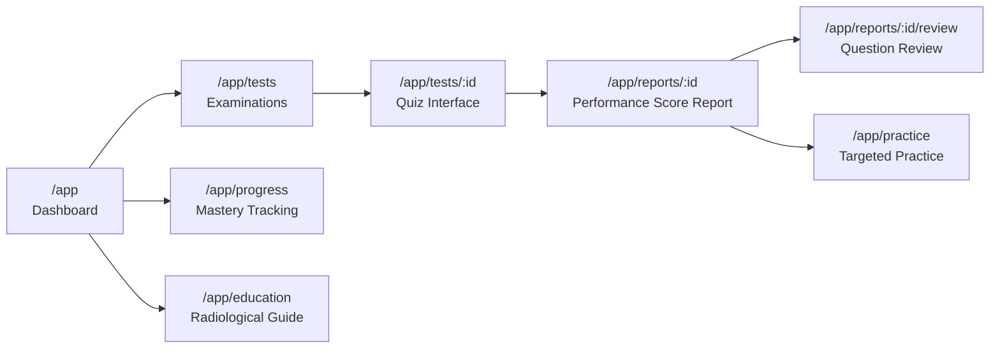

# 04 - System User Guide

> [!IMPORTANT]
> **Educational Training Platform Disclaimer**  
> The Radiology Adaptive Training Platform is strictly an educational computer-aided training environment designed to evaluate and improve radiology residents' visual diagnostic proficiency on chest radiographs.  
> **Under no circumstances should this software, its machine learning difficulty scores, or its LLM-generated explanations be utilized for real clinical decision-making, patient triage, or diagnostic purposes.**

---

## 1. Introduction & Getting Started

The platform provides two dedicated operational panels:
1. **Resident Training Panel (`/app`):** For radiology residents to undertake baseline and adaptive diagnostic examinations, inspect performance reports, study radiological disease profiles, and perform targeted practice on persistent diagnostic confusions.
2. **Instructor Supervisory Panel (`/instructor`):** For clinical faculty to review, approve, reject, or edit AI-generated question items, monitor resident cohort performance, and inspect the underlying radiograph catalog.

### 1.1 Local Demo Accounts
For local demonstrations and offline evaluation, the database includes pre-seeded demo accounts:

| User Role | Email Address | Password | Account Purpose |
|---|---|---|---|
| **Resident (Demo)** | `demo-resident@hospital.test` | `DemoResident123!` | Pre-seeded with 4 finished training sessions demonstrating longitudinal mastery progression. |
| **Instructor** | `instructor@hospital.test` | `InstructorPassword123!` | Administrative and pedagogical access for question bank review and cohort monitoring. |

New residents can also self-register at `/register`. Newly registered resident accounts begin with a clean slate and are automatically guided through the mandatory baseline examination.

---

## 2. Platform Navigation & Screen Reference

The platform features 19 dedicated screens organized by route.

### 2.1 Public & Authentication Routes

#### 2.1.1 Login Page (`/login`)
- **Route:** `/login`
- **Purpose:** Secure entry point for residents and instructors.
- **Controls & Behavior:**
  - Email and password input fields validated by Zod schemas.
  - Role-based automatic redirect upon successful authentication: residents are routed to `/app`, instructors to `/instructor`.
  - Rate limiting active: excessive failed login attempts (more than 20 within 15 minutes) trigger HTTP 429 rate limit protection.
- **Visual Reference:**  
  `[SCREENSHOT: /login]`

#### 2.1.2 Registration Page (`/register`)
- **Route:** `/register`
- **Purpose:** Onboarding portal for new radiology residents.
- **Controls & Behavior:**
  - Full Name, Email, and Password inputs. Password must be between 8 and 72 bytes.
  - Automatically provisions the user with the `resident` role (mass assignment of administrative roles is blocked).
  - Automatically logs the resident in and sets the secure `rt_session` HTTP-only cookie.
- **Visual Reference:**  
  `[SCREENSHOT: /register]`

#### 2.1.3 Access Forbidden Page (`/forbidden`)
- **Route:** `/forbidden`
- **Purpose:** Displayed when a user attempts to access a route outside their authorized role (e.g., a resident accessing `/instructor` or an instructor accessing `/app`).
- **Controls & Behavior:**
  - Displays a clean 403 Forbidden alert with friendly Persian guidance.
  - Context-aware back button returns residents to `/app` and instructors to `/instructor`.
- **Visual Reference:**  
  `[SCREENSHOT: /forbidden]`

#### 2.1.4 Not Found Page (`/*`)
- **Route:** Catch-all 404
- **Purpose:** Displayed when navigating to an unrecognized route.
- **Controls & Behavior:** Friendly error message with a link to return to the dashboard.
- **Visual Reference:**  
  `[SCREENSHOT: /not-found]`

---

### 2.2 Resident Panel Routes (`/app`)



#### 2.2.1 Resident Dashboard (`/app`)
- **Route:** `/app`
- **Purpose:** Central hub displaying current diagnostic progress, quick access to ongoing tests, and performance summaries.
- **Controls & Behavior:**
  - Four key action cards: "Start / Resume Examination", "Targeted Practice", "Mastery Progress", and "Radiological Reference".
  - Displays summary badges indicating recent session scores and active weakness focus areas.
- **Visual Reference:**  
  `[SCREENSHOT: /app]`

#### 2.2.2 Examinations Page (`/app/tests`)
- **Route:** `/app/tests`
- **Purpose:** Overview of completed and active training sessions; entry point to initiate a new examination.
- **Controls & Behavior:**
  - "Start Examination" primary action button:
    - If the resident has no completed sessions, the system initiates **Session 1: Baseline Examination**.
    - If the resident has completed one or more sessions, the system automatically configures an **Adaptive Examination** tailored to recent error patterns.
  - "Resume" action for any test currently `in_progress`.
  - Historical sessions table: lists past sessions, session dates (Jalali format in Persian mode), total questions answered, diagnostic accuracy score, and link to view report.
- **Visual Reference:**  
  `[SCREENSHOT: /app/tests]`

#### 2.2.3 Quiz Interface (`/app/tests/:sessionId`)
- **Route:** `/app/tests/:sessionId`
- **Purpose:** Focused diagnostic examination screen for chest radiograph interpretation.
- **Controls & Behavior:**
  - **Radiograph Viewer (`XrayImage`):** High-resolution chest X-ray image with zoom and pan controls. Strict clinical protection guarantees images are never mirrored or horizontally flipped.
  - **Question Navigator:** Top progress strip displaying question numbers ($1$ to $N$), current question marker, and completed indicators.
  - **Diagnostic Options:** 3 disease classification buttons:
    - `1` or `الف`: COVID-19 (`covid19`)
    - `2` or `ب`: Pneumonia (`pneumonia`)
    - `3` or `ج`: Normal (`normal`)
  - **Keyboard Shortcuts:**
    - Key `1`: Select COVID-19
    - Key `2`: Select Pneumonia
    - Key `3`: Select Normal
    - Key `Space`: Confirm answer and proceed to the next question
  - **Immediate Correctness Hiding:** The interface strictly conceals diagnostic correctness and true pathology during the examination to prevent learning bias and mimic real clinical examination conditions.
  - **Finish Dialog:** Modal prompt triggered upon completing the final question or clicking "Finish Examination", alerting the user if any questions remain unanswered.
- **Visual Reference:**  
  `[SCREENSHOT: /app/tests/:sessionId]`

#### 2.2.4 Performance Score Report (`/app/reports/:sessionId`)
- **Route:** `/app/reports/:sessionId`
- **Purpose:** Comprehensive post-examination performance debriefing and diagnostic weakness diagnosis.
- **Controls & Behavior:**
  - **Executive Summary:** Total questions ($N = 60$ default), overall accuracy percentage, and test mode indicator (Baseline vs Adaptive).
  - **$3 \times 3$ Confusion Matrix:** Visual matrix mapping Ground Truth against Resident Predictions across all three classes.
  - **Per-Class Metrics Table:** Specific breakdown of True Positives, False Positives (FPR), False Negatives (FNR), Sensitivity, and Precision.
  - **Adaptive Curriculum Plan:** Explains how the engine recalculated error weights based on this test and previews the class balance for the subsequent session.
  - **AI Clinical Feedback:** Expandable pedagogical explanations for mistaken interpretations powered by Gemini with full offline caching.
  - **Action Buttons:** "Review Incorrect Questions" and "Start Targeted Practice".
- **Visual Reference:**  
  `[SCREENSHOT: /app/reports/:sessionId]`

#### 2.2.5 Question Review Page (`/app/reports/:sessionId/review`)
- **Route:** `/app/reports/:sessionId/review`
- **Purpose:** Detailed retrospective walkthrough of every radiograph encountered in a finished examination.
- **Controls & Behavior:**
  - Side-by-side display of the original radiograph alongside the resident's submitted diagnosis and the ground truth class.
  - Filter toggle: "Show All Questions" vs "Show Incorrect Only".
  - Detailed radiological findings checklist highlighting key visual markers (e.g., ground-glass opacities, consolidations, costophrenic angle clarity).
- **Visual Reference:**  
  `[SCREENSHOT: /app/reports/:sessionId/review]`

#### 2.2.6 Targeted Practice Page (`/app/practice`)
- **Route:** `/app/practice`
- **Purpose:** Portal for launching focused micro-training sets targeted at specific confusion pairs.
- **Controls & Behavior:**
  - Displays available confusion pairs (e.g., `covid19 -> pneumonia`, `pneumonia -> normal`).
  - Active weakness cards highlighting the resident's most urgent confusion areas based on historical FPR and FNR.
  - "Launch Practice Set" button: dynamically generates a 5-item targeted MCQ set drawing exclusively from instructor-approved question items.
  - History of completed practice sets with mastery scores.
- **Visual Reference:**  
  `[SCREENSHOT: /app/practice]`

#### 2.2.7 Practice Set Interface (`/app/practice/:setId`)
- **Route:** `/app/practice/:setId`
- **Purpose:** Interactive MCQ solving environment for targeted practice items.
- **Controls & Behavior:**
  - Presents high-yield radiological multiple-choice questions across 3 clinical types: Finding identification, Anatomical distribution, and Differential diagnosis.
  - Radiograph thumbnail with interactive modal expansion.
  - **Immediate Formative Feedback:** Unlike the formal examination, submitting an answer instantly reveals whether it was correct, explains the underlying radiological rationale, and highlights why distractors are incorrect.
- **Visual Reference:**  
  `[SCREENSHOT: /app/practice/:setId]`

#### 2.2.8 Longitudinal Progress Page (`/app/progress`)
- **Route:** `/app/progress`
- **Purpose:** Longitudinal tracking of diagnostic performance, error rate decay, and class mastery over time.
- **Controls & Behavior:**
  - **Class Mastery Cards:** Visual status indicators for `covid19`, `pneumonia`, and `normal`. A class is marked **Mastered** when both $FPR \le 0.10$ and $FNR \le 0.10$ across recent sessions.
  - **Multi-Line Performance Chart (`LineChart`):** Accessible SVG chart plotting error rate trajectories across sessions. Features WCAG AA compliant contrasting colors and Persian pattern names (`پیوسته` for Normal, `خط‌چین` for Pneumonia, `نقطه‌چین` for COVID-19).
  - **Confusion Pair Trends:** Bar metrics showing the decline of specific diagnostic confusions across consecutive tests.
- **Visual Reference:**  
  `[SCREENSHOT: /app/progress]`

#### 2.2.9 Radiological Education Guide (`/app/education`)
- **Route:** `/app/education`
- **Purpose:** Static radiological study companion grounded in verified clinical literature.
- **Controls & Behavior:**
  - Zero external API dependencies (fully offline and self-contained).
  - Prominent Medical Disclaimer banner.
  - Step-by-step breakdown of the 4-stage adaptive learning cycle.
  - Grounded disease monographs for COVID-19, Pneumonia, and Normal chest radiographs, detailing characteristic radiological presentations:
    - *COVID-19:* Peripheral and bilateral ground-glass opacities (GGO), lower-lobe predominance, crazy-paving patterns, consolidation in late stages.
    - *Pneumonia:* Lobar or segmental alveolar consolidation, air bronchograms, patchy peribronchial infiltrates, interstitial opacities.
    - *Normal:* Clear costophrenic angles, sharp cardiothoracic ratio ($< 0.50$), clear lung parenchymal fields without focal opacities.
- **Visual Reference:**  
  `[SCREENSHOT: /app/education]`

---

### 2.3 Instructor Supervisory Panel (`/instructor`)

#### 2.3.1 Instructor Dashboard (`/instructor`)
- **Route:** `/instructor`
- **Purpose:** Faculty overview of resident cohort performance and question bank health.
- **Controls & Behavior:**
  - Summary metrics: total active residents, total sessions completed, approved questions in bank, and pending review queue count.
  - Quick links to Question Review, Resident Roster, and Radiograph Catalog.
- **Visual Reference:**  
  `[SCREENSHOT: /instructor]`

#### 2.3.2 Question Bank Review Interface (`/instructor/review`)
- **Route:** `/instructor/review`
- **Purpose:** Quality assurance panel for clinical faculty to audit, modify, approve, or reject AI-generated questions.
- **Controls & Behavior:**
  - **Filter Bar:** Filter questions by status (`approved`, `pending`, `rejected`), question type (`finding`, `distribution`, `differential`), and confusion pair.
  - **Question Card:** Displays question stem, 4 multiple-choice options, correct answer indicator, clinical rationale, and associated chest radiograph.
  - **Review State Actions:**
    - "Approve": Moves question to `approved` status; immediately becomes eligible for resident targeted practice.
    - "Reject": Marks question `rejected`; permanently prevents question from appearing in resident sessions.
    - "Edit Rationale / Options": In-place modal to correct medical terminology, adjust distractor phrasing, or clarify the explanation.
  - **Keyboard Hotkeys:**
    - Key `A`: Approve current question
    - Key `R`: Reject current question
    - Key `J`: Navigate to next question in queue
    - Key `K`: Navigate to previous question in queue
- **Visual Reference:**  
  `[SCREENSHOT: /instructor/review]`

#### 2.3.3 Resident Roster Page (`/instructor/residents`)
- **Route:** `/instructor/residents`
- **Purpose:** Cohort-wide monitoring of all registered radiology trainees.
- **Controls & Behavior:**
  - Search and filter bar for locating residents by name or email.
  - Data table: resident name, registration date, completed examination sessions, current average accuracy, and mastered classes count.
  - "Inspect Progress" link opening the individual resident detail view.
- **Visual Reference:**  
  `[SCREENSHOT: /instructor/residents]`

#### 2.3.4 Resident Detail Analysis (`/instructor/residents/:userId`)
- **Route:** `/instructor/residents/:userId`
- **Purpose:** Granular analytical profile for an individual resident trainee.
- **Controls & Behavior:**
  - Full longitudinal session history table.
  - Diagnostic error breakdown highlighting specific lingering confusion pairs.
  - Targeted practice set completion rate and score trajectory.
- **Visual Reference:**  
  `[SCREENSHOT: /instructor/residents/:userId]`

#### 2.3.5 Radiograph Catalog Monitoring (`/instructor/catalog`)
- **Route:** `/instructor/catalog`
- **Purpose:** Transparency dashboard for inspecting the 1,177 chest radiographs populating the active application catalog.
- **Controls & Behavior:**
  - **ADR 0005 Confounder Notice:** Prominent banner disclosing source dataset provenance (Kermany pediatric pneumonia/normal vs Cohen/Figure1 adult COVID-19) and the 500-image quota cap.
  - **Class $\times$ Bucket Matrix:** Grid showing exact image distributions across classes (`covid19`, `pneumonia`, `normal`) and difficulty buckets (`easy`, `medium`, `hard`).
  - **3-Axis Filter Bar:** Filter images by disease class, difficulty tier, and source dataset.
  - **Paginated Image Table:** Radiograph thumbnail (`XrayImage`), true class badge, ML difficulty score ($d = 1 - p$), and confused-with prediction.
- **Visual Reference:**  
  `[SCREENSHOT: /instructor/catalog]`

---

## 3. The Adaptive Training Flow & Performance Interpretation

### 3.1 Examination Lifecycle

```mermaid
sequenceDiagram
    autonumber
    actor R as Resident
    participant W as Web App (/app)
    participant S as API Session Engine
    participant E as Adaptive Math Engine

    R->>W: Click "Start Examination"
    W->>S: POST /api/sessions
    alt Session 1 (No past history)
        S->>E: selectFirstTest(catalog, N=60)
        Note over E: Balanced Allocation:<br/>20 Covid, 20 Pneu, 20 Normal<br/>Bucket split: 8 Easy, 6 Med, 6 Hard
    else Session 2+ (Adaptive)
        S->>E: selectNextTest(catalog, history, N=60)
        Note over E: Weighted Allocation:<br/>Extract FPR/FNR -> Class Weights<br/>Shift quota to weak classes & harder bins
    end
    S-->>W: Return Session (Opaque IDs, No Labels)
    R->>W: Answer Questions 1..60 (Keys 1-3, Space)
    W->>S: PUT /api/sessions/:id/answers/:qIndex
    Note over S: Stores answer; hides correctness
    R->>W: Finish Examination
    W->>S: POST /api/sessions/:id/finish
    S->>E: computeMetrics(responses)
    S-->>W: Return 3x3 Matrix, FPR, FNR, Weights
    W->>R: Display Score Report (/app/reports/:id)
```

### 3.2 Understanding the Performance Score Report

The post-examination report displays key statistical indices designed to diagnose visual interpretative biases:

#### 1. The $3 \times 3$ Confusion Matrix
The matrix cross-tabulates actual pathology against trainee interpretation:

| Actual \ Predicted | Predicted COVID-19 | Predicted Pneumonia | Predicted Normal | Total Actual |
|---|---|---|---|---|
| **True COVID-19** | Correct ($TP_{covid}$) | Confused as Pneumonia | Confused as Normal | Total Covid Cases |
| **True Pneumonia** | Confused as Covid | Correct ($TP_{pneu}$) | Confused as Normal | Total Pneumonia Cases |
| **True Normal** | False Alarm (Covid) | False Alarm (Pneu) | Correct ($TN_{norm}$) | Total Normal Cases |

- **Diagonal cells:** Represent correct clinical interpretations.
- **Off-diagonal cells:** Represent specific clinical error patterns.

#### 2. False Positive Rate (FPR) vs False Negative Rate (FNR)
- **False Positive Rate (FPR, "False Alarm"):**
  $$\text{FPR}_c = \frac{\text{False Positives}}{\text{Actual Negatives}} = \frac{FP_c}{FP_c + TN_c}$$
  *Plain Meaning:* How often you diagnosed a disease when it was **not present**. A high COVID-19 FPR indicates a tendency to over-call normal lungs or bacterial pneumonia as viral COVID-19.
- **False Negative Rate (FNR, "Missed Disease"):**
  $$\text{FNR}_c = \frac{\text{False Negatives}}{\text{Actual Positives}} = \frac{FN_c}{FN_c + TP_c}$$
  *Plain Meaning:* How often you **missed** a pathology that was genuinely present. A high COVID-19 FNR indicates failure to detect subtle peripheral ground-glass opacities, mistaking them for clear lungs.

#### 3. Class Error Weights & Next Test Allocation
The engine calculates total class error as $E_c = \text{FPR}_c + \text{FNR}_c$. The weight assigned to class $c$ in the next examination is:
$$w_c = \frac{E_c}{\sum_{k} E_k}$$
If a resident struggles with Pneumonia (e.g., $w_{pneu} = 0.50$, $w_{covid} = 0.25$, $w_{norm} = 0.25$), the engine automatically allocates 30 Pneumonia questions, 15 COVID-19 questions, and 15 Normal questions in the subsequent test, drawing primarily from medium and hard difficulty bins.

#### 4. Class Mastery Criterion
A disease class is considered **Mastered** when a trainee demonstrates consistent diagnostic competence across finished sessions:
$$\text{Mastery}_c \iff \text{FPR}_c \le 0.10 \land \text{FNR}_c \le 0.10$$
When all three classes satisfy this condition, the resident has achieved curriculum mastery.
