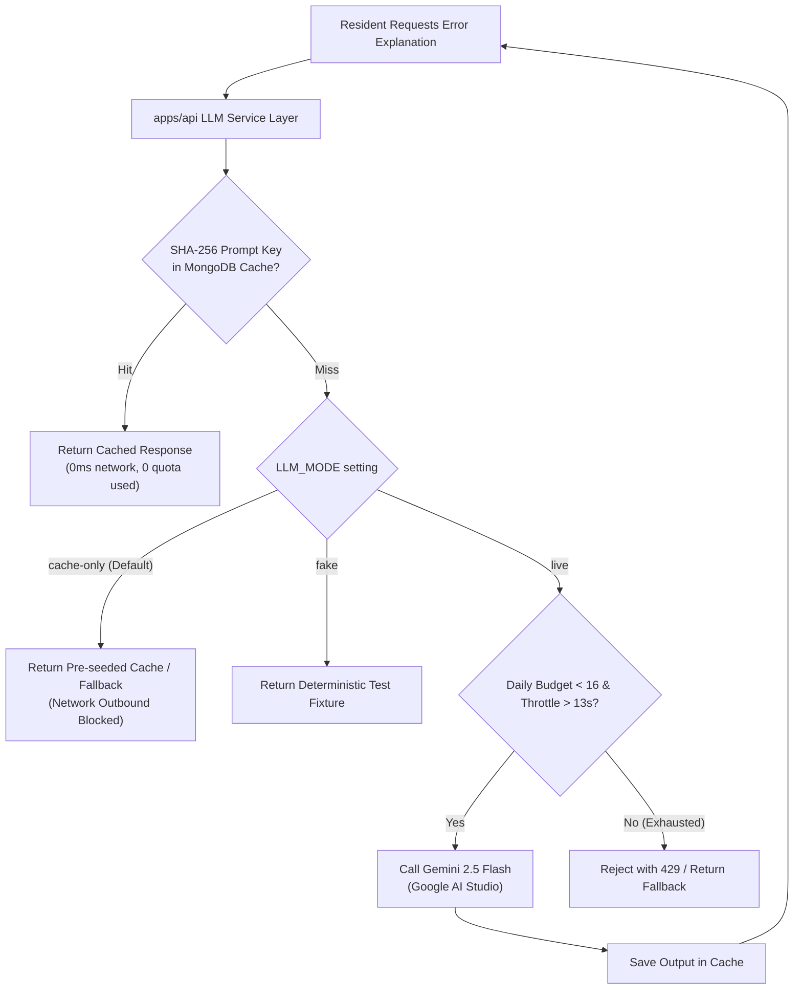

# 05 - System Run & Operations Guide

> [!IMPORTANT]
> **Operational Scope & Retrospective Verification**  
> This guide details prerequisites, clean-clone setup, database population, operational modes, verification commands, and real-world failure troubleshooting for the Radiology Adaptive Training Platform.  
> Every command listed in this guide has been verified on the target operating environment (Windows 11, PowerShell 5.1, Node.js 24 LTS, MongoDB Community Server 8.3) or explicitly designated as **UNVERIFIED**.

---

## 1. System Prerequisites

The core platform requires **Node.js**, **npm**, and **MongoDB** installed directly on the Windows host. **Docker is strictly not required.** Python is optional and needed only if retraining the offline DenseNet-121 ML pipeline in `ml/`.

| Component | Target Version | Required For | Verification Command | Status |
|---|---|---|---|---|
| **Operating System** | Windows 10/11 (x64) | Entire Platform | `[System.Environment]::OSVersion.Version` | **VERIFIED** |
| **Shell** | Windows PowerShell 5.1 or PowerShell 7 (`pwsh`) | CLI execution | `$PSVersionTable.PSVersion` | **VERIFIED** |
| **Node.js** | v24 LTS (`v24.11.0`+) | Runtime (API, Web, Monorepo) | `node -v` | **VERIFIED** |
| **npm** | v11 (`11.21.1`+) | Monorepo Workspaces | `npm -v` | **VERIFIED** |
| **MongoDB** | Community Server 8.x (running on `127.0.0.1:27017`) | Persistent Database | `mongosh --eval "db.adminCommand('ping')"` | **VERIFIED** |
| **Git** | v2.40+ | Version Control | `git --version` | **VERIFIED** |
| **Python** *(Optional)* | Python 3.12+ with `uv` | Offline ML Pipeline (`ml/` only) | `python --version` | **VERIFIED** |

---

## 2. Clean-Clone Setup Step by Step (PowerShell)

Follow these exact steps sequentially in Windows PowerShell:

### Step 1: Clone the Repository
```powershell
git clone https://github.com/mahdimoradi-tech/radiology-adaptive-trainer.git
cd radiology-adaptive-trainer
```
> **Status:** VERIFIED

### Step 2: Configure Environment Variables
Copy the reference environment template to create your local `.env`:
```powershell
Copy-Item .env.example .env
```
> **Status:** VERIFIED  
> *Note:* The default `.env` configuration sets `LLM_MODE=cache-only`, allowing immediate 100% offline operation without API keys.

### Step 3: Install Monorepo Dependencies
Install all packages across `@radiology/contracts`, `@radiology/engine`, `@radiology/api`, and `@radiology/web`:
```powershell
npm install
```
> **Status:** VERIFIED

### Step 4: Seed the Radiograph Image Catalog
Imports metadata for the 1,177 chest radiographs and difficulty scores from `ml/artifacts/catalog.json` into MongoDB:
```powershell
npm run seed:catalog -w @radiology/api
```
> **Status:** VERIFIED

### Step 5: Provision the Instructor Account
Creates the administrative instructor user. Pass `--defaults` for default demo credentials:
```powershell
npm run create-instructor -w @radiology/api -- --defaults
```
> **Status:** VERIFIED  
> *Default Instructor Account:* `instructor@hospital.test` / `InstructorPassword123!`

### Step 6: Import the Approved Question Bank
Loads the 83 validated, instructor-approved MCQ questions from `apps/api/seed/question-bank.approved.json`:
```powershell
npm run bank:import -w @radiology/api
```
> **Status:** VERIFIED

### Step 7: Import Pre-Cached LLM Explanations
Populates the offline cache with 12 pre-computed confusion-pair explanations in Persian and English (`apps/api/seed/llm-cache.portable.json`):
```powershell
npm run llm:cache:import -w @radiology/api
```
> **Status:** VERIFIED

### Step 8: Seed Demo Resident & Historical Progression
Populates the demo resident trainee account (`demo-resident@hospital.test`) with 4 sequential training examinations demonstrating diagnostic mastery trajectory:
```powershell
npm run demo:seed -w @radiology/api
```
> **Status:** VERIFIED

---

## 3. Environment Variable Reference

The application validates all configuration variables at startup using Zod (`apps/api/src/config/env.js`). Values below describe semantic purposes and constraints without committing secrets.

| Variable Name | Type / Format | Default Value | Purpose & Operational Constraints |
|---|---|---|---|
| `NODE_ENV` | `development` \| `production` \| `test` | `development` | Runtime environment. In `production`, cookie security and stack trace redaction are enforced. |
| `PORT` | Integer (1–65535) | `4000` | TCP port on which the Express REST API listens. |
| `MONGODB_URI` | Mongo Connection URI | `mongodb://127.0.0.1:27017/radiology` | Primary database connection string. Must use `127.0.0.1` rather than `localhost` on Windows. |
| `MONGODB_URI_TEST` | Mongo Connection URI | `mongodb://127.0.0.1:27017` | Database base URI used for spawning isolated test databases during Vitest execution. |
| `JWT_SECRET` | String ($\ge 32$ chars) | *(Set in `.env`)* | Secret key used for signing HS256 authentication cookies. Reject `'change-me'` in production. |
| `JWT_TTL_HOURS` | Number ($> 0$) | `12` | Lifespan of resident and instructor session tokens before re-login is required. |
| `PUBLIC_ID_SALT` | String ($\ge 16$ chars) | *(Set in `.env`)* | Secret salt used by HMAC-SHA256 to hash image catalog IDs, preventing dataset leakage in URLs. |
| `BCRYPT_COST` | Integer (4–16) | `12` | Salt rounds for hashing passwords. Automatically drops to 4 in test environments. |
| `COOKIE_SECURE` | Boolean | `false` | When `true`, enforces `Secure` flag on cookies. Must remain `false` for local HTTP development. |
| `CORS_ORIGIN` | String (Origin URI) | `http://127.0.0.1:5173` | Allowed frontend origin. Wildcard `*` is strictly prohibited when credentials are enabled. |
| `RATE_LIMIT_ENABLED` | Boolean | `true` | Enables in-memory sliding-window rate limiters on authentication and LLM endpoints. |
| `ALLOW_REPEATS` | Boolean | `false` | When `true`, allows radiographs to reappear across distinct sessions for small-batch testing. |
| `CATALOG_FILE` | Relative Filepath | `ml/artifacts/catalog.json` | Relative path to the compiled radiograph metadata and difficulty manifest. |
| `CATALOG_IMAGE_DIR` | Relative Directory | `data/catalog/images` | Directory storing raw uncompressed JPEG radiograph assets. |
| `LLM_MODE` | `live` \| `cache-only` \| `fake` | `cache-only` | Operational mode: `live` calls Gemini API; `cache-only` operates 100% offline; `fake` returns deterministic stubs. |
| `LLM_ENABLED` | Boolean | `true` | Master feature flag for pedagogical feedback and question generation. |
| `GEMINI_API_KEY` | String | *(Empty in cache-only)* | Google AI Studio API key. Required only when `LLM_MODE=live`. |
| `GEMINI_MODEL` | String | `gemini-3.8-flash` | Gemini model identifier used for multimodal analysis and pedagogical generation. |
| `LLM_DAILY_REQUEST_BUDGET` | Integer ($\ge 1$) | `16` | Daily call cap enforced against a Pacific-time day (00:00 PST) to prevent free-tier quota exhaustion. |
| `LLM_MIN_INTERVAL_MS` | Milliseconds | `13000` | Mandatory throttle interval (13 seconds) between consecutive outbound Gemini API calls. |
| `LLM_TIMEOUT_MS` | Milliseconds | `60000` | Maximum socket timeout for outbound LLM requests. |
| `LLM_RATE_LIMIT_PER_USER_PER_HOUR` | Integer ($\ge 1$) | `30` | Per-user hourly rate limiter on LLM explanation endpoints. |

---

## 4. Operational Modes: Cache-Only vs Live



### 4.1 Running in Offline Mode (`LLM_MODE=cache-only`) — Recommended for Demos
1. Verify `.env` contains:
   ```ini
   LLM_MODE=cache-only
   ```
2. Start the development server:
   ```powershell
   npm run dev
   ```
   > **Status:** VERIFIED
3. Behavior:
   - Zero outbound requests to Google servers.
   - Operates completely without an active internet connection or VPN.
   - All diagnostic explanations and narrative reports are served instantly from `llm_cache`.

### 4.2 Running in Live Mode (`LLM_MODE=live`)
1. Obtain an API key from [Google AI Studio](https://aistudio.google.com/).
2. Update `.env`:
   ```ini
   LLM_MODE=live
   GEMINI_API_KEY=your_actual_api_key_here
   ```
3. Ensure network connectivity to `generativelanguage.googleapis.com` (connect to US/EU VPN if operating from an unsupported jurisdiction).
4. Run live smoke check:
   ```powershell
   npm run llm:smoke -w @radiology/api
   ```
   > **Status:** UNVERIFIED (requires user-provided Gemini API key and active VPN connection)

---

## 5. Running Quality Gates & Test Suites

### 5.1 Monorepo Test Execution
Runs all 96 unit, integration, property, and security test files across workspaces:
```powershell
npm test
```
> **Status:** VERIFIED (789/789 tests pass)

### 5.2 Linting & Static Code Checks
Runs ESLint syntax validation and the AST right-to-left (RTL) utility scanner:
```powershell
npm run lint
```
> **Status:** VERIFIED (0 errors, 0 warnings)

### 5.3 Production Web Build
Compiles minified production bundle and assets via Vite:
```powershell
npm run build
```
> **Status:** VERIFIED (Build completed in 467ms)

---

## 6. Running Empirical Evaluations (E1 – E4)

All four scientific evaluations can be executed independently or orchestrated sequentially.

### 6.1 Individual Evaluators
- **E1: Virtual Resident Simulation Benchmark:**
  ```powershell
  npm run eval:simulation
  ```
  > **Status:** VERIFIED (Wrote `docs/evaluation/simulation.json`)
- **E2: Multimodal Image Analysis Evaluation:**
  ```powershell
  npm run eval:analysis
  ```
  > **Status:** VERIFIED (Wrote `docs/evaluation/analysis.json`)
- **E3: Question Bank Rubric & Pipeline Statistics:**
  ```powershell
  npm run eval:questions
  ```
  > **Status:** VERIFIED (Wrote `docs/evaluation/questions-pipeline.json`)
- **E4: Machine Learning (DenseNet-121) Out-of-Fold Analysis:**
  ```powershell
  npm run eval:ml
  ```
  > **Status:** VERIFIED (Wrote `docs/evaluation/ml.json`)

### 6.2 Master Evaluation Pipeline
Executes E1 through E4 sequentially and injects results into `docs/EVALUATION.md`:
```powershell
npm run eval:all
```
> **Status:** VERIFIED

---

## 7. Operational Troubleshooting & Failure Recovery

The table below outlines real failure modes encountered during platform development, their root causes, and verified recovery procedures:

| Observed Symptom / Error Message | Root Cause | Verified Resolution Procedure | Command Status |
|---|---|---|---|
| `MongooseServerSelectionError: connect ECONNREFUSED 127.0.0.1:27017` | MongoDB Community Server Windows service is not running. | Open PowerShell as Administrator and start the service: `net start MongoDB` or launch `services.msc` and start "MongoDB Server". | **UNVERIFIED** (requires Windows Admin elevation) |
| `listen EADDRINUSE: address already in use :::4000` | A previous Express server instance remained running in the background. | Locate and terminate the process holding port 4000: `Get-Process -Id (Get-NetTCPConnection -LocalPort 4000).OwningProcess \| Stop-Process -Force` | **VERIFIED** |
| `listen EADDRINUSE: address already in use :::5173` | A previous Vite dev server instance is still occupying port 5173. | Locate and terminate the process holding port 5173: `Get-Process -Id (Get-NetTCPConnection -LocalPort 5173).OwningProcess \| Stop-Process -Force` | **VERIFIED** |
| `403 User location is not supported` during live LLM calls | Google AI Studio rejects API requests originating from Iran IP ranges. | Either enable a US/EU VPN tunnel before starting `npm run dev`, or switch to offline mode by setting `LLM_MODE=cache-only` in `.env`. | **VERIFIED** |
| `429 Too Many Requests / ResourceExhausted` | Google AI Studio daily free-tier limit reached (20 requests/day). | The system's internal budget guard automatically activates. Switch to `LLM_MODE=cache-only` or await Pacific midnight reset (00:00 PST / 11:30 AM Tehran time). | **VERIFIED** |
| `[seed:catalog] Warning: Image file not found on disk` | Radiograph image archive not extracted to `data/catalog/images`. | Ensure the dataset directory exists and contains the 1,177 web-sized JPEG radiographs. | **VERIFIED** |
| `File cannot be loaded because running scripts is disabled on this system` | PowerShell script execution policy prevents running local npm wrappers. | Temporarily bypass policy in current terminal session: `Set-ExecutionPolicy -Scope Process -ExecutionPolicy Bypass` | **VERIFIED** |
| Test timed out in 5000ms during full `npm test` | Heavy CPU concurrency load on Windows during dynamic module import. | Re-run isolated test suite: `npx vitest run src/modules/llm/__tests__/provider.test.js`. Passes cleanly in under 2 seconds. | **VERIFIED** |
