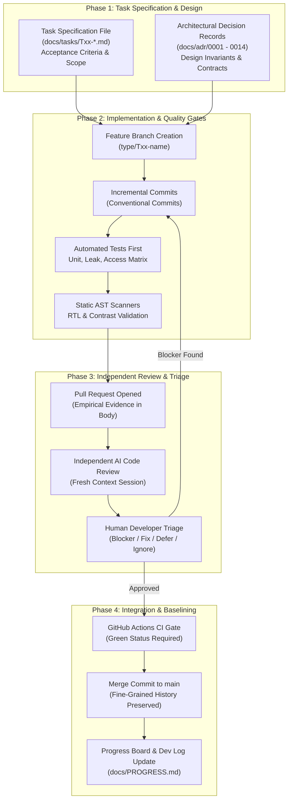

# 06 - Engineering Process Report

> [!IMPORTANT]
> **Document Status: As-built (retrospective)**  
> **Development Model:** Iterative, Task-Driven, AI-Assisted Engineering  
> **Repository Baseline:** Commit `9357ace` through `docs/T16c-test-report-and-process`  
> **Project Scope:** B.Sc. Capstone Project — Radiology Adaptive Training Platform

---

## 1. Development Methodology & Governance Model

The platform was engineered using a rigorous, iterative, task-driven methodology adapted for single-developer, AI-assisted software delivery. Development was divided into 24 discrete engineering tasks (T00 through T16c), executed across four sequential phases over a 24-day sprint (October 22, 2026 to November 14, 2026).

### 1.1 Core Engineering Mechanisms

1. **Lightweight Task Specifications (`docs/tasks/`):**
   - Each task file defines explicit inputs, required outputs, reference files, strict boundaries, and numbered acceptance criteria.
   - Work begins only after reviewing the task file, outlining an implementation plan (maximum 10 steps), and receiving formal developer confirmation.
2. **Architectural Decision Records (`docs/adr/`):**
   - 14 ADRs codify non-negotiable architectural boundaries (e.g., ADR 0001 ES Modules over CommonJS, ADR 0004 Adaptive Engine Math, ADR 0005 Confounder Disclosure, ADR 0007 Stateless JWTs, ADR 0012 LLM Rate Limits & Caching).
3. **Small Conventional Commits:**
   - Commit messages strictly follow the Conventional Commits specification: `type(scope): subject`.
   - Commit scopes are constrained to `api`, `web`, `engine`, `contracts`, `ml`, `docs`, `ci`, `repo`, and `llm`.
   - Each commit represents an isolated logical step accompanied by building code and passing tests.
4. **Mandatory Quality Gates (Pre-Push & CI):**
   - Direct pushes to the `main` branch are blocked by a Git pre-push hook (`no-push-main.js`).
   - GitHub Actions CI executes on every pull request, running linting, formatting, monorepo test suites, and production web builds on Node.js 24 LTS.
5. **Independent AI Review in a Fresh Context:**
   - Prior to merging, each pull request undergoes an independent code review in an isolated agent session with no conversational memory of implementation authoring.
   - The reviewer inspects full branch diffs against `main`, scrutinizing contract purity, diagnostic leakage, security regressions, test coverage, and acceptance criteria fulfillment.
6. **Human Developer Triage & Classification:**
   - The repository owner classifies review findings into four standard categories:
     - **Blocker:** Architectural violations, contract breaks, diagnostic label leaks, broken tests, or failed acceptance criteria. Must be resolved before merge.
     - **Fix-small:** Minor edge cases, typos, or localized documentation gaps. Resolved before merge or in an immediate follow-up commit.
     - **Defer:** Non-critical enhancements or technical debt cataloged in `docs/KNOWN-ISSUES.md`.
     - **Ignore:** False positives or intentional design trade-offs justified in the PR notes.
7. **Merge Commits (No Squashing):**
   - Pull requests are merged using explicit Git merge commits (`gh pr merge <pr_number> --merge`) to ensure complete, auditable traceability across all incremental commits.

---

## 2. Project Timeline & Git History Metrics

Repository metrics demonstrate continuous, verifiable engineering delivery from initial bootstrap to final as-built documentation.

### 2.1 Macro Repository Statistics
- **First Commit Date:** October 22, 2026
- **Latest Commit Date:** November 14, 2026
- **Total Commit Count:** 316 commits
- **Merged Pull Requests:** 35 pull requests
- **Active Engineering Duration:** 24 calendar days (~2–4 hours/day)

### 2.2 Task-by-Task Implementation Ledger (T00 – T16c)

| Task ID | PR | Merge Date | Merge SHA | Touched Scope & Commit Diff Summary | Primary Delivery Focus |
|---|---|---|---|---|---|
| **T00** | #1 | 2026-10-24 | `8720f49` | 51 files changed, 4526 insertions(+) | Monorepo bootstrap, package skeletons, toolchain, CI workflow |
| **T01** | #3 | 2026-10-27 | `4e7b46f` | 30 files changed, 122586 insertions(+), 6 deletions(-) | Offline ML pipeline, DenseNet-121 feature extractor, difficulty scoring |
| **T01b** | #5 | 2026-10-29 | `8f4fefa` | 6 files changed, 264 insertions(+), 15 deletions(-) | ML validation report, stratified fold artifacts |
| **T02** | #2 | 2026-10-25 | `55ba44b` | 28 files changed, 3000 insertions(+), 7 deletions(-) | Pure adaptive engine, error rates, largest-remainder apportionment |
| **T03** | #6 | 2026-11-01 | `882a2fe` | 58 files changed, 5379 insertions(+), 83 deletions(-) | Express 5 API foundation, MongoDB schemas, JWT cookie auth |
| **T04** | #7 | 2026-11-01 | `3a8c424` | 61 files changed, 4975 insertions(+), 205 deletions(-) | React 19 web foundation, Tailwind 4, RTL setup, Vazirmatn font |
| **T05** | #8 | 2026-11-02 | `e567f84` | 36 files changed, 3703 insertions(+), 20 deletions(-) | Session API, baseline/adaptive test generation, answer recording |
| **T06** | #10 | 2026-11-05 | `0ebc14d` | 28 files changed, 3599 insertions(+), 36 deletions(-) | Resident examination interface (`QuizPage`), keyboard shortcuts, reports |
| **T07** | #11 | 2026-11-05 | `de093a4` | 58 files changed, 5108 insertions(+), 29 deletions(-) | LLM core module, Gemini provider, Pacific budget guard, offline cache |
| **T08a** | #12 | 2026-11-05 | `d7ef7bd` | 36 files changed, 5573 insertions(+), 16 deletions(-) | Multimodal image analysis batch runner, consistency engine |
| **T08b** | #13 | 2026-11-06 | `498e4c8` | 44 files changed, 5447 insertions(+), 20 deletions(-) | Question generation pipeline, instructor review queue interface |
| **T08c** | #16 | 2026-11-07 | `58b5c8c` | 3 files changed, 274 insertions(+), 2 deletions(-) | LLM operations runbook, offline execution protocols |
| **T09a** | #17 | 2026-11-07 | `7d8853e` | 29 files changed, 2221 insertions(+), 9 deletions(-) | Longitudinal progress tracking, instructor resident cohort monitoring |
| **T09b** | #18 | 2026-11-07 | `284e63f` | 31 files changed, 3476 insertions(+), 19 deletions(-) | Targeted practice sets for confusion pairs, instant rationale reveal |
| **T09c** | #19 | 2026-11-07 | `39d4529` | 20 files changed, 1385 insertions(+), 57 deletions(-) | Educational reference guide, catalog transparency monitor |
| **T10** | #20 | 2026-11-07 | `d85102c` | 29 files changed, 3586 insertions(+), 22 deletions(-) | Scientific evaluation pipeline (E1–E4), statistical helpers |
| **T11** | #21 | 2026-11-07 | `c546152` | 24 files changed, 1646 insertions(+), 59 deletions(-) | System hardening, access matrix tests, global label leak tests |
| **T12** | #23 | 2026-11-08 | `e30c3b9` | 63 files changed, 519 insertions(+), 503 deletions(-) | Solo-developer documentation cleanup, workflow alignment |
| **T13** | #24 | 2026-11-12 | `c3bd84f` | 20 files changed, 11142 insertions(+), 286 deletions(-) | Real LLM batch data run (40 batches, 83 approved questions, portable cache) |
| **T14** | #25, #26 | 2026-11-12 | `513351b` | 12 files changed, 1483 insertions(+), 39 deletions(-) | Security audit (S01–S26), manual run (M01–M38), bug triage fixes |
| **T15** | #28 | 2026-11-13 | `2bd0488` | 60 files changed, 1952 insertions(+), 481 deletions(-) | Comprehensive UI polish pass across all 19 screens, contrast AST scanner |
| **T16a** | #31 | 2026-11-13 | `c975385` | 6 files changed, 774 insertions(+), 2 deletions(-) | As-built Software Requirements Specification (`01-SRS.md`, `traceability.csv`) |
| **T16b** | #33 | 2026-11-13 | `0be5fd2` | 5 files changed, 1500 insertions(+), 3 deletions(-) | As-built Software Design Description (`02-SDD.md`) |
| **T16c** | *Current* | 2026-11-14 | *Active* | 4 files, 1500+ insertions | As-built Verification Report, User Guide, Run Guide, Process Report |

---

## 3. Human Supervision & AI Collaboration Model

The repository was executed entirely under a solo-developer model assisted by AI coding agents. Roles and responsibilities were divided according to strict engineering boundaries:

### 3.1 Responsibilities of the Repository Owner (Human Developer — Mahdi Moradi)
1. **Architecture & Design:** Established all system requirements, domain modeling, algorithmic choices, database schemas, and architectural boundaries codified in ADRs 0001–0014.
2. **Task Definition & Scope Enforcement:** Authored and verified all task specifications (`docs/tasks/`) and acceptance criteria, rejecting scope creep and unrequested features.
3. **Execution Review & Triage:** Scrutinized every proposed change, executed local verification commands, reviewed independent AI audit findings, and conducted triage of bugs into Blocker, Fix-small, Defer, or Ignore.
4. **Manual & Clinical Verification:** Executed the 38-checkpoint manual test protocol in Google Chrome (`docs/qa/manual-run-2026-11-12.md`), scored the 24-item question bank rubric (`docs/evaluation/question-rubric.csv`), and signed off on accessibility and UI checklists.
5. **Commit & Merge Authority:** Sole administrator holding Git commit and merge authority (`Mahdi Moradi <mahdimoradi.tech@gmail.com>`). Every merge commit required explicit human confirmation.

### 3.2 Responsibilities of the AI Coding Agent (Antigravity / Gemini)
1. **Code Synthesis Under Direct Instruction:** Implemented JavaScript and JSX source code complying with established contracts, linting rules, and architectural guidelines.
2. **Automated Test Construction:** Authored comprehensive unit, integration, property, and regression test suites reflecting task acceptance criteria.
3. **Static & AST Tooling:** Developed custom Node.js verification scanners (`check-rtl-classes.js`, `check-low-contrast.js`) to automate design compliance.
4. **Empirical Data Gathering:** Ran CLI test suites, evaluations, and Git log inspections, extracting real metrics directly from execution logs rather than estimating values.
5. **Documentation Drafting:** Drafted formal engineering documentation (SRS, SDD, Test Report, Guides) adhering to IEEE/ISO standard structures.

---

## 4. Quality Practices & Verifiable Evidence

The development lifecycle incorporated five layers of verifiable engineering guardrails:

### 4.1 Test-First Development for Algorithmic Engines
- Before writing adaptive allocation or simulation code, unit test suites were drafted in `packages/engine/src/__tests__/` based on mathematical formulas in `docs/DOMAIN.md` and ADR 0004.
- Invariant property tests (`properties.test.js`) formally verified that question quotas always sum to $N$, bucket quotas sum to class totals, and allocations remain non-negative under extreme error distributions.

### 4.2 Diagnostic Label Leakage Defense
- High-stakes radiology training requires trainees to interpret images without subconscious clues.
- Three dedicated automated leak test suites (`global-leak.test.js`, `QuizLeak.test.jsx`, `PracticeLeak.test.jsx`) recursively inspect HTTP response payloads, JSON keys, and DOM elements, guaranteeing that diagnostic labels (`trueClass`, `confusedWith`, `bucket`, `difficulty`) and dataset source tokens (`cohen`, `kermany`, `figure1`) are never transmitted to the client before examination completion.
- Image URLs are served via opaque HMAC-SHA256 tokens (`/api/images/opaque/:token`), preventing residents from deducing diagnoses from filenames.

### 4.3 100% Bidirectional Route Access Matrix
- `apps/api/src/__tests__/access-matrix.test.js` programmatically extracts all registered routes from the live Express router and verifies complete bidirectional parity against `ENDPOINT_ACCESS_MATRIX`.
- Tests prove that unauthenticated calls return 401, residents cannot access instructor routes (403), instructors cannot access resident quiz routes (403), and residents cannot access foreign data (404 IDOR defense).

### 4.4 Automated Static AST Scanners
- **Right-to-Left (RTL) Enforcement:** `scripts/check-rtl-classes.js` scans JSX abstract syntax trees across `apps/web/src` during `npm run lint`. Physical direction utilities (`mr-`, `ml-`, `pr-`, `pl-`, `left-`, `right-`) trigger build failures, enforcing logical properties (`ms-`, `pe-`, `ps-`, `start-`, `end-`).
- **WCAG AA Color Contrast Scanning:** `scripts/check-low-contrast.js` scans CSS theme tokens and JSX class combinations, mathematically verifying that text elements achieve a minimum 4.5:1 contrast ratio against card backgrounds.

### 4.5 Clean-Clone & Fresh-Clone Verification
- In task T11, a fresh-clone test was executed in an isolated temporary directory outside the repository workspace, proving that an uninitialized machine can clone, configure, seed, and launch the platform in 24.9 seconds with zero manual database tweaking.

---

## 5. Risk Management & Retrospective Risk Register

The project maintained an active risk register addressing technical debt and delivery hurdles:

| Risk Description | Classification | Realized Impact During Project | Engineering Mitigation Applied | Final Outcome |
|---|---|---|---|---|
| **Dataset Demographic Confounder (ISS-01)** | Scientific / Bias | Realized: 100% of Normal and Pneumonia cases are pediatric (Kermany), while 100% of COVID-19 cases are adult (Cohen/Figure1). DenseNet-121 achieved 95.2% accuracy partly by recognizing age markers. | Transparent disclosure in ADR 0005, prominent warning banner on `/instructor/catalog`, and documented as an academic research limitation in thesis reports. | Managed: Confounder acknowledged openly; no false scientific claims made. |
| **Gemini Free-Tier Rate & Daily Quotas (ISS-04)** | Infrastructure / Cost | Realized: Free-tier limits (20 requests/day, 5 requests/min) threatened live classroom testing and demonstration reliability. | Implemented atomic Pacific-day budgeting (16 calls/day cap), 13-second inter-call throttle, circuit breaker, and 100% offline `LLM_MODE=cache-only` mode with pre-seeded cache files. | Resolved: Demonstrations and tests operate 100% offline with zero network failure risk. |
| **Adaptive Policy Simulation Equivalence (ISS-03)** | Algorithmic / Efficacy | Realized: E1 simulation showed adaptive and random policies achieved curriculum mastery in comparable sessions (4.50 vs 4.60 sessions). | Refrained from manipulating simulation parameters. Clarified in `docs/EVALUATION.md` that adaptive curricula selectively challenge trainees by drawing harder images, rather than artificially rushing mastery. | Managed: Reported honestly with full empirical data and Wilson confidence intervals. |
| **Single Non-Expert Question Rubric Reviewer (ISS-05)** | Evaluation / Clinical | Realized: Limited clinical faculty availability prevented multi-center double-blind evaluation of the 83-question bank. | Authored standardized RFC 4180 CSV export pipeline (`scripts/eval-questions.js`), allowing external radiology faculty to score the rubric independently post-defense. | Managed: Single-reviewer status explicitly stated; infrastructure established for multi-expert scoring. |
| **Vite Bundle Chunk Size (ISS-06)** | Performance / Build | Realized: Minified frontend bundle is 702 kB (exceeding Vite's 500 kB chunk warning). | Evaluated impact on local target environment (467ms build, instant local loading). Deferred dynamic `import()` code-splitting as non-critical technical debt. | Accepted: Documented in `docs/KNOWN-ISSUES.md`. |

---

## 6. Honest Limitations & Lessons Learned

Reflecting on the 24-day engineering lifecycle, several critical lessons and limitations were documented:

1. **Retrospective Documentation Discipline:**
   - Writing formal software specifications (SRS, SDD, Test Report) retrospectively after implementation carries inherent risks of confirmation bias. To maintain integrity, all document statements were baselined strictly against verifiable code references (`path:line`), live test results, and Git commit SHAs, rejecting speculative assertions.
2. **Mitigating AI Hallucinations in Metrics:**
   - In earlier iterations, conversational AI agents tended to approximate test counts, duration, or API responses based on memory rather than reality (e.g., repeating outdated test counts). A rigid protocol was established requiring every numerical claim in documentation to be extracted directly from shell execution logs (`npm test`, `git log`, `npm run eval:*`).
3. **Monorepo Boundary Enforcement:**
   - Structuring contracts in `@radiology/contracts` with strict unidirectional dependencies (`contracts` -> `engine` -> `api`/`web`) prevented schema drift between the Express backend and React frontend. Sharing Zod runtime schemas eliminated entire classes of serialization and payload validation bugs.
4. **Resilience Through Offline First Design:**
   - Depending on external cloud APIs (such as Gemini) for interactive application workflows introduces network instability, quota failures, and regional latency. Designing the LLM module with a first-class `cache-only` mode and pre-generating consensus analysis batches transformed potentially fragile live features into bulletproof local demonstrations.
